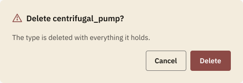

# Delete warning

> [Home](../../../README.md) › [Design system](../../README.md) › [Screens](../README.md) › [Screens of Metadata](README.md) › Delete warning

The [dialog](../../08-organisms/dialog.md) `warning` that every delete button opens as an overlay; its two buttons close it. The dimmed background behind it is set by hand in Figma.

## Figma

| Frame | Id |
| --- | --- |
| Section | [`670:13025`](https://www.figma.com/design/2hW8t5CgVru1VFbQZ1yETL/?node-id=670-13025) |
| MD-02 · Delete warning | [`670:13026`](https://www.figma.com/design/2hW8t5CgVru1VFbQZ1yETL/?node-id=670-13026) |

## Screens

### MD-02 · Delete warning

