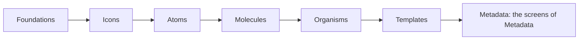

# design-system

> [Home](../README.md) › Design system

Status: first draft, written by the assistant on 2026-11-22 from the Product Owner's brief of the same day, and drawn in Figma the same day (foundations, icons, atoms, molecules, organisms, prototyped, each shown as a table of its variants and states; the template of the screens; the screens of Metadata with their content states and their prototype). The icons are validated (2026-11-22); the rest is not. The values marked "proposed" are to review on screen, in Figma.

What the design system of Synoptic Studio is made of, and how it is drawn in the Figma file (https://www.figma.com/design/2hW8t5CgVru1VFbQZ1yETL). The design system is reusable outside Synoptic Studio; its code is the library of the repository `synoptic-studio-design-system`.

## What it contains

| File or folder | What it holds |
| --- | --- |
| [Principles](01-principles.md) | Who it is for, how dense and how large, the one theme, the size of the screens. |
| [Foundations](02-foundations.md) | The tokens: colours, typography, spacing, sizes, radii, borders, shadows. |
| [Components](03-components.md) | The levels, what a sheet holds, and the rules every component follows. |
| [Icons](icons/README.md) | The icons of the interface, each exported as SVG. |
| [Atoms](atoms/README.md) | One sheet per atom; the tables of their variants and states in `atoms/images`. |
| [Molecules](molecules/README.md) | One sheet per molecule, tables in `molecules/images`. |
| [Organisms](organisms/README.md) | One sheet per organism, tables in `organisms/images`. |
| [Templates](templates/README.md) | The layout of the screens. |
| [Screens of Metadata](metadata/README.md) | One page per part of a type: its screens as drawn, with their ids; the SVG files in `metadata/images`. |
| [Figma file](04-figma-file.md) | The pages, variables and styles of the Figma file, how a page shows its components, the exports, and the ways of Figma to keep in mind. |
| [Skill rules](skill-rules.md) | What the Product Owner adds to, or changes in, the design-system skills of the assistant. |
| [Open questions](open-questions.md) | What is left to decide. |

Only the components the screens of Metadata use have a sheet for now (Product Owner, 2026-11-22).

## The pages of the Figma file

Set by the Product Owner on 2026-11-22. The pages of the old design system stay as they are, for inspiration only; nothing is copied from them.

| Page | What it holds |
| --- | --- |
| Foundations | The variables and the styles of [Foundations](02-foundations.md), shown with their names. |
| Icons | One component per icon of [Icons](icons/README.md). |
| Atoms | The atoms, each with its variants and its states. |
| Molecules | The molecules, made of atoms only. |
| Organisms | The organisms, made of molecules and atoms. |
| Templates | The layout of the screens without their content: window, top bar, left column, main area, drawn once at 1600 × 900 and reused by every screen. |
| Metadata | The screens of Metadata (`MD-00` to `MD-13` of [Screens of Metadata](../screens/metadata.md)), made of instances of the templates and components only, each with its content states. |

The screens of Metadata stay in the library file, not in a product file of their own: see [Skill rules R1](skill-rules.md#r1--the-pages-of-the-library).

## Where it is used

| Where | What it uses |
| --- | --- |
| [Screens](../screens/README.md) | Every control of every screen is a component of this design system. |
| [Controls](../controls/README.md) | The shared number and text fields are the components `number-input` and `text-input`. |
| Repository `synoptic-studio-design-system` | The same components and tokens, in code, with the same names, inputs and outputs; the icons from the SVG files of [Icons](icons/README.md). |
