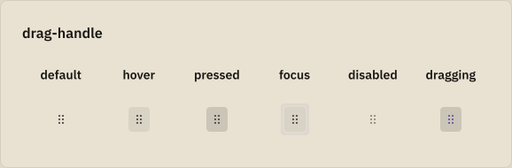

# drag-handle

> [Home](../../../README.md) › [Design system](../../README.md) › [Atoms](../README.md) › drag-handle

The grip at the left of a line, held to move the line in an ordered list.

## Figma

| Node | Id |
| --- | --- |
| Component set | [`635:135`](https://www.figma.com/design/2hW8t5CgVru1VFbQZ1yETL/?node-id=635-135) |

## Variants and states

## Inputs

| Input | Type | Default | Figma |
| --- | --- | --- | --- |
| `label` | text | — | none: the accessible name, "Move the line" |
| `disabled` | boolean | `false` | `state=disabled` |

## Outputs

| Output | When | Value |
| --- | --- | --- |
| `dragStart` | The mouse button goes down on it. | — |
| `move` | The up or down arrow while it has the focus. | `-1` or `+1` |
| `dragEnd` | The mouse button goes up. | the new place of the line |

## Behaviour

- Only the handle starts a drag: pressing it turns its whole line to `dragging` (violet, `layer-selected`); a click elsewhere on the line does nothing (Product Owner, 2026-11-22).
