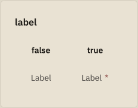

# label

> [Home](../../../README.md) › [Design system](../../README.md) › [Atoms](../README.md) › label

The name of a field outside a table, with its required mark.

## Figma

| Node | Id |
| --- | --- |
| Component set | [`635:141`](https://www.figma.com/design/2hW8t5CgVru1VFbQZ1yETL/?node-id=635-141) |

## Variants and states

## Inputs

| Input | Type | Default | Figma |
| --- | --- | --- | --- |
| `text` | text | `Label` | text property `text` |
| `required` | boolean | `false` | variant `required` |
| `for` | the field it names | — | none: in code, it names its field for the screen readers |

## Outputs

None.
