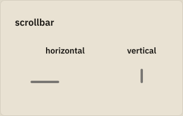

# scrollbar

> [Home](../../../README.md) › [Design system](../../README.md) › [Atoms](../README.md) › scrollbar

The thumb of a list or a table that scrolls: 4 thick, `border-strong`, `radius` 2, no track, no arrows.

## Figma

| Node | Id |
| --- | --- |
| Component set | [`713:5`](https://www.figma.com/design/2hW8t5CgVru1VFbQZ1yETL/?node-id=713-5) |
| Variant `direction=vertical` | [`706:717`](https://www.figma.com/design/2hW8t5CgVru1VFbQZ1yETL/?node-id=706-717) |
| Variant `direction=horizontal` | [`713:3`](https://www.figma.com/design/2hW8t5CgVru1VFbQZ1yETL/?node-id=713-3) |

## Variants and states

## Inputs

| Input | Type | Default | Figma |
| --- | --- | --- | --- |
| `direction` | `vertical`, `horizontal` | `vertical` | variant `direction` |
| `length` | the part of the content shown | — | the length of the thumb, set on the instance |
| `position` | where the view is in the content | — | the place of the thumb |

## Outputs

| Output | When | Value |
| --- | --- | --- |
| `scroll` | The thumb is dragged. | the new position |

## Behaviour

- It shows only when the content is longer than its frame.
