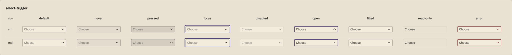

# select-trigger

> [Home](../../../README.md) › [Design system](../../README.md) › [Atoms](../README.md) › select-trigger

The closed part of a select: it shows the chosen item and opens its [menu](../../molecules/menu/README.md) or its [menu-grouped](../../molecules/menu-grouped/README.md) right under it.

## Figma

| Node | Id |
| --- | --- |
| Component set | [`634:430`](https://www.figma.com/design/2hW8t5CgVru1VFbQZ1yETL/?node-id=634-430) |

## Variants and states

## Inputs

| Input | Type | Default | Figma |
| --- | --- | --- | --- |
| `value` | the chosen item's text | none | text property `value`; `state=filled` when chosen |
| `placeholder` | text | `Choose` | the text of `state=default` |
| `icon` | icon name | none | boolean `leading-icon` and instance swap `icon`: `signal-input` or `signal-output` for a direction, `quantity` or `difference` for a quantity |
| `size` | `sm`, `md` | `sm` | variant `size` |
| `open` | boolean | `false` | `state=open`; `state=open-focus` when opened with the keyboard |
| `readOnly` | boolean | `false` | `state=read-only` |
| `error` | text | none | `state=error` |
| `disabled` | boolean | `false` | `state=disabled` |

## Outputs

| Output | When | Value |
| --- | --- | --- |
| `openChange` | A click, Enter, Space or the down arrow opens it; a click on it, Escape or a click outside closes it. | `true` or `false` |

## Behaviour

- The choice itself is made in the menu; the select-trigger only shows it.
- Its focus opens it on a click; a click on it while open closes it, back to `default`.
- Opened with the keyboard (Enter, Space or the down arrow), it keeps the double focus line around the line of `open`: `open-focus`. Opened with the mouse, only the line of `open` (Product Owner, 2026-11-22).
- The 2 px line of `open` and `error` is drawn over the padding: the text never moves (Product Owner, 2026-11-22).
