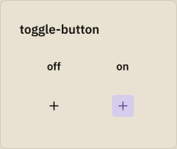

# toggle-button

> [Home](../../../README.md) › [Design system](../../README.md) › [Atoms](../README.md) › toggle-button

An [icon-button](../icon-button/README.md) `ghost` that stays on: bold and italic of the formatting tool bar. Its look follows the state of the selected text; a click turns it on or off.

## Figma

| Node | Id |
| --- | --- |
| Component set | [`684:2199`](https://www.figma.com/design/2hW8t5CgVru1VFbQZ1yETL/?node-id=684-2199) |

## Variants and states

## Inputs

| Input | Type | Default | Figma |
| --- | --- | --- | --- |
| `icon` | icon name | — | the icon of its instance |
| `label` | text | — | none: the accessible name and the text of the tooltip |
| `on` | boolean | `false` | variant `state=off, on` |

## Outputs

| Output | When | Value |
| --- | --- | --- |
| `onChange` | A click, or Enter or Space. | the new value of `on` |

## Behaviour

- Turned on, it still reacts to the mouse: a click turns it off. It is the exception to "what is selected does not react" ([Components](../../04-components.md)).
