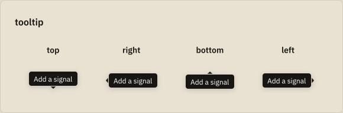

# tooltip

> [Home](../../../README.md) › [Design system](../../README.md) › [Atoms](../README.md) › tooltip

A small dark bubble that names an icon alone, after the mouse has stayed on it.

## Figma

| Node | Id |
| --- | --- |
| Component set | [`635:158`](https://www.figma.com/design/2hW8t5CgVru1VFbQZ1yETL/?node-id=635-158) |

## Variants and states

## Inputs

| Input | Type | Default | Figma |
| --- | --- | --- | --- |
| `text` | text | — | text property `text` |
| `placement` | `top`, `right`, `bottom`, `left` | `top` | variant `placement`: the side of the icon where it shows |

## Outputs

None.

## Behaviour

- It shows after 0.8 s on the icon, and hides when the mouse leaves.
- It is centred on the icon it names, whatever the length of its text (Product Owner, 2026-11-22).
