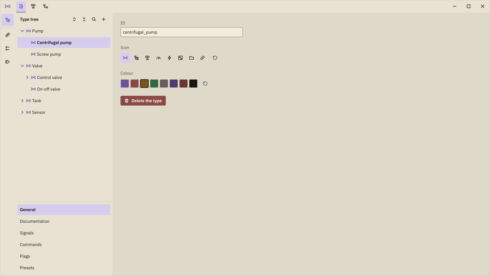
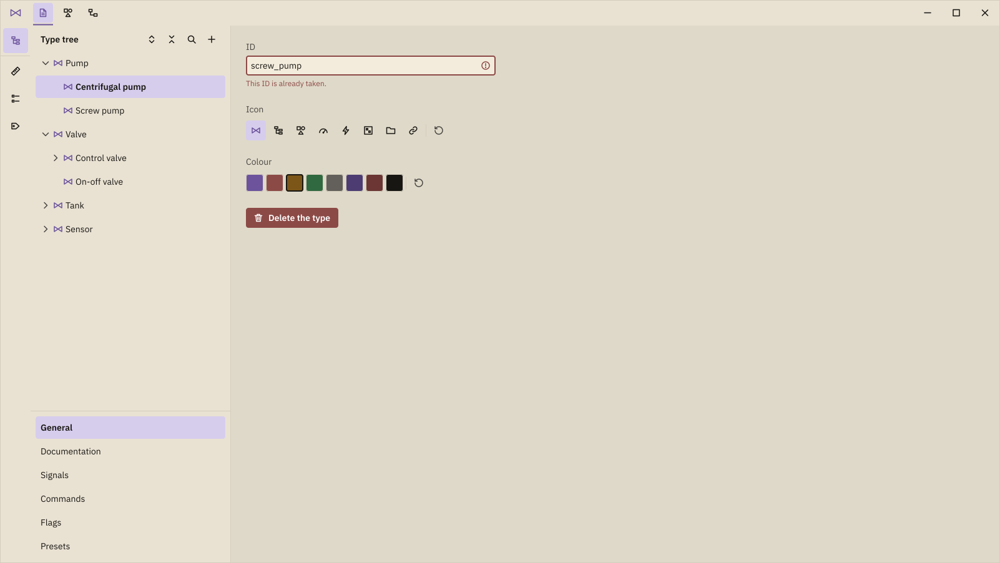
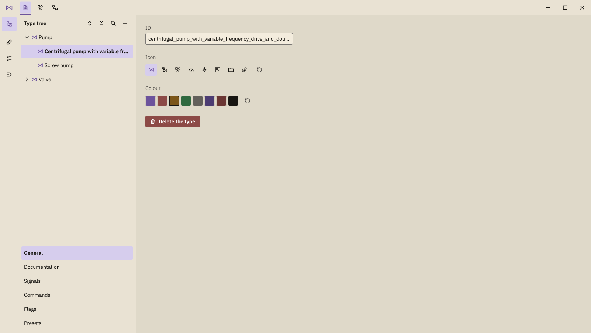
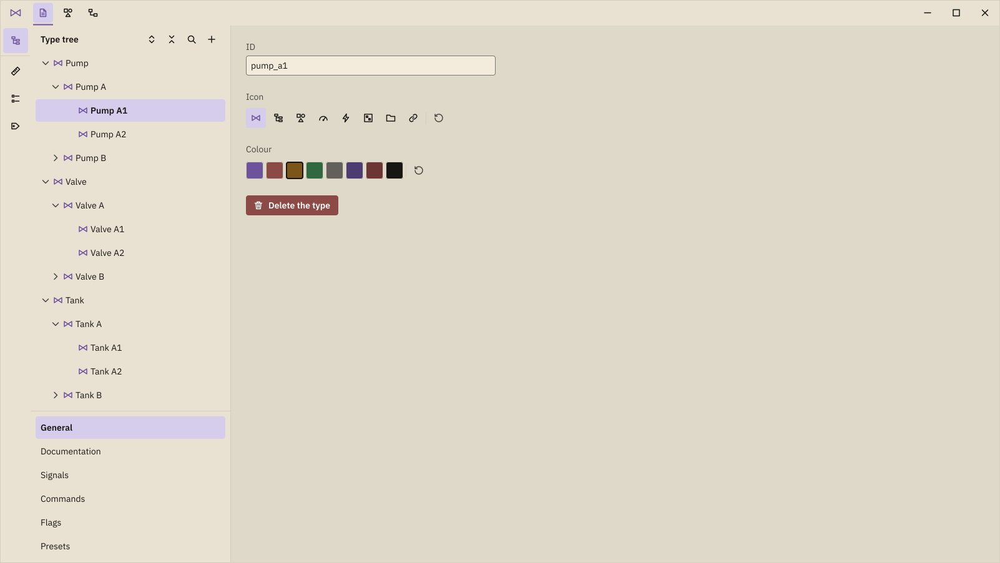
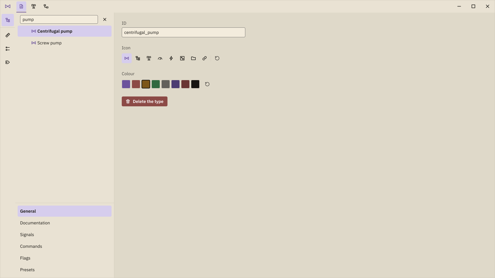
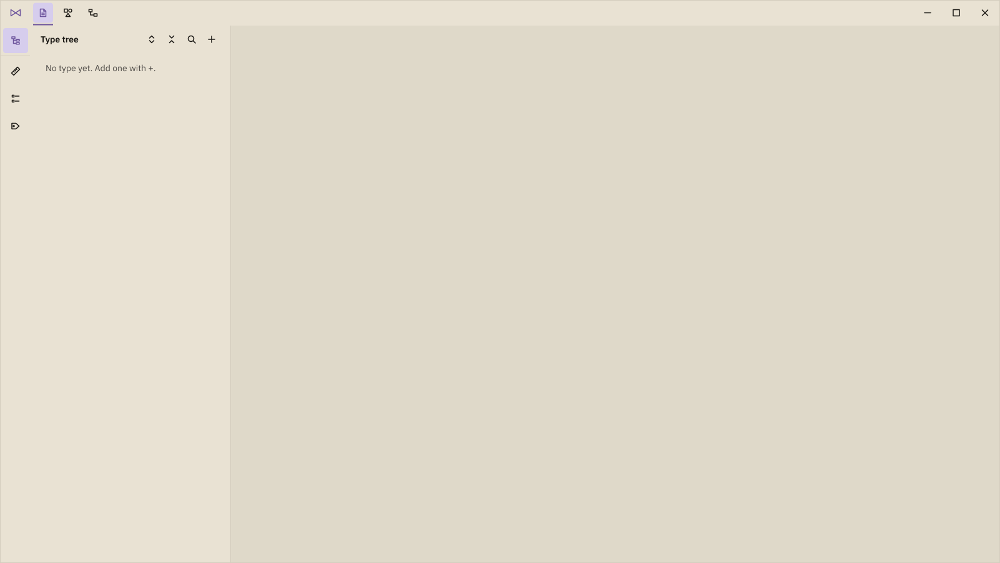

# MD-01 Types and MD-02 General

> [Home](../../README.md) › [Design system](../README.md) › [Screens of Metadata](README.md) › General

The type tree on the left, the General part of the selected type in the main area. Controls: [MD-01](../../screens/metadata.md#md-01--types-the-tree-and-the-type-editor), [MD-02](../../screens/metadata.md#md-02--general).

## Figma

| Frame | Id |
| --- | --- |
| Section | [`667:6125`](https://www.figma.com/design/2hW8t5CgVru1VFbQZ1yETL/?node-id=667-6125) |
| MD-02 · General | [`667:6126`](https://www.figma.com/design/2hW8t5CgVru1VFbQZ1yETL/?node-id=667-6126) |
| MD-02 · General · error | [`667:6622`](https://www.figma.com/design/2hW8t5CgVru1VFbQZ1yETL/?node-id=667-6622) |
| MD-02 · General · long text | [`667:7000`](https://www.figma.com/design/2hW8t5CgVru1VFbQZ1yETL/?node-id=667-7000) |
| MD-01 · Types · many | [`667:7326`](https://www.figma.com/design/2hW8t5CgVru1VFbQZ1yETL/?node-id=667-7326) |
| MD-01 · Types · searching | [`667:7877`](https://www.figma.com/design/2hW8t5CgVru1VFbQZ1yETL/?node-id=667-7877) |
| MD-01 · Types · empty | [`667:8162`](https://www.figma.com/design/2hW8t5CgVru1VFbQZ1yETL/?node-id=667-8162) |

## Screens

### MD-02 · General

### MD-02 · General · error

### MD-02 · General · long text

### MD-01 · Types · many

### MD-01 · Types · searching

### MD-01 · Types · empty

