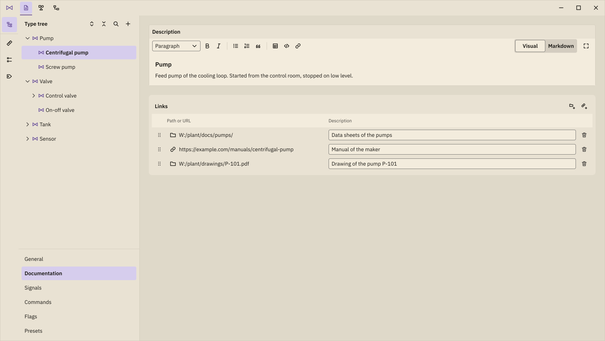
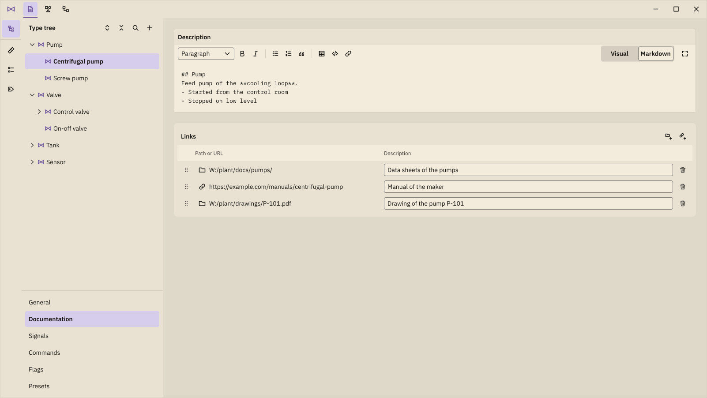
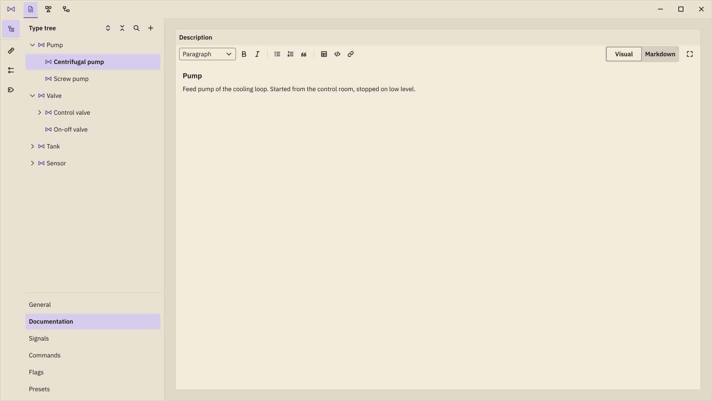
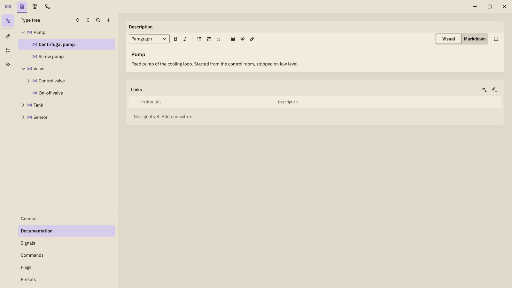
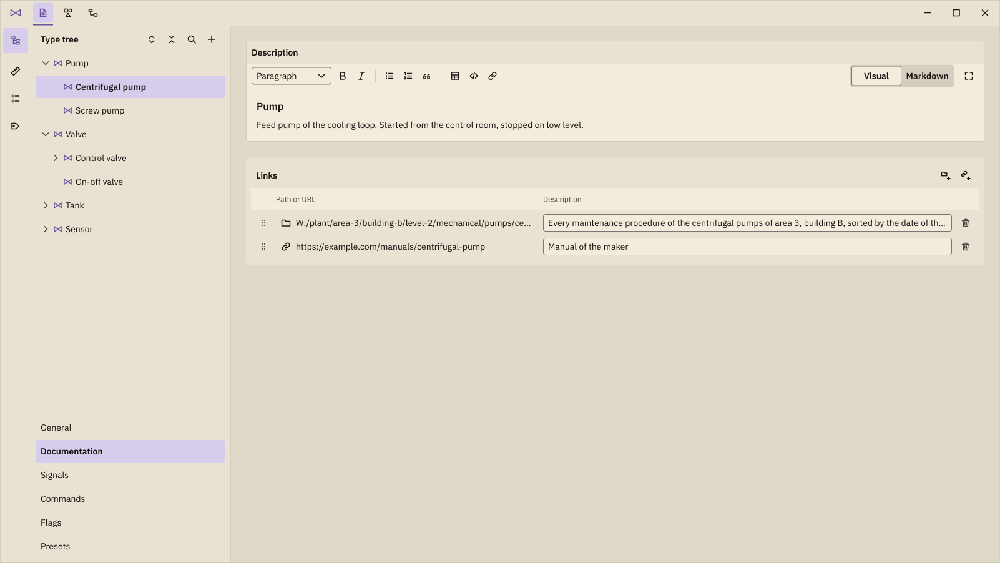
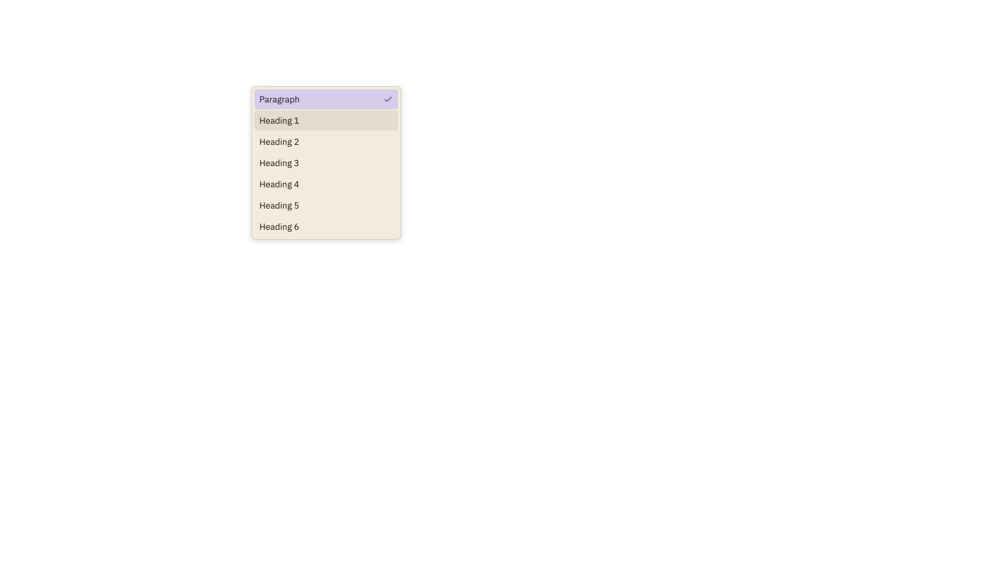
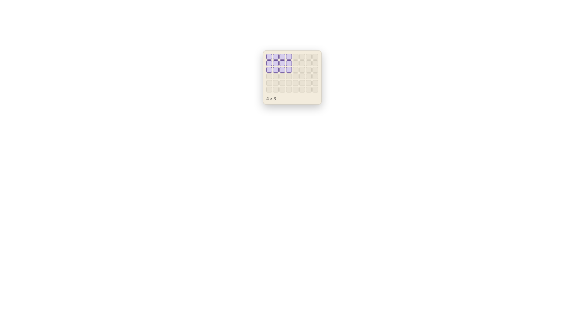
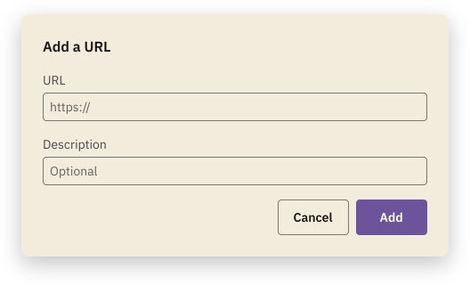
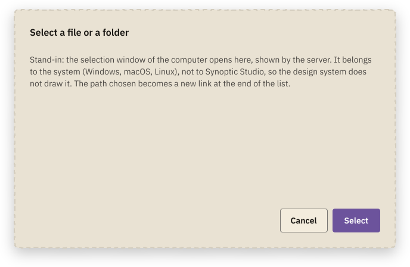

# MD-03 Documentation

> [Home](../../../README.md) › [Design system](../../README.md) › [Screens of Metadata](../README.md) › Documentation

The documentation of a type: its description in the [markdown-editor](../../organisms/markdown-editor/README.md) and its links. Controls: [MD-03](../../../screens/metadata.md#md-03--documentation).

Figma: sections `667:9805` (the screens), `684:14751` (the lists of the tool bar), `679:15292` (the links).

## MD-03 · Documentation · visual

[`667:10608`](https://www.figma.com/design/2hW8t5CgVru1VFbQZ1yETL/?node-id=667-10608)

## MD-03 · Documentation · markdown

[`667:11451`](https://www.figma.com/design/2hW8t5CgVru1VFbQZ1yETL/?node-id=667-11451)

## MD-03 · Documentation · full page

[`667:12243`](https://www.figma.com/design/2hW8t5CgVru1VFbQZ1yETL/?node-id=667-12243)

## MD-03 · Documentation · no link

[`667:12582`](https://www.figma.com/design/2hW8t5CgVru1VFbQZ1yETL/?node-id=667-12582)

## MD-03 · Documentation · long text

[`667:12922`](https://www.figma.com/design/2hW8t5CgVru1VFbQZ1yETL/?node-id=667-12922)

## MD-03 · Heading level

The list of the heading select, right under it. A transparent frame of the size of the screen, closed by a click anywhere.

[`684:14752`](https://www.figma.com/design/2hW8t5CgVru1VFbQZ1yETL/?node-id=684-14752)

## MD-03 · Insert a table

The grid of the table button, right under it.

[`684:14867`](https://www.figma.com/design/2hW8t5CgVru1VFbQZ1yETL/?node-id=684-14867)

## MD-03 · Add a URL

The dialog the URL icon of the links opens.

[`679:15293`](https://www.figma.com/design/2hW8t5CgVru1VFbQZ1yETL/?node-id=679-15293)

## MD-03 · Add a path · window of the computer

A stand-in for the window of the system, opened by the path icon.

[`679:15322`](https://www.figma.com/design/2hW8t5CgVru1VFbQZ1yETL/?node-id=679-15322)

