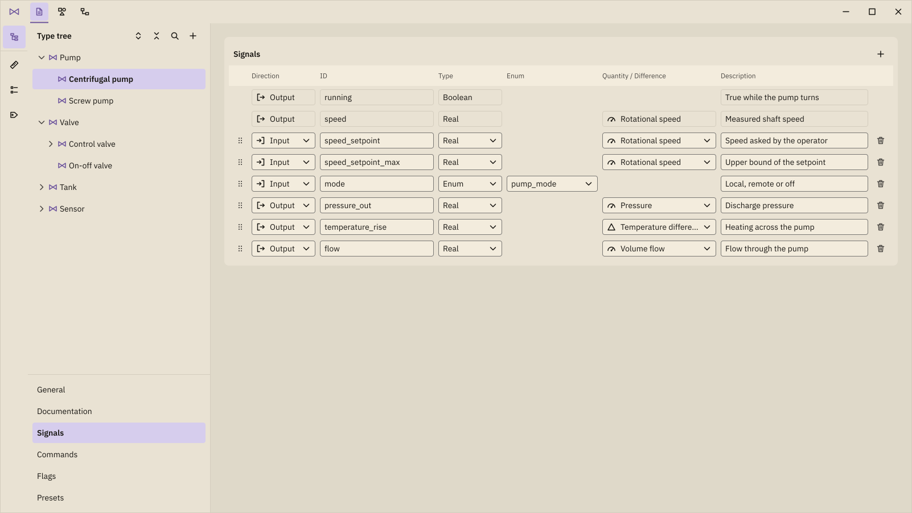
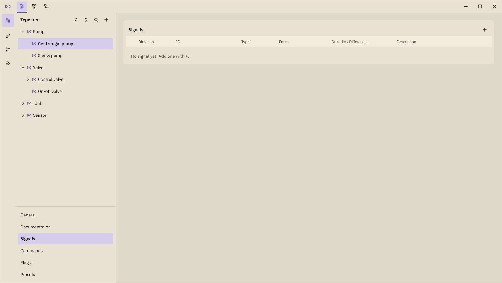
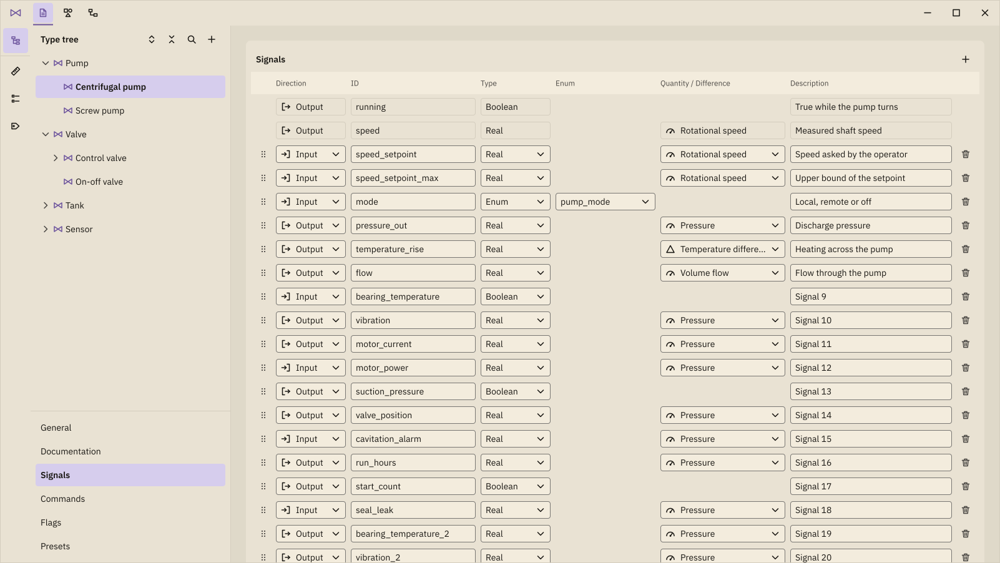
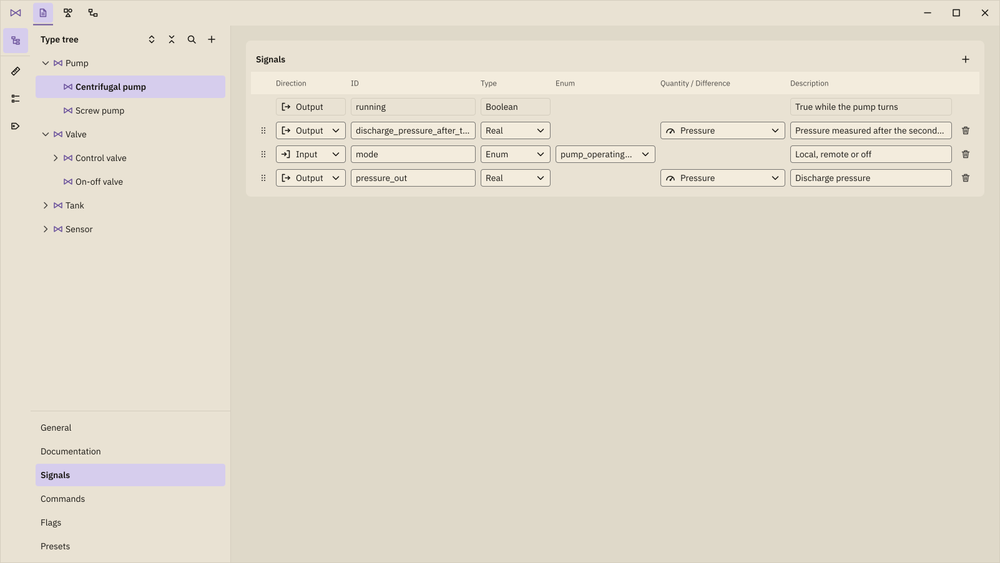
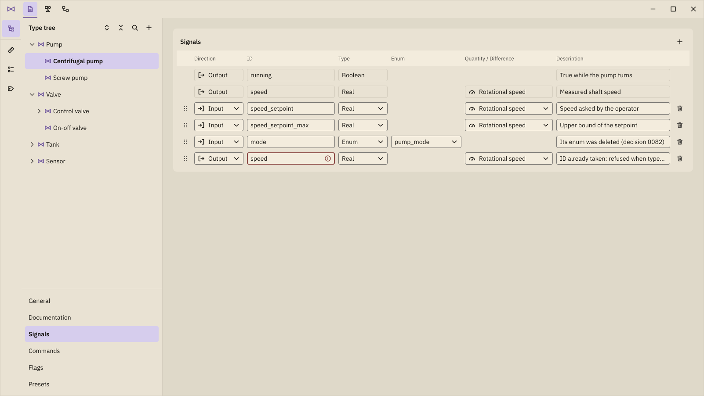

# MD-04 Signals

> [Home](../../README.md) › [Design system](../README.md) › [Screens of Metadata](README.md) › Signals

The signals of a type, in a [data-table](../organisms/data-table.md). Controls: [MD-04](../../screens/metadata.md#md-04--signals).

## Figma

| Frame | Id |
| --- | --- |
| Section | [`665:4990`](https://www.figma.com/design/2hW8t5CgVru1VFbQZ1yETL/?node-id=665-4990) |
| MD-04 · Signals | [`665:4991`](https://www.figma.com/design/2hW8t5CgVru1VFbQZ1yETL/?node-id=665-4991) |
| MD-04 · Signals · empty | [`665:6664`](https://www.figma.com/design/2hW8t5CgVru1VFbQZ1yETL/?node-id=665-6664) |
| MD-04 · Signals · many | [`665:6982`](https://www.figma.com/design/2hW8t5CgVru1VFbQZ1yETL/?node-id=665-6982) |
| MD-04 · Signals · long text | [`665:11211`](https://www.figma.com/design/2hW8t5CgVru1VFbQZ1yETL/?node-id=665-11211) |
| MD-04 · Signals · error | [`665:12140`](https://www.figma.com/design/2hW8t5CgVru1VFbQZ1yETL/?node-id=665-12140) |

## Screens

### MD-04 · Signals

### MD-04 · Signals · empty

### MD-04 · Signals · many

### MD-04 · Signals · long text

### MD-04 · Signals · error

