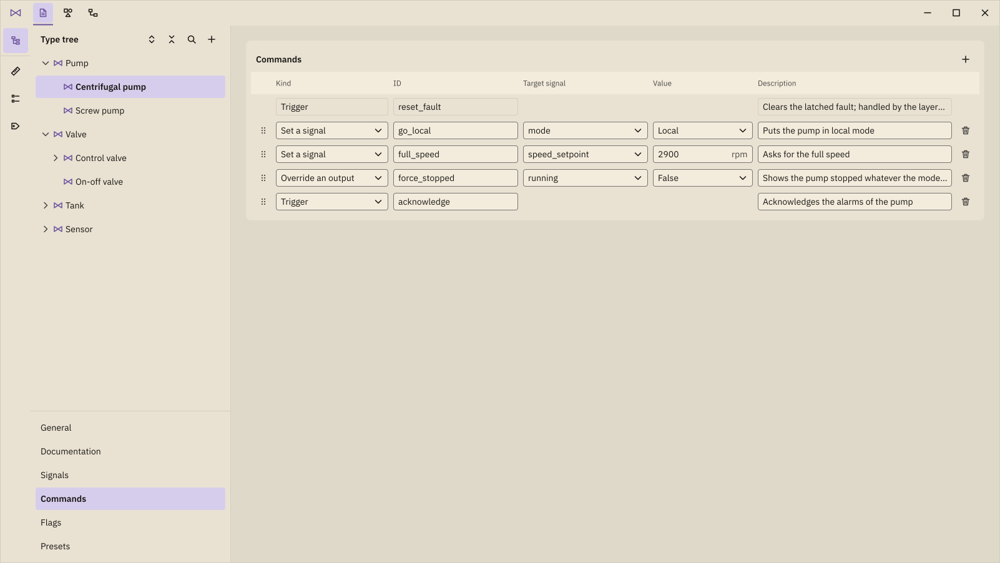
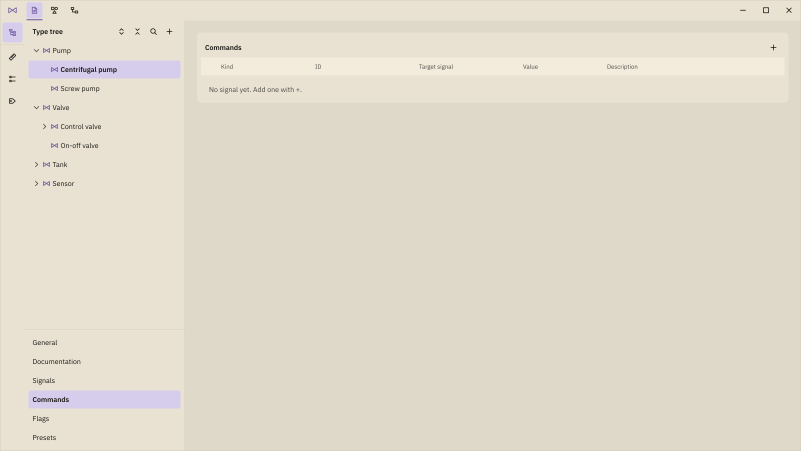
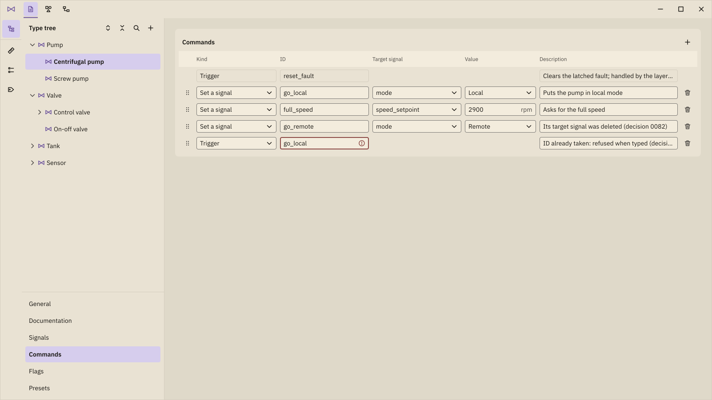

# MD-05 Commands

> [Home](../../../README.md) › [Design system](../../README.md) › [Screens of Metadata](../README.md) › Commands

The commands of a type, in a [data-table](../../organisms/data-table/README.md). Controls: [MD-05](../../../screens/metadata.md#md-05--commands).

Figma: section `666:3777`.

## MD-05 · Commands

[`666:3778`](https://www.figma.com/design/2hW8t5CgVru1VFbQZ1yETL/?node-id=666-3778)

## MD-05 · Commands · empty

[`666:5225`](https://www.figma.com/design/2hW8t5CgVru1VFbQZ1yETL/?node-id=666-5225)

## MD-05 · Commands · error

[`666:5542`](https://www.figma.com/design/2hW8t5CgVru1VFbQZ1yETL/?node-id=666-5542)

