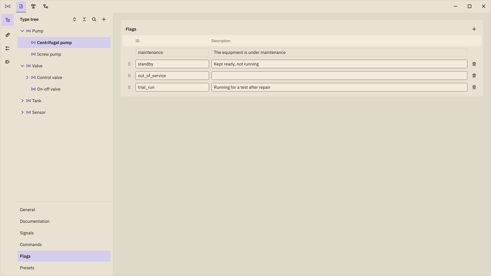
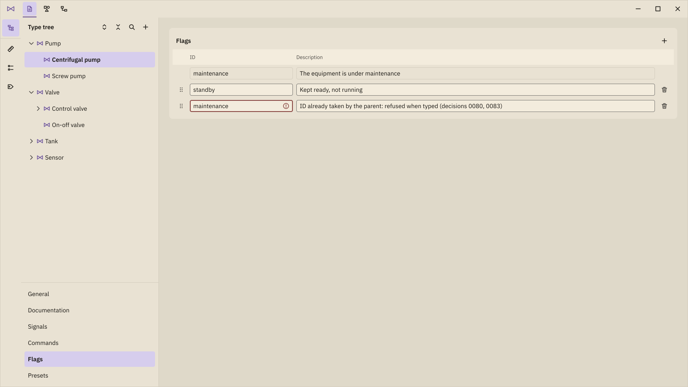

# MD-12 Flags

> [Home](../../../README.md) › [Design system](../../README.md) › [Screens of Metadata](../README.md) › Flags

The flags of a type, in a [data-table](../../organisms/data-table/README.md). Controls: [MD-12](../../../screens/metadata.md#md-12--flags-a-part-of-the-type).

Figma: section `666:6541`.

## MD-12 · Flags

[`666:6542`](https://www.figma.com/design/2hW8t5CgVru1VFbQZ1yETL/?node-id=666-6542)

## MD-12 · Flags · empty

[`666:7349`](https://www.figma.com/design/2hW8t5CgVru1VFbQZ1yETL/?node-id=666-7349)

## MD-12 · Flags · error

[`666:7657`](https://www.figma.com/design/2hW8t5CgVru1VFbQZ1yETL/?node-id=666-7657)

