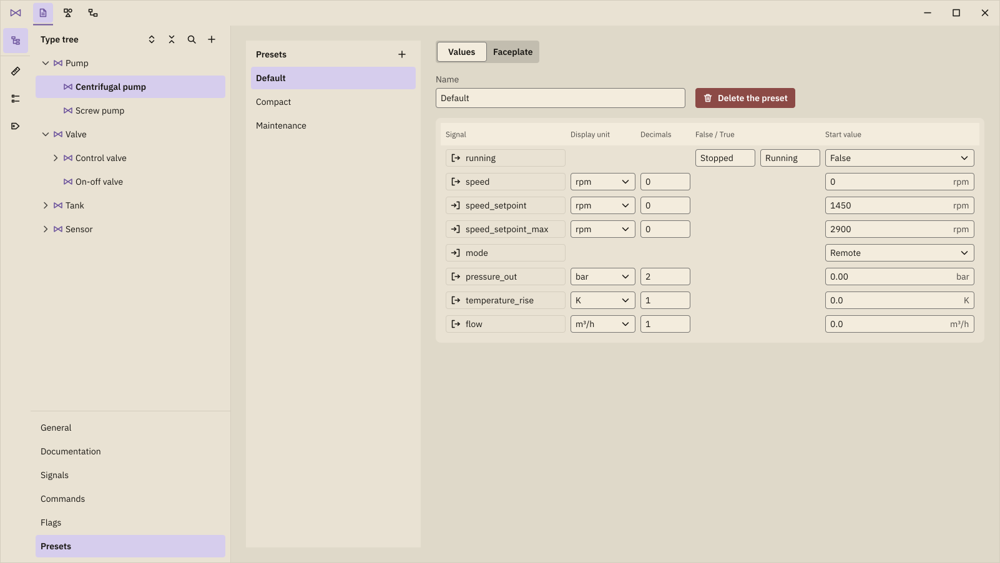
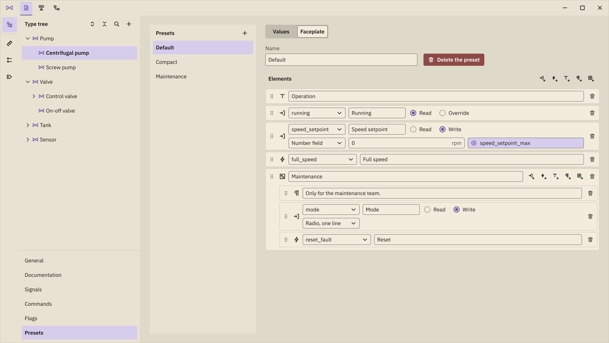
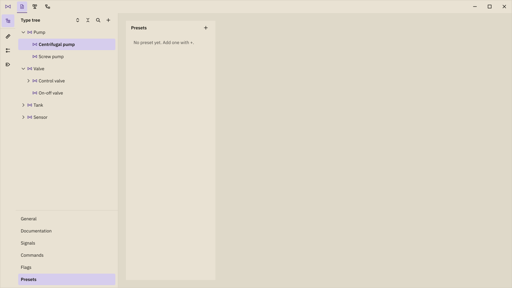
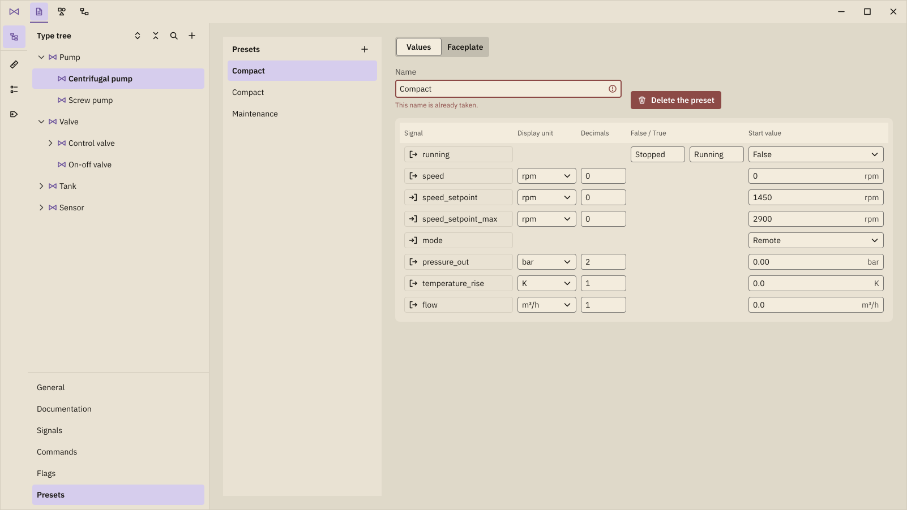
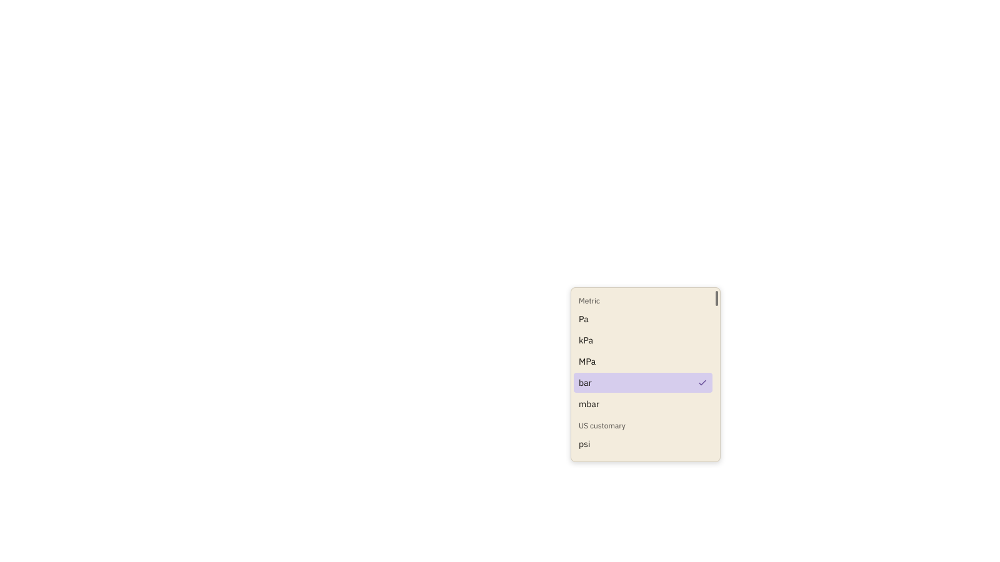

# MD-07 Presets

> [Home](../../../README.md) › [Design system](../../README.md) › [Screens of Metadata](../README.md) › Presets

The presets of a type, in a [list-panel](../../organisms/list-panel/README.md); the selected preset, its values or its faceplate. Controls: [MD-07](../../../screens/metadata.md#md-07--presets).

Figma: section `668:9609`.

## MD-07 · Presets · Values

[`668:9610`](https://www.figma.com/design/2hW8t5CgVru1VFbQZ1yETL/?node-id=668-9610)

## MD-07 · Presets · Faceplate

Every signal in write is on two lines. The title Elements sits `spacing-03` (8) above its first element, the other blocks of the preset `spacing-05` (16) apart (Product Owner, 2026-11-22).

[`668:11695`](https://www.figma.com/design/2hW8t5CgVru1VFbQZ1yETL/?node-id=668-11695)

## MD-07 · Presets · empty

[`668:12629`](https://www.figma.com/design/2hW8t5CgVru1VFbQZ1yETL/?node-id=668-12629)

## MD-07 · Presets · error

[`668:12907`](https://www.figma.com/design/2hW8t5CgVru1VFbQZ1yETL/?node-id=668-12907)

## MD-07 · Display unit

The grouped list the display unit `bar` of `pressure_out` opens: a transparent frame of the size of the screen, the list right under its select. Two groups: Metric, then US customary, which holds psi, inHg, inH2O and ftH2O (Product Owner, 2026-11-22).

[`706:13686`](https://www.figma.com/design/2hW8t5CgVru1VFbQZ1yETL/?node-id=706-13686)

