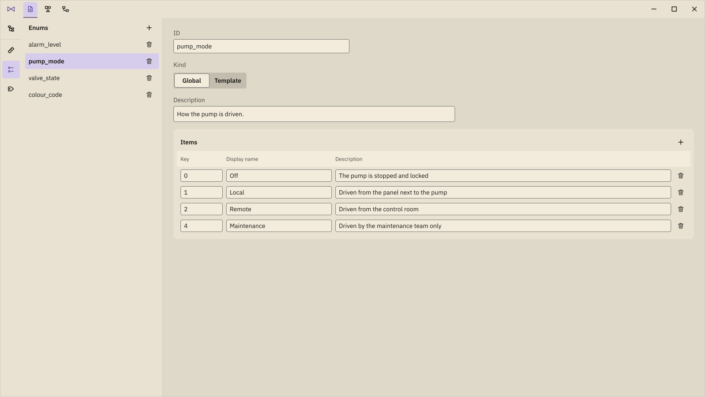
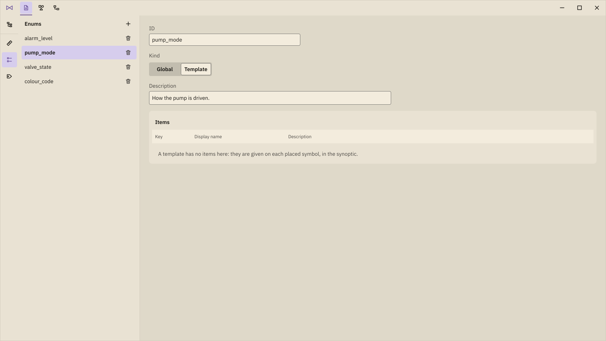
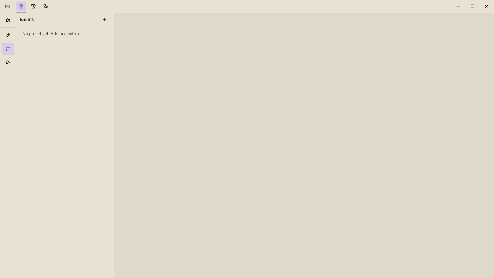
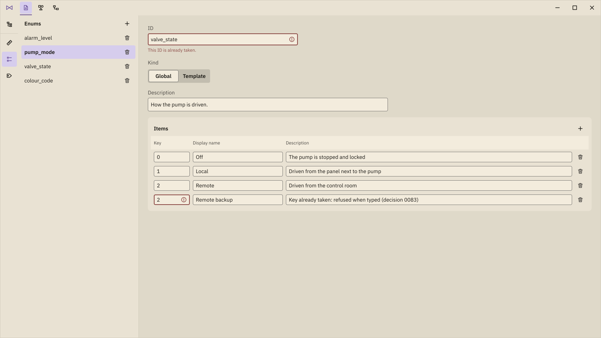

# MD-09 Enums

> [Home](../../../README.md) › [Design system](../../README.md) › [Screens of Metadata](../README.md) › Enums

The enums, global or template, and their items. Controls: [MD-09](../../../screens/metadata.md#md-09--enums).

Figma: section `669:14179`.

## MD-09 · Enums

A global enum.

[`669:14180`](https://www.figma.com/design/2hW8t5CgVru1VFbQZ1yETL/?node-id=669-14180)

## MD-09 · Enums · template

The same enum `pump_mode` as a template: its items table empty, with its message.

[`669:15030`](https://www.figma.com/design/2hW8t5CgVru1VFbQZ1yETL/?node-id=669-15030)

## MD-09 · Enums · empty

[`669:15241`](https://www.figma.com/design/2hW8t5CgVru1VFbQZ1yETL/?node-id=669-15241)

## MD-09 · Enums · error

[`669:15338`](https://www.figma.com/design/2hW8t5CgVru1VFbQZ1yETL/?node-id=669-15338)

