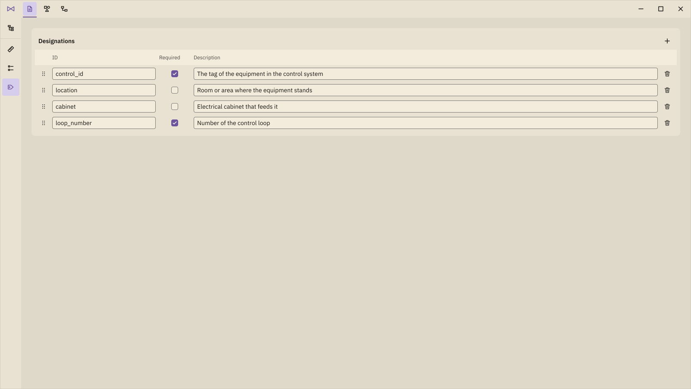
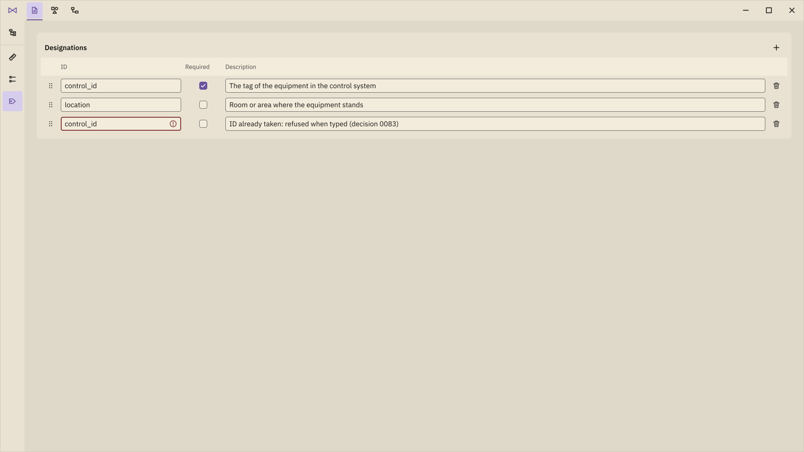

# MD-13 Designations

> [Home](../../../README.md) › [Design system](../../README.md) › [Screens of Metadata](../README.md) › Designations

The designations, in a [data-table](../../organisms/data-table/README.md). Controls: [MD-13](../../../screens/metadata.md#md-13--designations).

Figma: section `666:8401`.

## MD-13 · Designations

[`666:8402`](https://www.figma.com/design/2hW8t5CgVru1VFbQZ1yETL/?node-id=666-8402)

## MD-13 · Designations · empty

[`666:9055`](https://www.figma.com/design/2hW8t5CgVru1VFbQZ1yETL/?node-id=666-9055)

## MD-13 · Designations · error

[`666:9190`](https://www.figma.com/design/2hW8t5CgVru1VFbQZ1yETL/?node-id=666-9190)

