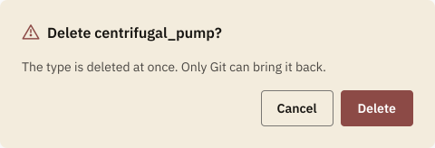

# Delete warning

> [Home](../../../README.md) › [Design system](../../README.md) › [Screens of Metadata](../README.md) › Delete warning

The [dialog](../../organisms/dialog/README.md) `warning` that every delete button opens as an overlay; its two buttons close it. The dimmed background behind it is set by hand in Figma.

Figma: section `670:13025`.

## MD-02 · Delete warning

[`670:13026`](https://www.figma.com/design/2hW8t5CgVru1VFbQZ1yETL/?node-id=670-13026)

