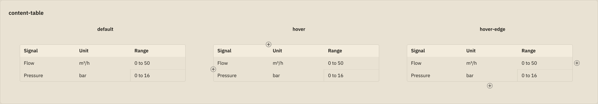

# content-table

> [Home](../../README.md) › [Design system](../README.md) › [Molecules](README.md) › content-table

A table of a description, as the visual editor shows it: a header line, then its lines, each cell a text. Under the mouse, small + insert a line or a column where they sit ([MD-03.13](../../screens/metadata.md#md-03--documentation)).

## Figma

| Node | Id |
| --- | --- |
| Component set | [`732:892`](https://www.figma.com/design/2hW8t5CgVru1VFbQZ1yETL/?node-id=732-892) |

## Variants and states

## Inputs

| Input | Type | Default | Figma |
| --- | --- | --- | --- |
| `rows` | the lines of the Markdown table, the first one its header | — | the texts of its cells (a sample of 3 columns and 3 lines) |
| `hover` | boolean | `false` | `state=hover` |

## Outputs

| Output | When | Value |
| --- | --- | --- |
| `insertRow` | A + between two lines, on the left edge. | the index of the new line |
| `insertColumn` | A + between two columns, on the top edge. | the index of the new column |
| `addRow` | The + under the table. | — |
| `addColumn` | The + on the right of the table. | — |

## Behaviour

- Header line on `layer-02` in `body-strong`, the other lines in `body`; lines of `border-subtle` between cells and around the table, radius `radius-sm`.
- Under the mouse, every + of the table shows at once (assistant's reading); a + sits half outside the table, so the component keeps 8 px on its left and top and 24 px on its right and bottom in both states: the table never moves.
- Each + is an [insert-button](../atoms/insert-button.md).
- No hover per cell: a cell is edited as text, as in a word processor.

## Made of

| Component | Role |
| --- | --- |
| [insert-button](../atoms/insert-button.md) | Each +. |
