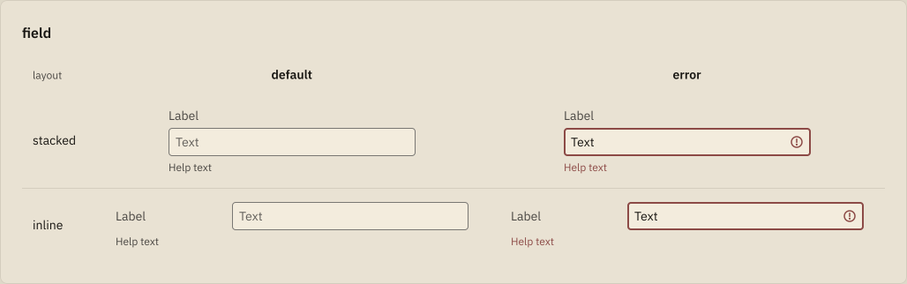

# field

> [Home](../../../README.md) › [Design system](../../README.md) › [Molecules](../README.md) › field

A [label](../../atoms/label/README.md), one input atom and a help text, as one block: every field outside a table.

## Figma

| Node | Id |
| --- | --- |
| Component set | [`637:53`](https://www.figma.com/design/2hW8t5CgVru1VFbQZ1yETL/?node-id=637-53) |

## Variants and states

## Inputs

| Input | Type | Default | Figma |
| --- | --- | --- | --- |
| `label` | text | — | the text of its label |
| `required` | boolean | `false` | the variant of its label |
| `help` | text | none | text property `help`, boolean `show-help` |
| `layout` | `stacked`, `inline` | `stacked` | variant `layout`: the label above, or on the left |
| `error` | text | none | `state=error`: the help text shows the message, in `danger` |
| content | one input atom | `text-input` | the input placed in it |

## Outputs

None of its own: the input it holds gives its own outputs.

## Made of

| Component | Role |
| --- | --- |
| [label](../../atoms/label/README.md) | The name of the field. |
| [text-input](../../atoms/text-input/README.md) | The input, or a number-input or a select-trigger. |
