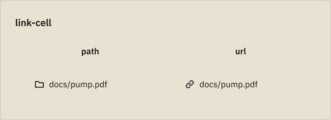

# link-cell

> [Home](../../README.md) › [Design system](../README.md) › [Molecules](README.md) › link-cell

A table cell that shows a path or a URL with its icon.

## Figma

| Node | Id |
| --- | --- |
| Component set | [`638:860`](https://www.figma.com/design/2hW8t5CgVru1VFbQZ1yETL/?node-id=638-860) |

## Variants and states

## Inputs

| Input | Type | Default | Figma |
| --- | --- | --- | --- |
| `address` | text | — | text property `address` |
| `kind` | `path`, `url` | `path` | variant `kind`: icon `folder` or `link` |

## Outputs

| Output | When | Value |
| --- | --- | --- |
| `open` | A click on the address. | the address |

## Behaviour

- A long address ends with "…".

## Made of

| Component | Role |
| --- | --- |
| [Icons](../icons/README.md) | folder or link. |
