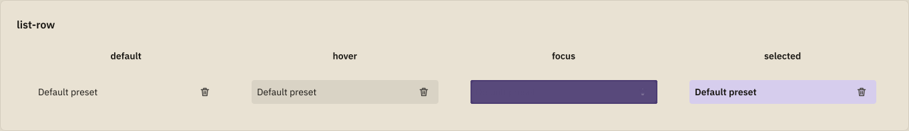

# list-row

> [Home](../../../README.md) › [Design system](../../README.md) › [Molecules](../README.md) › list-row

A line of a list: a name, its icons `quantity` and `difference` when needed, and its delete button.

## Figma

| Node | Id |
| --- | --- |
| Component set | [`638:841`](https://www.figma.com/design/2hW8t5CgVru1VFbQZ1yETL/?node-id=638-841) |

## Variants and states

## Inputs

| Input | Type | Default | Figma |
| --- | --- | --- | --- |
| `name` | text | — | text property `name` |
| `deletable` | boolean | `true` | boolean `with-delete` |
| `quantity`, `difference` | boolean | `false` | booleans `quantity-icon`, `difference-icon` |
| `selected` | boolean | `false` | `state=selected` |

## Outputs

| Output | When | Value |
| --- | --- | --- |
| `select` | A click on a line not selected, or Enter. | — |
| `delete` | A click on delete. | — |

## Behaviour

- A selected line does not react to the mouse.

## Made of

| Component | Role |
| --- | --- |
| [Icons](../../icons/README.md) | quantity, difference. |
| [icon-button](../../atoms/icon-button/README.md) | Delete. |
