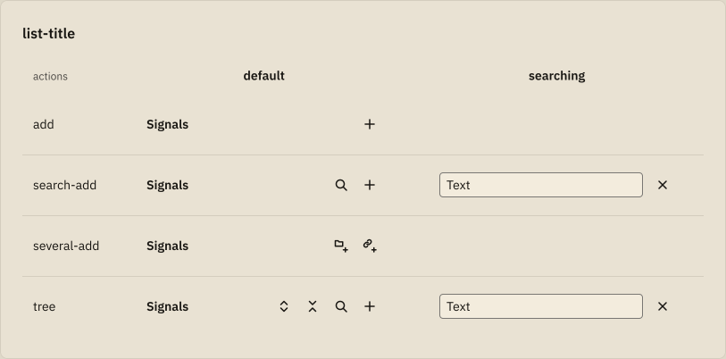

# list-title

> [Home](../../README.md) › [Design system](../README.md) › [Molecules](README.md) › list-title

The title of a list or a table, with its buttons on the right: one + per kind of thing to add, search, open all and close all.

## Figma

| Node | Id |
| --- | --- |
| Component set | [`638:143`](https://www.figma.com/design/2hW8t5CgVru1VFbQZ1yETL/?node-id=638-143) |
| Variant `actions=tree` | [`699:14056`](https://www.figma.com/design/2hW8t5CgVru1VFbQZ1yETL/?node-id=699-14056) |
| Variant `actions=tree`, `state=searching` | [`699:14060`](https://www.figma.com/design/2hW8t5CgVru1VFbQZ1yETL/?node-id=699-14060) |

## Variants and states

## Inputs

| Input | Type | Default | Figma |
| --- | --- | --- | --- |
| `title` | text | — | text property `title` |
| `actions` | `add`, `search-add`, `several-add`, `tree` | `add` | variant `actions` |
| `addButtons` | list of icon buttons | none | slot `actions`, for `several-add`; empty for a title with no button (Quantities, Unit systems) |
| `searching` | boolean | `false` | `state=searching`: the title becomes a [text-input](../atoms/text-input.md), the + a `dismiss` |
| `query` | text | empty | the value of the search field |

## Outputs

| Output | When | Value |
| --- | --- | --- |
| `add` | A click on a +. | the kind added, for `several-add` |
| `searchOpen`, `searchClose` | A click on search, on `dismiss` or Escape. | — |
| `queryChange` | Each key typed in the search field. | the text |
| `expandAll`, `collapseAll` | A click on open all or close all (`actions=tree`). | — |

## Behaviour

- The buttons are `spacing-02` apart, on the right of the title.
- `tree`: open all, close all, search, + (MD-01.7); while searching, the search field takes the line.

## Made of

| Component | Role |
| --- | --- |
| [icon-button](../atoms/icon-button.md) | Each +, search, open all, close all, dismiss. |
| [text-input](../atoms/text-input.md) | The search field, while searching. |
