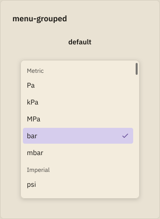

# menu-grouped

> [Home](../../../README.md) › [Design system](../../README.md) › [Molecules](../README.md) › menu-grouped

A [menu](../menu/README.md) whose items are grouped under [menu-group-title](../menu-group-title/README.md): the display units, grouped by unit system.

## Figma

| Node | Id |
| --- | --- |
| Component | [`706:738`](https://www.figma.com/design/2hW8t5CgVru1VFbQZ1yETL/?node-id=706-738) |

## Variants and states

## Inputs

| Input | Type | Default | Figma |
| --- | --- | --- | --- |
| `groups` | list of groups: a title and its items | two groups: Metric (Pa, kPa, MPa, bar, mbar), US customary (psi, inHg, inH2O, ftH2O) | `menu-group-title` and `menu-item` (no icon) |
| `value` | the chosen item | none | the `menu-item` in `state=selected` |

## Outputs

| Output | When | Value |
| --- | --- | --- |
| `select` | An item is chosen. | the item |
| `close` | Escape, or a click outside. | — |

## Behaviour

- 280 high at most: beyond, it scrolls inside, with its [scrollbar](../../atoms/scrollbar/README.md) on the right.
- Its titles and items sit in a frame `content` that carries the padding of the top and the bottom: once scrolled to the end, the last item keeps its margin (Product Owner, 2026-11-22: "ftH2O touchait le bas").

## Made of

| Component | Role |
| --- | --- |
| [menu-group-title](../../molecules/menu-group-title/README.md) | The title of each group. |
| [menu-item](../../molecules/menu-item/README.md) | Each item, no icon. |
| [scrollbar](../../atoms/scrollbar/README.md) | On the right, beyond 280 high. |
