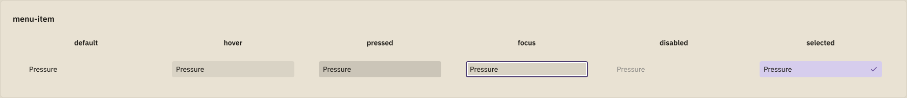

# menu-item

> [Home](../../README.md) › [Design system](../README.md) › [Molecules](README.md) › menu-item

One line of a menu: an item to choose, with an optional icon and a check when it is the chosen one.

## Figma

| Node | Id |
| --- | --- |
| Component set | [`637:102`](https://www.figma.com/design/2hW8t5CgVru1VFbQZ1yETL/?node-id=637-102) |

## Variants and states

## Inputs

| Input | Type | Default | Figma |
| --- | --- | --- | --- |
| `text` | text | — | text property `text` |
| `icon` | icon name | none | boolean `show-icon` and instance swap `icon` |
| `selected` | boolean | `false` | `state=selected`: the check on the right |
| `disabled` | boolean | `false` | `state=disabled` |

## Outputs

| Output | When | Value |
| --- | --- | --- |
| `select` | A click, or Enter while it is the active item. | — |

## Behaviour

- The selected item does not react to the mouse.
- A text too long ends with "…".

## Made of

| Component | Role |
| --- | --- |
| [Icons](../icons/README.md) | Its optional icon, and the check of the chosen item. |
