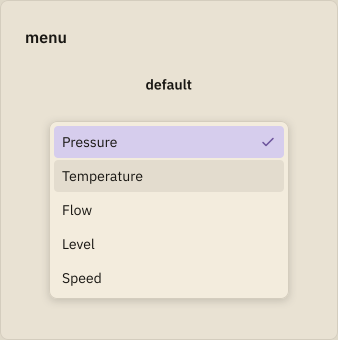

# menu

> [Home](../../../README.md) › [Design system](../../README.md) › [Molecules](../README.md) › menu

The list that opens under a [select-trigger](../../atoms/select-trigger/README.md): [menu-item](../menu-item/README.md) lines on a floating surface.

## Figma

| Node | Id |
| --- | --- |
| Component | [`637:103`](https://www.figma.com/design/2hW8t5CgVru1VFbQZ1yETL/?node-id=637-103) |

## Variants and states

## Inputs

| Input | Type | Default | Figma |
| --- | --- | --- | --- |
| `items` | list of items: text, icon, disabled | five items | five `menu-item`, two more behind the booleans `item-6` and `item-7` |
| `value` | the chosen item | none | the `menu-item` in `state=selected` |

## Outputs

| Output | When | Value |
| --- | --- | --- |
| `select` | An item is chosen. | the item |
| `close` | Escape, or a click outside. | — |

## Behaviour

- 280 high at most: beyond, it scrolls inside, with a [scrollbar](../../atoms/scrollbar/README.md), and stays `spacing-04` from the edge of the window.
- Its items sit in a frame `content` that carries the padding of the top and the bottom, so the last item keeps its margin once scrolled to the end (Product Owner, 2026-11-22).
- The up and down arrows move the active item; Enter chooses it.

## Made of

| Component | Role |
| --- | --- |
| [menu-item](../../molecules/menu-item/README.md) | Each item. |
| [scrollbar](../../atoms/scrollbar/README.md) | Beyond 280 high. |
