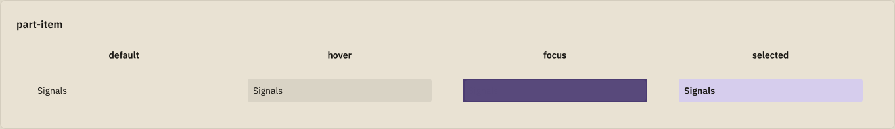

# part-item

> [Home](../../../README.md) › [Design system](../../README.md) › [Molecules](../README.md) › part-item

One part of the selected type, in the list under the tree: General, Documentation, Signals…

## Figma

| Node | Id |
| --- | --- |
| Component set | [`638:850`](https://www.figma.com/design/2hW8t5CgVru1VFbQZ1yETL/?node-id=638-850) |

## Variants and states

## Inputs

| Input | Type | Default | Figma |
| --- | --- | --- | --- |
| `text` | text | — | text property `text` |
| `selected` | boolean | `false` | `state=selected` |

## Outputs

| Output | When | Value |
| --- | --- | --- |
| `select` | A click on a part not selected, or Enter. | — |

## Behaviour

- The selected part does not react to the mouse.
