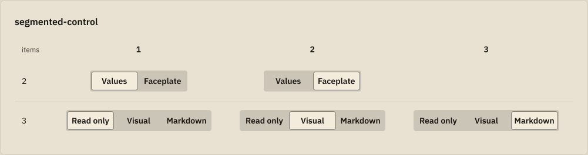

# segmented-control

> [Home](../../../README.md) › [Design system](../../README.md) › [Molecules](../README.md) › segmented-control

Two or three [buttons](../../atoms/button/README.md) side by side, one selected: it switches a view or a mode.

## Figma

| Node | Id |
| --- | --- |
| Component set | [`637:250`](https://www.figma.com/design/2hW8t5CgVru1VFbQZ1yETL/?node-id=637-250) |

## Variants and states

## Inputs

| Input | Type | Default | Figma |
| --- | --- | --- | --- |
| `items` | two or three texts | — | variant `items=2, 3`; the label of each button |
| `selected` | 1, 2 or 3 | 1 | variant `selected` |

## Outputs

| Output | When | Value |
| --- | --- | --- |
| `selectedChange` | A click on an item not selected, or the left and right arrows. | the number of the item |

## Behaviour

- The selected item is a `secondary` button and does not react to the mouse; the others are `ghost` buttons, with their hover.
- On the screens, the click of an item leads to the screen with that item selected, never to a change of the component in place: Figma keeps the hover of the clicked item after such a change (Product Owner, 2026-11-22, Units · temperature).

## Made of

| Component | Role |
| --- | --- |
| [button](../../atoms/button/README.md) | Each item: secondary when selected, ghost otherwise. |
