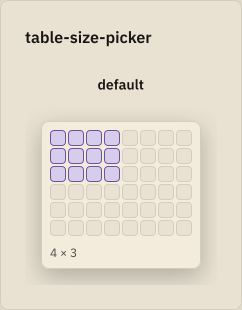

# table-size-picker

> [Home](../../../README.md) › [Design system](../../README.md) › [Molecules](../README.md) › table-size-picker

The grid of the table button of the formatting tool bar: 8 × 6 cells; the cells from the top left to the mouse light up (`layer-selected`, `accent`); the caption says columns × rows; a click inserts the table.

## Figma

| Node | Id |
| --- | --- |
| Component | [`684:2760`](https://www.figma.com/design/2hW8t5CgVru1VFbQZ1yETL/?node-id=684-2760) |

## Variants and states

## Inputs

| Input | Type | Default | Figma |
| --- | --- | --- | --- |
| `size` | columns × rows under the mouse | `4 × 3` | text property `size` and the cells lit |

## Outputs

| Output | When | Value |
| --- | --- | --- |
| `insert` | A click on a cell, or Enter. | columns and rows |
| `close` | Escape, or a click outside. | — |

## Behaviour

- The arrows move the lit corner when it has the focus.
