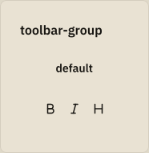

# toolbar-group

> [Home](../../../README.md) › [Design system](../../README.md) › [Molecules](../README.md) › toolbar-group

[Icon buttons](../../atoms/icon-button/README.md) grouped in a tool bar.

## Figma

| Node | Id |
| --- | --- |
| Component | [`638:885`](https://www.figma.com/design/2hW8t5CgVru1VFbQZ1yETL/?node-id=638-885) |

## Variants and states

## Inputs

| Input | Type | Default | Figma |
| --- | --- | --- | --- |
| `buttons` | list of icon buttons or toggle buttons | — | its instances |

## Outputs

None of its own: each button gives its `click`.

## Behaviour

- The left and right arrows move the focus from one button to the next.

## Made of

| Component | Role |
| --- | --- |
| [icon-button](../../atoms/icon-button/README.md) | Each action. |
| [toggle-button](../../atoms/toggle-button/README.md) | Bold, italic. |
