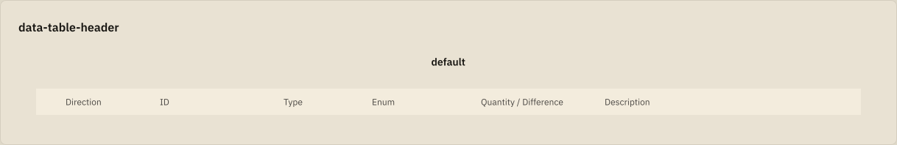

# data-table-header

> [Home](../../README.md) › [Design system](../README.md) › [Organisms](README.md) › data-table-header

The names of the columns of a [data-table](data-table.md): the room of the handle, the [column-header](../atoms/column-header.md) of each column, the room of the delete button.

## Figma

| Node | Id |
| --- | --- |
| Component | [`641:352`](https://www.figma.com/design/2hW8t5CgVru1VFbQZ1yETL/?node-id=641-352) |

## Variants and states

## Inputs

| Input | Type | Default | Figma |
| --- | --- | --- | --- |
| `columns` | list: name, width | the columns of Signals | slot `columns`, filled with column-header |

## Outputs

None.

## Behaviour

- Each column header is as wide as the cells of its column.
- It is the only line of a table with a straight line under it.

## Made of

| Component | Role |
| --- | --- |
| [column-header](../atoms/column-header.md) | Each column, in the slot columns. |
