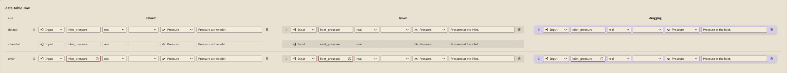

# data-table-row

> [Home](../../../README.md) › [Design system](../../README.md) › [Organisms](../README.md) › data-table-row

One line of a [data-table](../data-table/README.md): a [drag-handle](../../atoms/drag-handle/README.md), its cells, and a delete [icon-button](../../atoms/icon-button/README.md). Its default cells are the columns of Signals: direction, ID, type, enum, quantity or difference, description.

## Figma

| Node | Id |
| --- | --- |
| Component set | [`641:1229`](https://www.figma.com/design/2hW8t5CgVru1VFbQZ1yETL/?node-id=641-1229) |

## Variants and states

## Inputs

| Input | Type | Default | Figma |
| --- | --- | --- | --- |
| `cells` | list of cell components | the cells of Signals | slot `cells`: each cell as wide as its column-header |
| `kind` | `default`, `inherited`, `error` | `default` | variant `kind` |
| `error` | text | none | `kind=error`: the line in error (decision 0082) |

## Outputs

| Output | When | Value |
| --- | --- | --- |
| `cellChange` | A cell changes. | the column and the value |
| `move` | The line is dropped at a new place, by its handle. | the new place |
| `delete` | A click on delete. | — |

## Behaviour

- `hover` lights the line; a click on the line itself does nothing: a line of a table is never selected (Product Owner, 2026-11-22).
- `dragging` (`layer-selected` and `shadow-raised`): only while its handle is held; own lines only.
- `inherited`: read only, no handle nor delete, nothing that tells its parent (the tree already shows it).
- No direction is told by a background: only by its icon.
- No line under it: lines are told apart by the `spacing-01` between them.

## Made of

| Component | Role |
| --- | --- |
| [drag-handle](../../atoms/drag-handle/README.md) | Moves the line. |
| [text-input](../../atoms/text-input/README.md) | Text cells. |
| [number-input](../../atoms/number-input/README.md) | Number cells. |
| [select-trigger](../../atoms/select-trigger/README.md) | Cells chosen in a list. |
| [checkbox](../../atoms/checkbox/README.md) | Cells on or off. |
| [link-cell](../../molecules/link-cell/README.md) | A link. |
| [icon-button](../../atoms/icon-button/README.md) | Delete. |
