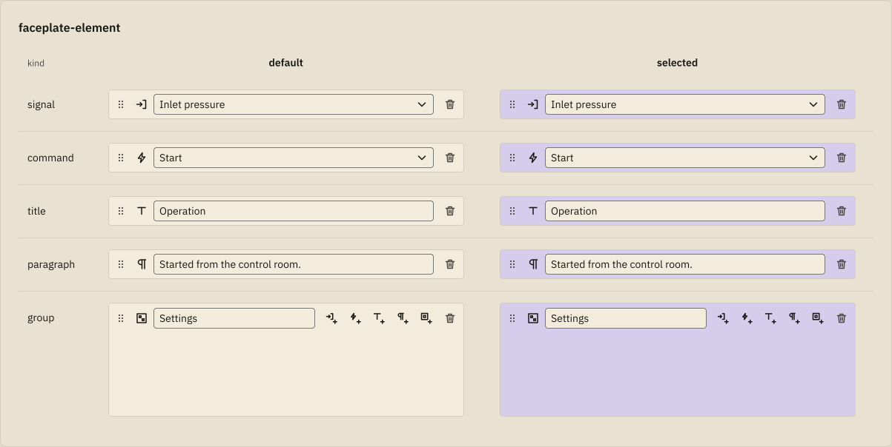

# faceplate-element

> [Home](../../README.md) › [Design system](../README.md) › [Organisms](README.md) › faceplate-element

One element of the faceplate builder of a preset: a [drag-handle](../atoms/drag-handle.md), the icon of its kind, the fields of its kind, and delete. A group holds its own elements.

## Figma

| Node | Id |
| --- | --- |
| Component set | [`642:1828`](https://www.figma.com/design/2hW8t5CgVru1VFbQZ1yETL/?node-id=642-1828) |

## Variants and states

## Inputs

| Input | Type | Default | Figma |
| --- | --- | --- | --- |
| `kind` | `signal`, `command`, `title`, `paragraph`, `group` | `signal` | variant `kind` |
| `fields` | the fields of its kind | — | slot `fields` |
| `addButtons` | the five add buttons | — | slot `actions`, group only |
| `elements` | its own elements | — | slot `elements`, group only, indented by `spacing-07` |

## Outputs

| Output | When | Value |
| --- | --- | --- |
| `change` | A field changes. | the field and the value |
| `add` | An add button of a group. | the kind added |
| `move` | The element is dropped at a new place, by its handle. | the new place |
| `delete` | A click on delete. | — |

## Behaviour

- `dragging` (`layer-selected`, violet): only while its handle is held, as a line of a table; a click on the element itself does nothing (Product Owner, 2026-11-22: "faut que ça fasse violet que quand je clique sur le bouton pour bouger la ligne").
- A signal in write or override is always on two lines, whatever its input: the first ends with read or write (read or override, a horizontal [radio-group](../molecules/radio-group.md)); the second holds the kind of input, then for a number the minimum and the maximum, of the same width.
- In a group, the delete follows the add buttons `spacing-02` apart, as one row of buttons.
- The kind `paragraph` is shown "Description" on the screens and in its icon `description` (MD-07.19).

## Made of

| Component | Role |
| --- | --- |
| [drag-handle](../atoms/drag-handle.md) | Moves the element. |
| [Icons](../icons/README.md) | The icon of its kind; the add icons of a group. |
| [select-trigger](../atoms/select-trigger.md) | The signal, the kind of input. |
| [text-input](../atoms/text-input.md) | Labels, titles. |
| [text-area](../atoms/text-area.md) | The text of a description. |
| [number-input](../atoms/number-input.md) | Minimum and maximum. |
| [radio-group](../molecules/radio-group.md) | Read or write, read or override. |
| [icon-button](../atoms/icon-button.md) | The add buttons of a group, delete. |
