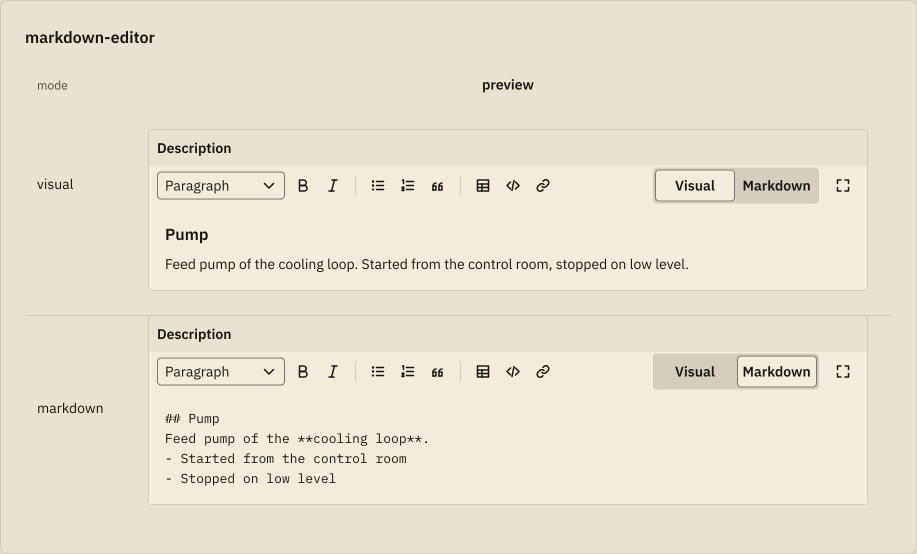

# markdown-editor

> [Home](../../../README.md) › [Design system](../../README.md) › [Organisms](../README.md) › markdown-editor

The documentation editor of a type: a [list-title](../../molecules/list-title/README.md) "Description" with no button, the [formatting-toolbar](../formatting-toolbar/README.md), and the editing area.

## Figma

| Node | Id |
| --- | --- |
| Component set | [`642:1487`](https://www.figma.com/design/2hW8t5CgVru1VFbQZ1yETL/?node-id=642-1487) |

## Variants and states

## Inputs

| Input | Type | Default | Figma |
| --- | --- | --- | --- |
| `value` | Markdown text | empty | the text of its editing area |
| `mode` | `visual`, `markdown` | `visual` | variant `mode`: the text formatted, or its Markdown source |
| `fullPage` | boolean | `false` | the full page state: the editing area fills down to the bottom |

## Outputs

| Output | When | Value |
| --- | --- | --- |
| `valueChange` | The text changes. | the Markdown text |
| `modeChange`, `fullPageChange` | From its tool bar. | the mode, the full page |

## Behaviour

- No read-only mode (Product Owner, 2026-11-22).
- In full page, the description takes the whole editing part; the links are hidden; the tree and the menus stay (MD-03.4c).

## Made of

| Component | Role |
| --- | --- |
| [list-title](../../molecules/list-title/README.md) | Description, no button. |
| [formatting-toolbar](../../organisms/formatting-toolbar/README.md) | Its tool bar. |
