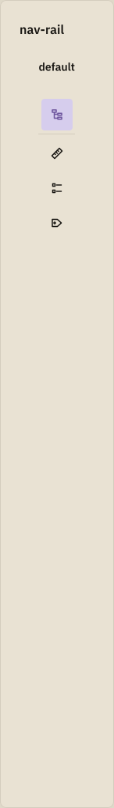

# nav-rail

> [Home](../../README.md) › [Design system](../README.md) › [Organisms](README.md) › nav-rail

The vertical bar of icons that switches the pages of a part: [nav-rail-item](../molecules/nav-rail-item.md) `rail` and a [divider](../atoms/divider.md).

## Figma

| Node | Id |
| --- | --- |
| Component | [`640:201`](https://www.figma.com/design/2hW8t5CgVru1VFbQZ1yETL/?node-id=640-201) |

## Variants and states

## Inputs

| Input | Type | Default | Figma |
| --- | --- | --- | --- |
| `pages` | list: icon, name | the pages of Metadata | its items |
| `page` | the selected page | Types | the item in `state=selected` |

## Outputs

| Output | When | Value |
| --- | --- | --- |
| `pageChange` | A click on a page not selected. | the page |

## Behaviour

- In Metadata, the divider sits after Types: the type, then what the types use (Units, Enums, Designations).
- The up and down arrows move the focus from item to item.

## Made of

| Component | Role |
| --- | --- |
| [nav-rail-item](../molecules/nav-rail-item.md) | Each page, placement rail. |
| [divider](../atoms/divider.md) | After Types. |
