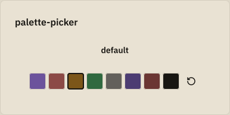

# palette-picker

> [Home](../../../README.md) › [Design system](../../README.md) › [Organisms](../README.md) › palette-picker

The colours a type can take: the [colour-swatch](../../atoms/colour-swatch/README.md) of the palette, and a reset to the colour of the parent.

## Figma

| Node | Id |
| --- | --- |
| Component | [`641:1471`](https://www.figma.com/design/2hW8t5CgVru1VFbQZ1yETL/?node-id=641-1471) |

## Variants and states

## Inputs

| Input | Type | Default | Figma |
| --- | --- | --- | --- |
| `palette` | list of colours | sample colours | its swatches, until the palette of the project is known |
| `value` | the chosen colour, or the parent's | the parent's | the swatch in `state=selected` |

## Outputs

| Output | When | Value |
| --- | --- | --- |
| `valueChange` | A swatch is chosen. | the colour |
| `reset` | The reset button: follow the parent again. | — |

## Made of

| Component | Role |
| --- | --- |
| [colour-swatch](../../atoms/colour-swatch/README.md) | Each colour. |
| [icon-button](../../atoms/icon-button/README.md) | Reset. |
