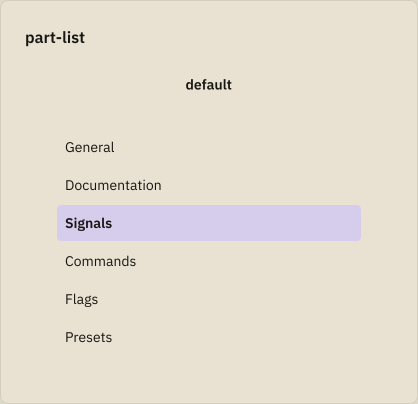

# part-list

> [Home](../../README.md) › [Design system](../README.md) › [Organisms](README.md) › part-list

The parts of the selected type, listed under the tree: [part-item](../molecules/part-item.md) lines.

## Figma

| Node | Id |
| --- | --- |
| Component | [`640:574`](https://www.figma.com/design/2hW8t5CgVru1VFbQZ1yETL/?node-id=640-574) |

## Variants and states

## Inputs

| Input | Type | Default | Figma |
| --- | --- | --- | --- |
| `parts` | list of texts | the parts of a type | its part-items |
| `part` | the selected part | General | the part-item in `state=selected` |

## Outputs

| Output | When | Value |
| --- | --- | --- |
| `partChange` | A click on a part not selected. | the part |

## Made of

| Component | Role |
| --- | --- |
| [part-item](../molecules/part-item.md) | Each part. |
