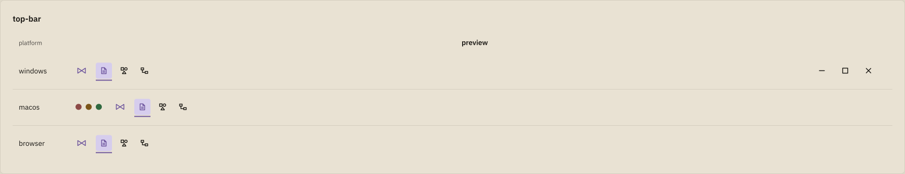

# top-bar

> [Home](../../../README.md) › [Design system](../../README.md) › [Organisms](../README.md) › top-bar

The bar at the top of the window: the mark of the application, the three parts as [nav-rail-item](../../molecules/nav-rail-item/README.md) `top-bar`, and the [window-controls](../../molecules/window-controls/README.md).

## Figma

| Node | Id |
| --- | --- |
| Component set | [`640:200`](https://www.figma.com/design/2hW8t5CgVru1VFbQZ1yETL/?node-id=640-200) |

## Variants and states

## Inputs

| Input | Type | Default | Figma |
| --- | --- | --- | --- |
| `platform` | `windows`, `macos`, `browser` | `windows` | variant `platform` |
| `part` | `metadata`, `symbols`, `synoptic` | `metadata` | the item in `state=selected` |

## Outputs

| Output | When | Value |
| --- | --- | --- |
| `partChange` | A click on a part not selected. | the part |
| window events | From its window-controls. | — |

## Behaviour

- `browser`: no window controls; the application runs in a tab.
- The bar can drag the window on Windows and macOS.

## Made of

| Component | Role |
| --- | --- |
| [Icons](../../icons/README.md) | app-mark, the mark of the application. |
| [nav-rail-item](../../molecules/nav-rail-item/README.md) | Each part, placement top-bar. |
| [window-controls](../../molecules/window-controls/README.md) | The window buttons. |
