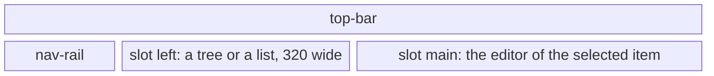
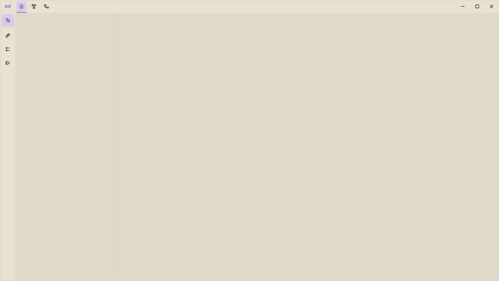
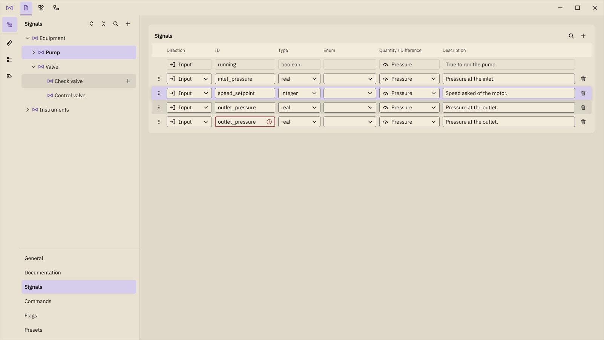

# template/editor

> [Home](../../../README.md) › [Design system](../../README.md) › [Templates](../README.md) › editor

The layout of every screen of an editor, at 1600 × 900, the smallest window ([Principles](../../01-principles.md)): the [top-bar](../../organisms/top-bar/README.md) across the whole width, then the [nav-rail](../../organisms/nav-rail/README.md), the slot `left`, a vertical [divider](../../atoms/divider/README.md), and the slot `main`.

## Figma

| Node | Id |
| --- | --- |
| Component | [`657:2`](https://www.figma.com/design/2hW8t5CgVru1VFbQZ1yETL/?node-id=657-2) |
| `example/editor`, its slots filled | [`657:155`](https://www.figma.com/design/2hW8t5CgVru1VFbQZ1yETL/?node-id=657-155) |

## The layout

How the window is shared.

## Inputs

| Input | Type | Default | Figma |
| --- | --- | --- | --- |
| `left` | content of the left column | empty | slot `left`, width `size-left-column` |
| `main` | content of the main area | empty | slot `main`, padding and gap `spacing-06` |
| `platform` | `windows`, `macos`, `browser` | `windows` | the variant of its top-bar |
| `part`, `page` | the part and the page selected | — | its top-bar and its nav-rail |

## Outputs

None of its own: its top-bar and its nav-rail give theirs.

## Behaviour

- A screen is an instance of the template: its content goes into the two slots, as instances.
- The template draws its first child on top, so that the rail and the top bar show their tooltips over the columns.

## Made of

| Component | Role |
| --- | --- |
| [top-bar](../../organisms/top-bar/README.md) | Across the whole width. |
| [nav-rail](../../organisms/nav-rail/README.md) | On the left. |
| [divider](../../atoms/divider/README.md) | Between the left column and the main area. |
