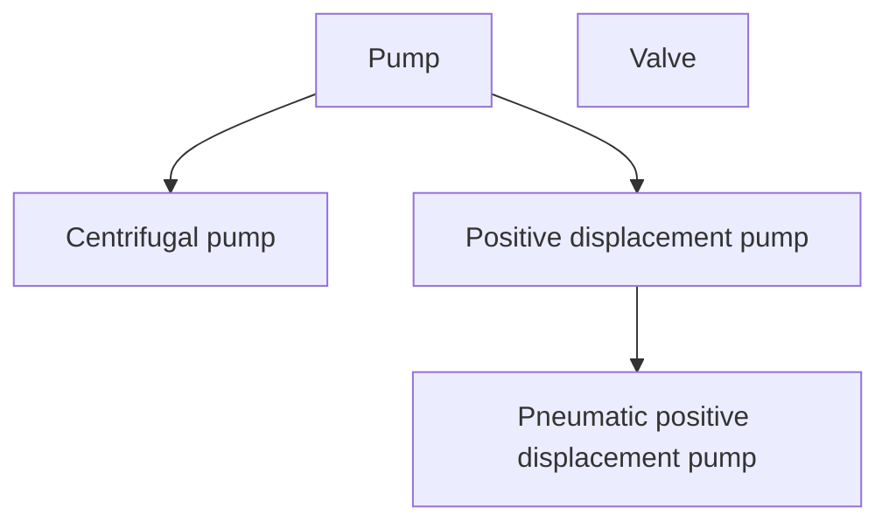
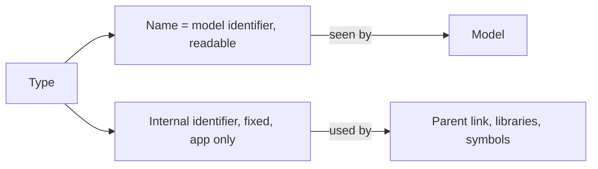
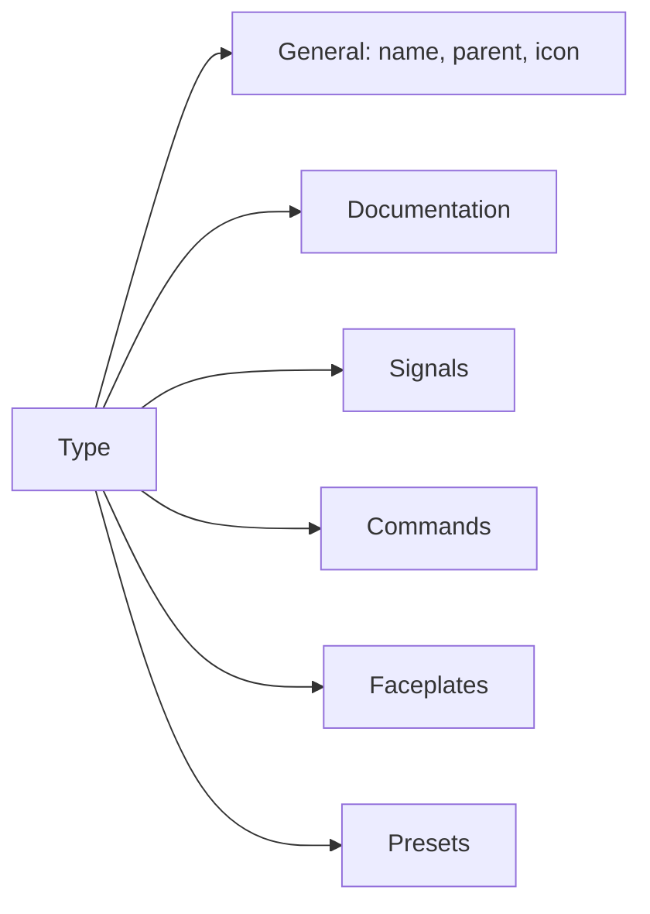
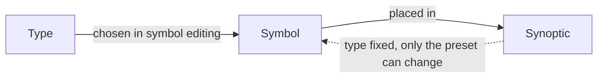
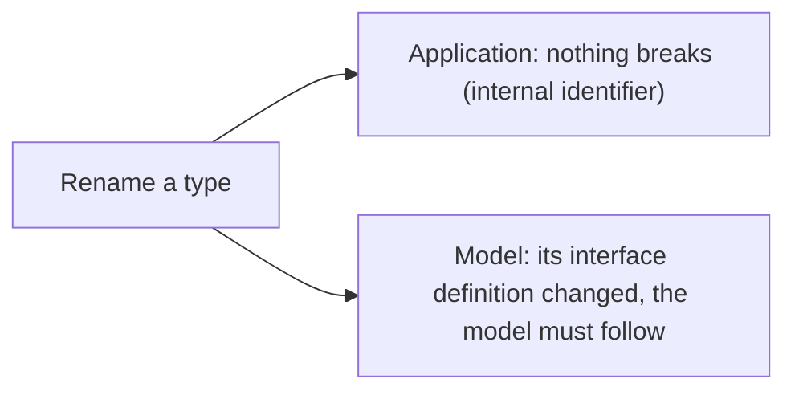
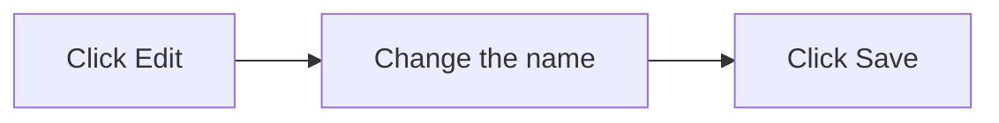

# Types

> [Home](../README.md) › [Metadata](README.md) › Types · Next: [Icons](02-icons.md)

Status: validated by the Product Owner on 2026-11-11. Open points are listed in [Open questions](12-open-questions.md).

A type is the representation of a symbol at one level of detail. Types form a tree, hence parents and sub-types.

## Rules

- The General part holds the name, the parent, and an icon with its colour (see [Icons](02-icons.md)). The description and the links are in a separate documentation page (see [Documentation](03-documentation.md)).
- The name is the type's identifier for the model, like a signal's name. No second label. It must be readable and exact, because model authors use it to know what the type is (example: `centrifugal_pump`). Where a standard already names things, the type takes that name.
- A type also has an internal identifier, set by the software, that never changes. It exists on the application side only and never goes to the model. It is needed to define the parent and for libraries to point to the type, so renaming a type breaks nothing in the application.
- So there are two identifiers: the name (seen by the model, meaningful) and the internal one (seen by the application only, meaningless).

- No abstract types: "Pump", "Positive displacement pump" and "Pneumatic positive displacement pump" can all be chosen.
- A type inherits the signals of its parents.
- The name and the parent are changed in the General part only. Double-clicking an item in the right-hand tree does not rename it: hidden options are avoided.
- No virtual links between types of the tree. Duplicates are accepted: a change in one type must not change another silently, so nothing has to be retested everywhere. It also lets each type be versioned alone later. The documentary research (2026-11-10) finds this rule defensible: neither FMI, OPC UA nor AutomationML requires or forbids it.

### Limits of "no virtual link" (decided on 2026-11-11, from the research)

The rule is true between types that have no parent link. Three mechanisms do propagate a change, on purpose, and are written as such:

- Changing a parent changes all its descendants.
- A sub-type cannot declare again a signal name it already inherits. No redefinition: it is the simplest rule, and a name stays one thing along the tree.
- The values of an enum are part of the contract with the model: changing them is breaking, like a rename (see [Enums](06-enums.md)). Links to an enum or a quantity go through an internal identifier, like libraries do for types.

Versioned, published types (the answer of OPC UA's best-practices guide and of Siemens) are kept for later.

## What a type holds

| Part | File |
| --- | --- |
| General: icon and colour | [Icons](02-icons.md) |
| Documentation: description (Markdown), links | [Documentation](03-documentation.md) |
| Signals | [Signals](04-signals.md) |
| Commands | [Commands](07-commands.md) |
| Faceplates | [Faceplates](08-faceplates.md) |
| Presets | [Presets](09-presets.md) |

## Type and symbol

- A symbol is attached to one type.
- The type of a symbol can only be changed in symbol editing.
- In a synoptic, the type can never be changed. Only the preset can be.

## Renaming is breaking, on purpose

The names of types (and of signals) build the interface definition of the model. They are meant to be defined at the start and never to change.

- A name is a contract with the model. No mapping layer between an old name and a new one: it would make no sense here.
- Renaming a type is possible but breaking: the model must change its name too, because its interface definition changed.
- The more names change, the more the model has to change. So names must be thought through before they are set.
- The application does not break on a rename, because it uses the internal identifier.

## How a rename is done: deliberate, without a warning

- A name can never be changed just by typing in place. The user clicks an Edit button, changes the name, then clicks a Save button.
- Those few deliberate actions are what make the change important. No warning or confirmation dialog is added on top: it would only waste time, and people doing this know what they are doing.
- The consequences for models (see above) are to be explained in a user manual. That manual is not part of the open source version.

## Where it is used

| Thing | Created and changed in | Used in | In a symbol | In a synoptic |
| --- | --- | --- | --- | --- |
| Type (name, parent) | Metadata, General | Library (as a pointer), signal and command inheritance | Chosen, only here | No |
