# Types

> [Home](../README.md) › [Metadata](README.md) › Types · Next: [Icons](02-icons.md)

Status: validated by the Product Owner on 2026-11-11; changed by him on 2026-11-16 (no libraries of types, type tree actions, fixed parent, icon buttons in General, parts listed by name under the tree, a Faceplate part that only shows the faceplate, no Edit or Save step). Reviewing the wireframes later that day, he validated the tree (coloured icon and name, nesting, + on hover and + on the title), put the search behind an icon on the line of the title, removed every right click, moved Delete to General with a warning, and asked for lists of types indented with dashes. At the end of the day he removed the Faceplate part: five parts are left. Open points are listed in [Open questions](12-open-questions.md).

A type is the representation of a symbol at one level of detail. Types form a tree, hence parents and sub-types.

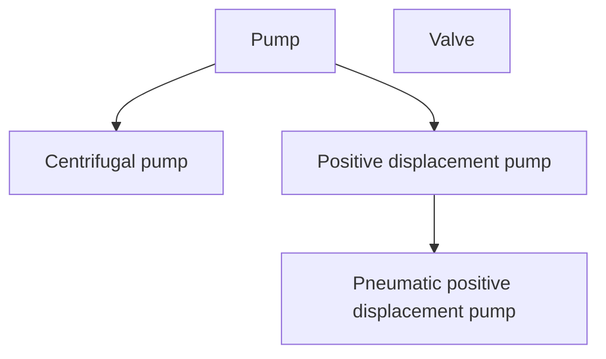

## Rules

- The General part holds the name, the parent, and an icon with its colour (see [Icons](02-icons.md)). The description and the links are in a separate documentation page (see [Documentation](03-documentation.md)).
- The name is the type's identifier for the model, like a signal's name. No second label. It must be readable and exact, because model authors use it to know what the type is (example: `centrifugal_pump`). Where a standard already names things, the type takes that name.
- A type also has an internal identifier, set by the software, that never changes. It exists on the application side only and never goes to the model. It is needed to define the parent and for symbols to point to the type, so renaming a type breaks nothing in the application.
- So there are two identifiers: the name (seen by the model, meaningful) and the internal one (seen by the application only, meaningless).

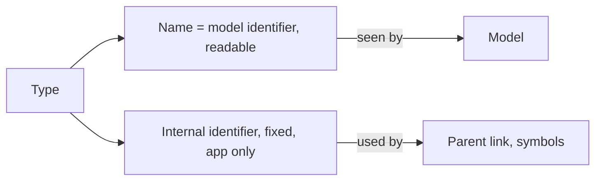

- No abstract types: "Pump", "Positive displacement pump" and "Pneumatic positive displacement pump" can all be chosen.
- A type inherits the signals of its parents.
- The type tree is on the **left** of the screen, as in a code editor (IDE), where every tree sits on the left (Product Owner, 2026-11-11). It sits just right of the navigation bar of Metadata (see [Screens](../screens/README.md#layout-rules)).
- There are no libraries of types: every type of the tree can be chosen everywhere (Product Owner, 2026-11-16).
- The name is changed in the General part only. Double-clicking an item in the tree does not rename it: hidden options are avoided.
- **The parent never changes** (Product Owner, 2026-11-16; decision 0013; asked again after the review of the wireframes, see [A list of types shows the tree](#a-list-of-types-shows-the-tree-indented)). It is set when the type is created, by the + of the type under which it is created (or the + of the title, for a root type). General shows it, read only: its name with its icon.
  - Why: moving a type to another parent changes the signals it inherits and breaks what uses it. No signal goes from one parent to another "aussi bêtement que ça". Metadata must stay strict ("ça doit être carré").
  - A type created under the wrong parent is deleted and created again under the right one; it is never moved.

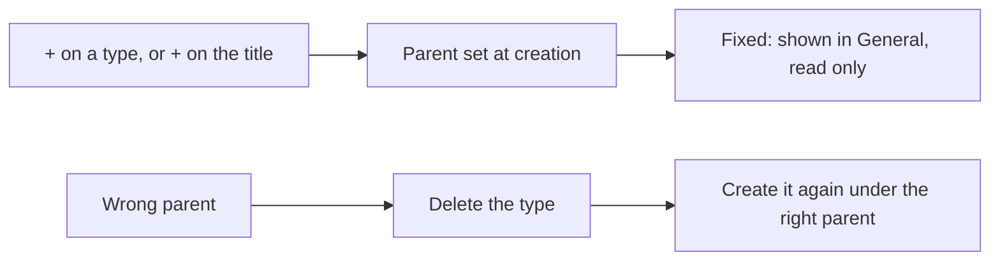

- The parts of a type are shown in this order (Product Owner, 2026-11-11, then 2026-11-16): General, Documentation, Signals, Commands, Presets. There is **no Faceplate part** (removed by the Product Owner at the end of 2026-11-16): the faceplate is built and seen in the mode Faceplate of a preset (see [Presets](09-presets.md#no-faceplate-part)). They are shown as **a list of their names, in the column of the type tree, fixed under the tree** (proposal B, changed by the Product Owner on 2026-11-16; see [The parts of a type](#the-parts-of-a-type-a-list-fixed-under-the-tree)).

### The type tree: search, create, delete (Product Owner, 2026-11-16)

Validated by the Product Owner on 2026-11-16, while reviewing the wireframes ("cette partie-là, on peut la valider").

- Each type of the tree shows **its icon, in its colour, and its name**. Types nest: a type can hold types, at any depth.
- **Create a child:** each type of the tree has a **+** on its right, **shown when the mouse is over the type** ("sinon on va les voir tout le temps et ça va être imbuvable"). It creates a new type **inside** it (a child): "le truc le plus logique". The new type starts with a default name, changed afterwards in General.
  - The Product Owner thought for a moment of showing these + all the time, in a light colour, so that nothing is hidden; then dropped it: one more mark on every line "va faire beaucoup trop surchargé". They stay on hover.
- **Create a root type:** a **+** on the line of the title "Type tree", always on the far right. It is always shown, so that creating a type is never hidden.
- **Search:** a **search icon** sits on the line of the title, just left of the +.
  - A click on it turns the title into a **search field**: the words "Type tree" disappear and the field takes their place.
  - Typing filters the tree.
  - While searching, the **+ becomes a cross (×)**, which closes the search: the field goes, the title "Type tree" and the + come back.
  - It replaces the search field always shown under the title, drawn earlier the same day.
- **No double click:** double-clicking a type does not rename it; hidden options are avoided.
- **No right click** in the tree, nor anywhere in Metadata (Product Owner, 2026-11-16: "on ne peut juste pas avoir de clic droit du tout"). Its menu held only Delete, and a delete must not be that easy to reach.
- **Delete:** a **Delete button in the General part** of the type. A click opens a **warning message** that asks to confirm, as for every delete of Metadata (see the [layout rules](../screens/README.md#delete-with-a-button-and-a-warning-in-metadata)). It replaces the right click and the "no warning" decided earlier the same day. The delete also shows on the [Versions](13-versions.md) page, where it can be undone before a version is made.

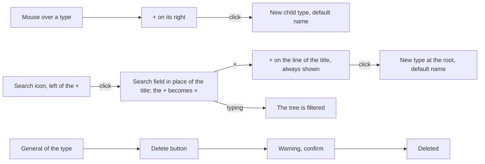

The line of the title, out of search and in search:

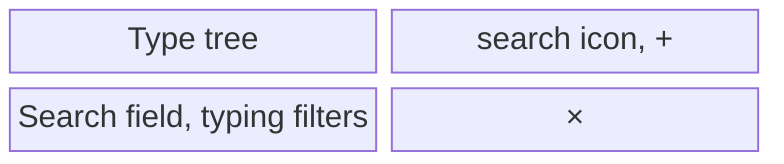

- The General part holds the name, the parent, the icon and the colour, and the **Delete button** of the type (Product Owner, 2026-11-11, confirmed on 2026-11-16; the Delete button added the same day).
- Open: should the field of the name be labelled "Name" or "ID", as for the signals and the commands? The Product Owner hesitates (2026-11-16: "Je ne sais pas s'il faut mettre vraiment un nom ou plutôt un ID").

### A list of types shows the tree, indented

Said by the Product Owner on 2026-11-16, for the list of the parent in General.

- When a list of types opens (a select), it shows **the whole type tree**, each type with its icon and its name.
- The level of a type is shown by **small dashes before the icon**, one per level, each taking a wide square of space, so that the indentation reads as in the tree ("des petits tirets, mais qui prennent un gros carré d'espacement"). Example: `Pump`, then `— Centrifugal pump`, then `— — …`.
- Assistant's proposal, to confirm: the same display wherever a type is picked in a list, for example when a symbol picks its type.

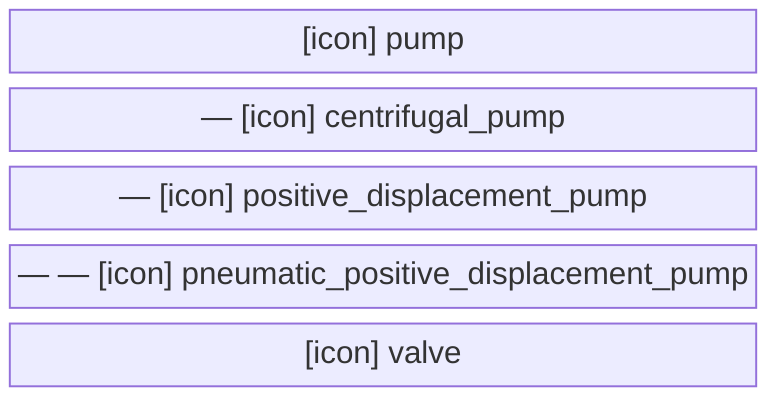

À trancher: the Product Owner described the parent in General as "une liste qu'il faut choisir". Decision 0013 (accepted on 2026-11-16) says the parent is fixed at creation and shown read only. Asked to the Product Owner whether the parent becomes changeable through this list; until the answer, the rule above (fixed parent) holds.

- **Icon and colour:** a list of icons and a list of colours, each with its reset button, validated (Product Owner, 2026-11-16). The colours, and the icons, may take more than one line: where the reset button goes then is to find with the design ("il faudra trouver une autre disposition, mais dans le général, là, ça suffit").
- In General, the name is **always editable**: no Edit or Save button (Product Owner, 2026-11-16: "il faut que tout soit éditable tout le temps"). The resets to the parent (icon, colour) are **icon buttons**, without a text label.
- No virtual links between types of the tree. Duplicates are accepted: a change in one type must not change another silently, so nothing has to be retested everywhere. It also lets each type be versioned alone later. The documentary research (2026-11-10) finds this rule defensible: neither FMI, OPC UA nor AutomationML requires or forbids it.

### Limits of "no virtual link" (decided on 2026-11-11, from the research)

The rule is true between types that have no parent link. Three mechanisms do propagate a change, on purpose, and are written as such:

- Changing the content of a parent (its signals, its commands) changes all its descendants. The parent link itself never changes (see above).
- A sub-type cannot declare again a signal name it already inherits. No redefinition: it is the simplest rule, and a name stays one thing along the tree.
- The values of an enum are part of the contract with the model: changing them is breaking, like a rename (see [Enums](06-enums.md)). Links to an enum or a quantity go through an internal identifier, like symbols do for types.

Versions, the answer of OPC UA's best-practices guide and of Siemens, came on 2026-11-16: Metadata as a whole is versioned (see [Versions](13-versions.md)).

## What a type holds

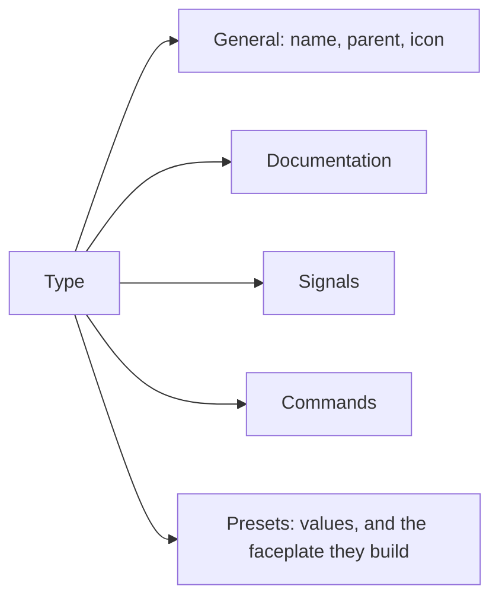

| Part | File |
| --- | --- |
| General: icon and colour | [Icons](02-icons.md) |
| Documentation: description (Markdown), links | [Documentation](03-documentation.md) |
| Signals | [Signals](04-signals.md) |
| Commands | [Commands](07-commands.md) |
| Presets: values, and the faceplate they build | [Presets](09-presets.md) |

## The parts of a type: a list fixed under the tree

Chosen by the Product Owner on 2026-11-16: **proposal B, the parts written in whole words**, placed in the column of the type tree. It replaces proposal C (a strip of icons), chosen earlier the same day.

- The five parts are listed **with their names in whole words**, one under the other, in the order General, Documentation, Signals, Commands, Presets (the Faceplate part, there for a while on 2026-11-16, was removed the same day).
- They sit **in the same column as the type tree, under it**, not in a column of their own. The list was moved above the tree for a while the same day, then put back under it: above the title "Type tree", it made no sense (Product Owner, 2026-11-16: "ça n'a aucun sens logique").
- The list is **fixed** at the bottom of that column: it never moves, whatever the length of the tree (Product Owner: "on fixe, et comme ça, ça ne bouge pas … ça bougera jamais"). The tree scrolls above it.
- Why: whole words are understood at once, icons are not ("il faut faire des mots entiers, sinon ils vont rien comprendre"); and since the column on the left already holds long lines (the names of the types), the names of the parts fit there without taking a column of their own.
- The same design applies to every screen of a type, General to Presets (Product Owner: "il va falloir que t'appliques ce design-là partout").

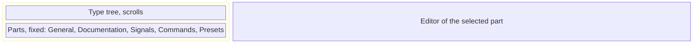

The four proposals drawn before the choice, kept for the record. The Product Owner liked the tabs in a row, easy to use, but they break the rule "columns rather than rows" (see [Layout rules](../screens/README.md#layout-rules)). Their drawings were removed from the Figma file once B was in place (Product Owner, 2026-11-16). D was refused ("c'est mort"). C was chosen first, then B, its parts moved into the column of the tree, under it (moved above it for a while, then back under it).

| Proposal | What it is | For | Against |
| --- | --- | --- | --- |
| A. Tabs in a row | The five parts as tabs above the editor (the current wireframes). | Known by everyone; all the width stays for the part. | A row, against the rule of columns. |
| B. A column of parts (**chosen**, placed under the tree) | A narrow column between the tree and the editor lists the five parts, one under the other, with their names. Chosen with the list moved into the column of the tree, under it, fixed. | Follows the rule of columns; the names stay readable. | Drawn as one more column; moved into the column of the tree, it takes no width. |
| C. A strip of icons (chosen first, then replaced by B) | The same column, reduced to five icons, the name in a tooltip. | Narrow: almost all the width stays for the part. | Icons to learn; the name is hidden until the mouse is over it. |
| D. Under the type, in the tree | When a type is selected, its five parts unfold under it in the tree, as the layers of a frame in Figma. | No extra column; the type and its part are read together. | The tree grows and moves; a part is mixed with the types. |

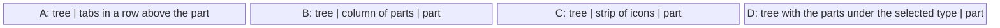

## Type and symbol

- A symbol is attached to one type.
- The type of a symbol can only be changed in symbol editing.
- In a synoptic, the type can never be changed. Only the preset can be.

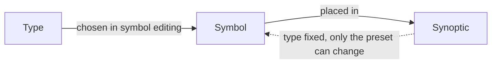

## Renaming is breaking, on purpose

The names of types (and of signals) build the interface definition of the model. They are meant to be defined at the start and never to change.

- A name is a contract with the model. No mapping layer between an old name and a new one: it would make no sense here.
- Renaming a type is possible but breaking: the model must change its name too, because its interface definition changed.
- The more names change, the more the model has to change. So names must be thought through before they are set.
- The application does not break on a rename, because it uses the internal identifier.

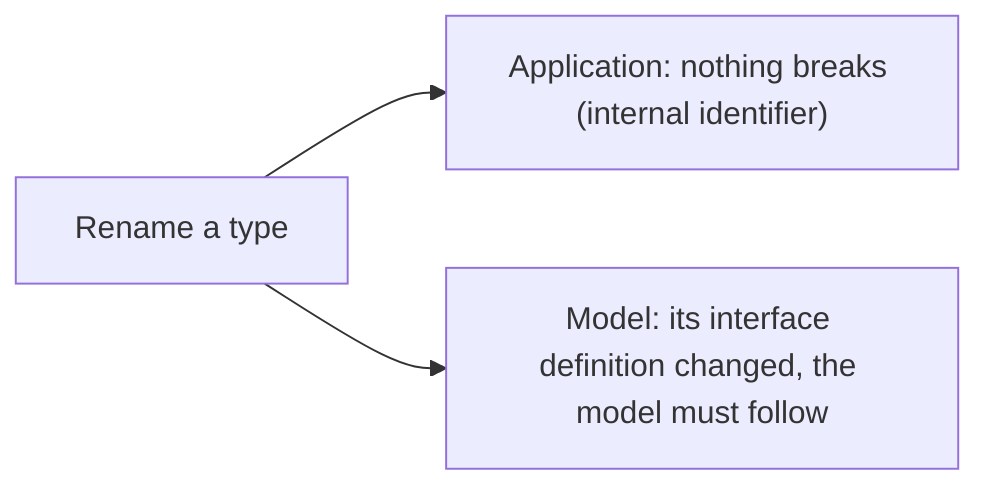

## How a rename is done: typed in place, checked in the versions

Changed by the Product Owner on 2026-11-16. It replaces the Edit and Save buttons of 2026-11-11.

- The name is typed in place in General, like every field of Metadata. No Edit or Save button, no warning, no confirmation dialog.
- What stops a mistake is the [Versions](13-versions.md) page: before a version is made, the rename is shown among the differences, and it can be undone. A rename breaks the model, so it makes the version a major one.
- The consequences for models (see above) are to be explained in a user manual. That manual is not part of the open source version.

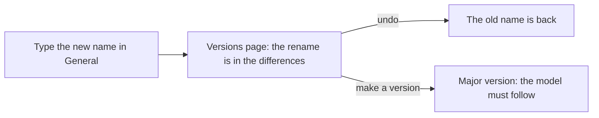

## Where it is used

| Thing | Created and changed in | Used in | In a symbol | In a synoptic |
| --- | --- | --- | --- | --- |
| Type (name, parent) | Metadata: the name in General, the parent at creation only; deleted in General, with a warning | Signal and command inheritance | Chosen among all the types, only here | No |

## Open questions

- The label of the name in General: "Name" or "ID"?
- The parent: fixed at creation (decision 0013), or chosen in a list of the whole tree, indented with dashes, as described during the review of the wireframes?
- The search: does the filtered tree keep the parents of a type that matches, so that its place is seen?
- Where the reset buttons of the icon and the colour go when their lists take several lines.
