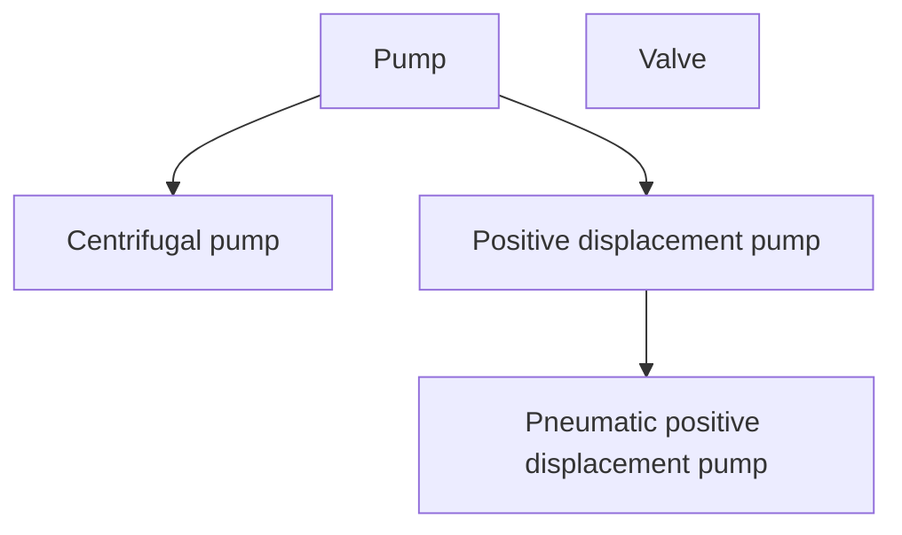
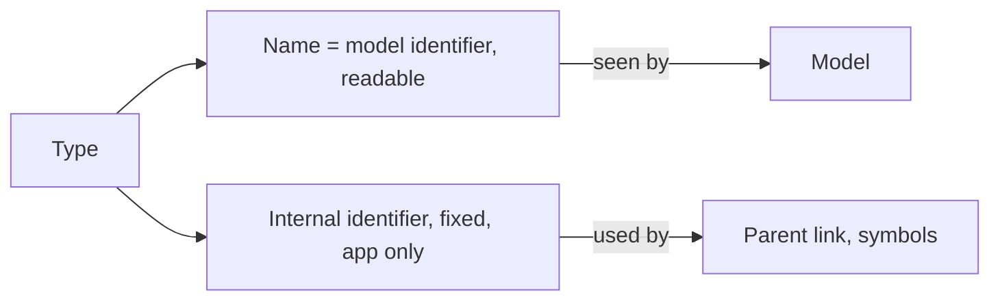
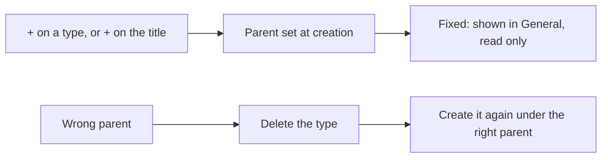
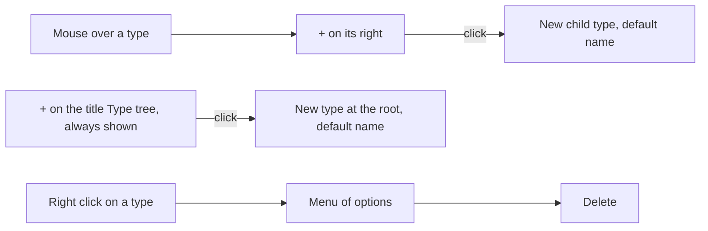
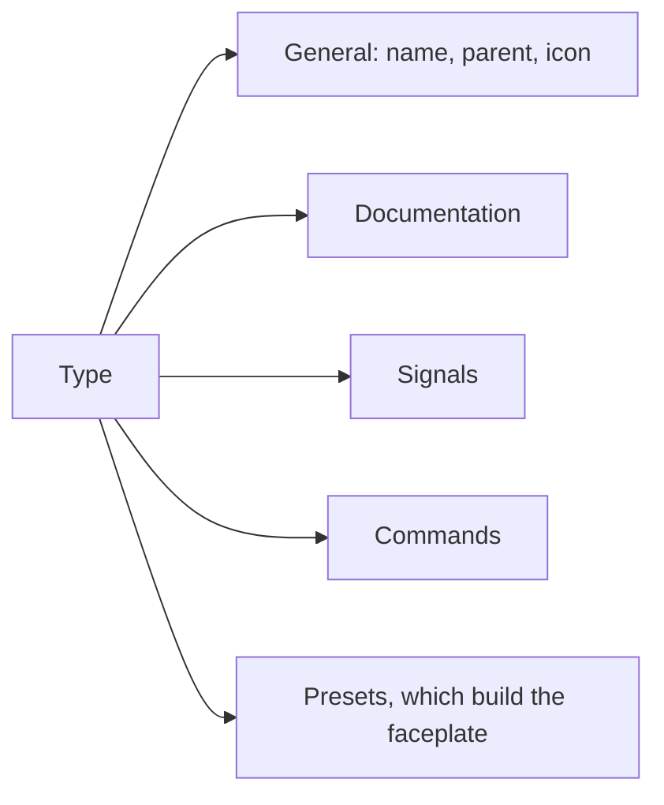
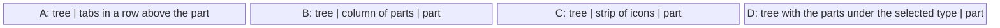
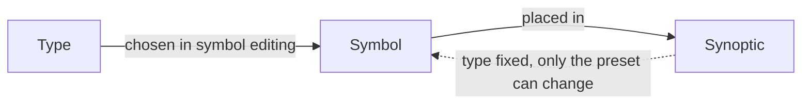
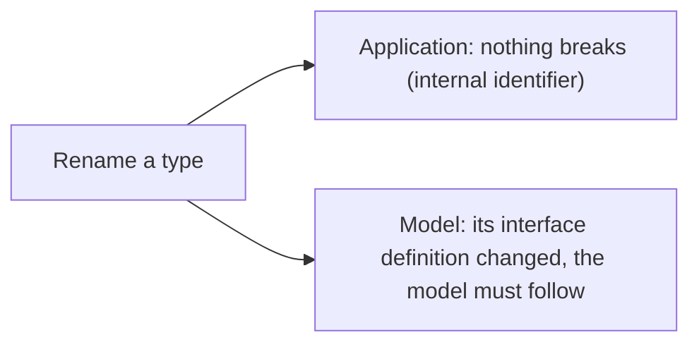
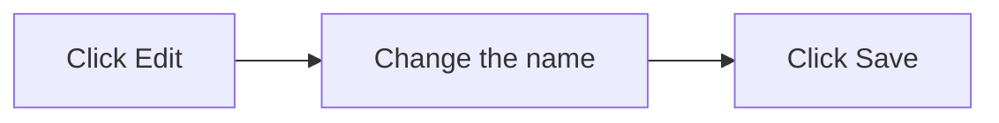

# Types

> [Home](../README.md) › [Metadata](README.md) › Types · Next: [Icons](02-icons.md)

Status: validated by the Product Owner on 2026-11-11; changed by him on 2026-11-16 (no libraries of types, type tree actions, fixed parent, icon buttons in General). Open points are listed in [Open questions](12-open-questions.md).

A type is the representation of a symbol at one level of detail. Types form a tree, hence parents and sub-types.

## Rules

- The General part holds the name, the parent, and an icon with its colour (see [Icons](02-icons.md)). The description and the links are in a separate documentation page (see [Documentation](03-documentation.md)).
- The name is the type's identifier for the model, like a signal's name. No second label. It must be readable and exact, because model authors use it to know what the type is (example: `centrifugal_pump`). Where a standard already names things, the type takes that name.
- A type also has an internal identifier, set by the software, that never changes. It exists on the application side only and never goes to the model. It is needed to define the parent and for symbols to point to the type, so renaming a type breaks nothing in the application.
- So there are two identifiers: the name (seen by the model, meaningful) and the internal one (seen by the application only, meaningless).

- No abstract types: "Pump", "Positive displacement pump" and "Pneumatic positive displacement pump" can all be chosen.
- A type inherits the signals of its parents.
- The type tree is on the **left** of the screen, as in a code editor (IDE), where every tree sits on the left (Product Owner, 2026-11-11). It sits just right of the navigation bar of Metadata (see [Screens](../screens/README.md#layout-rules)).
- There are no libraries of types: every type of the tree can be chosen everywhere (Product Owner, 2026-11-16).
- The name is changed in the General part only. Double-clicking an item in the tree does not rename it: hidden options are avoided.
- **The parent never changes** (Product Owner, 2026-11-16). It is set when the type is created, by the + of the type under which it is created (or the + of the title, for a root type). General shows it, read only: its name with its icon.
  - Why: moving a type to another parent changes the signals it inherits and breaks what uses it. No signal goes from one parent to another "aussi bêtement que ça". Metadata must stay strict ("ça doit être carré").
  - A type created under the wrong parent is deleted and created again under the right one; it is never moved.

- The parts of a type are shown in this order (Product Owner, 2026-11-11): General, Documentation, Signals, Commands, Presets. The Faceplate part is merged into the Presets since 2026-11-16 (see [Presets](09-presets.md)). How they are shown is open: tabs in a row break the rule of columns, so four proposals are drawn (see [The parts of a type: four proposals](#the-parts-of-a-type-four-proposals)).

### The type tree: search, create, delete (Product Owner, 2026-11-16)

- A **search field** sits under the title "Type tree".
- **Create:** each type of the tree has a **+** on its right, shown when the mouse is over the type. It creates a new type **under** it (a child). The new type starts with a default name, changed afterwards in General.
- A **+** on the title "Type tree" creates a type at the root. It is always shown, so that creating a type is never hidden. The Product Owner fears it looks bad ("ça va être dégueulasse … s'il le faut"): kept, its look is for the design.
- **Delete:** a right click on a type opens a menu of options; **Delete** is one of them.

- The General part holds only the name, the parent, the icon and the colour. Nothing more is needed (Product Owner, 2026-11-11, confirmed on 2026-11-16).
- In General, Edit, Save and the resets to the parent (icon, colour) are **icon buttons**, without a text label (Product Owner, 2026-11-16).
- No virtual links between types of the tree. Duplicates are accepted: a change in one type must not change another silently, so nothing has to be retested everywhere. It also lets each type be versioned alone later. The documentary research (2026-11-10) finds this rule defensible: neither FMI, OPC UA nor AutomationML requires or forbids it.

### Limits of "no virtual link" (decided on 2026-11-11, from the research)

The rule is true between types that have no parent link. Three mechanisms do propagate a change, on purpose, and are written as such:

- Changing the content of a parent (its signals, its commands) changes all its descendants. The parent link itself never changes (see above).
- A sub-type cannot declare again a signal name it already inherits. No redefinition: it is the simplest rule, and a name stays one thing along the tree.
- The values of an enum are part of the contract with the model: changing them is breaking, like a rename (see [Enums](06-enums.md)). Links to an enum or a quantity go through an internal identifier, like symbols do for types.

Versioned, published types (the answer of OPC UA's best-practices guide and of Siemens) are kept for later.

## What a type holds

| Part | File |
| --- | --- |
| General: icon and colour | [Icons](02-icons.md) |
| Documentation: description (Markdown), links | [Documentation](03-documentation.md) |
| Signals | [Signals](04-signals.md) |
| Commands | [Commands](07-commands.md) |
| Presets and their faceplate | [Presets](09-presets.md) |

## The parts of a type: four proposals

The Product Owner likes the tabs in a row, which are easy to use, but they break the rule "columns rather than rows" (see [Layout rules](../screens/README.md#layout-rules)). He asked for three or four ways to show the parts (2026-11-16; six then, five since the Faceplate part was merged into the Presets the same day). They are drawn in the Figma file, page "Spec", section "MD-01 · Parts of a type: four proposals". Nothing is chosen.

| Proposal | What it is | For | Against |
| --- | --- | --- | --- |
| A. Tabs in a row | The five parts as tabs above the editor (the current wireframes). | Known by everyone; all the width stays for the part. | A row, against the rule of columns. |
| B. A column of parts | A narrow column between the tree and the editor lists the five parts, one under the other, with their names. | Follows the rule of columns; the names stay readable. | One more column: less width for the part. |
| C. A strip of icons | The same column, reduced to five icons, the name in a tooltip. | Narrow: almost all the width stays for the part. | Icons to learn; the name is hidden until the mouse is over it. |
| D. Under the type, in the tree | When a type is selected, its five parts unfold under it in the tree, as the layers of a frame in Figma. | No extra column; the type and its part are read together. | The tree grows and moves; a part is mixed with the types. |

## Type and symbol

- A symbol is attached to one type.
- The type of a symbol can only be changed in symbol editing.
- In a synoptic, the type can never be changed. Only the preset can be.

## Renaming is breaking, on purpose

The names of types (and of signals) build the interface definition of the model. They are meant to be defined at the start and never to change.

- A name is a contract with the model. No mapping layer between an old name and a new one: it would make no sense here.
- Renaming a type is possible but breaking: the model must change its name too, because its interface definition changed.
- The more names change, the more the model has to change. So names must be thought through before they are set.
- The application does not break on a rename, because it uses the internal identifier.

## How a rename is done: deliberate, without a warning

- A name can never be changed just by typing in place. The user clicks an Edit button, changes the name, then clicks a Save button.
- Those few deliberate actions are what make the change important. No warning or confirmation dialog is added on top: it would only waste time, and people doing this know what they are doing.
- The consequences for models (see above) are to be explained in a user manual. That manual is not part of the open source version.

## Where it is used

| Thing | Created and changed in | Used in | In a symbol | In a synoptic |
| --- | --- | --- | --- | --- |
| Type (name, parent) | Metadata: the name in General, the parent at creation only | Signal and command inheritance | Chosen among all the types, only here | No |

## Open questions

- How are the five parts of a type shown: tabs, a column of parts, a strip of icons, or under the type in the tree? See [the four proposals](#the-parts-of-a-type-four-proposals).
- Deleting a type: is the user warned that symbols will lose their type (see [Libraries and symbols](../symbols/01-libraries-and-symbols.md))?
