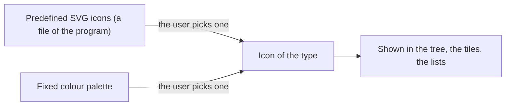
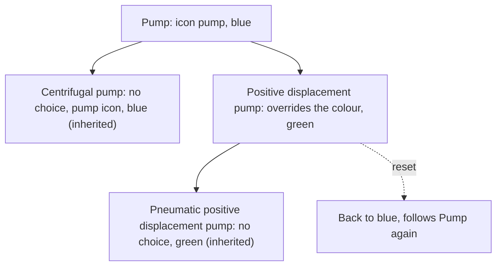

# Type icons

> [Home](../README.md) › [Metadata](README.md) › Icons · Previous: [Types](01-types.md) · Next: [Documentation](03-documentation.md)

Status: draft, rules stated by the Product Owner on 2026-11-10. Nothing here is validated.

An icon helps to recognise a type at a glance, in addition to its name. It is only for the application and says nothing to the model.

## Rules

- The icons come from a predefined list of SVG files that ships with the program. The user cannot import their own icon. To add one by hand, the file of the list is edited, and that is all.
- The list can already hold icons for common objects (for example, several pumps).
- The colour comes from a fixed palette of predefined colours. The user cannot pick any other colour.
- For a type, the user picks one icon in the list, then one colour in the palette.
- Icon and colour are chosen in the General part of the type (see [Types](01-types.md)).
- The icon is shown in the type tree, in the tiles of the library screen and wherever types are listed.
- A default icon and a default colour exist, so that a type with no choice and no parent choice still shows something. They are defined with the design system.

## Icon and colour are inherited

- If a parent type chooses an icon and/or a colour, all its children take the same.
- A child can override the icon and/or the colour with its own choice. Its own children then follow the child.
- A child that overrides can reset: a reset action, available when choosing the icon or the colour, makes it follow its parent again.
- A type with no choice anywhere up its branch uses the default icon and the default colour.

## Where it is used

| Thing | Created and changed in | Used in | In a symbol | In a synoptic |
| --- | --- | --- | --- | --- |
| Icon and colour of a type | Metadata, General | Tree, tiles, lists | No | No |

## Open questions

- To define with the design system: the contents of the palette, the list of icons at the start, and the default icon and colour are not decided here. They are defined when the design system is defined.
