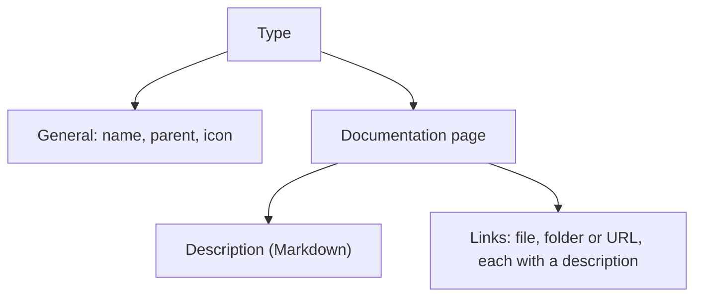
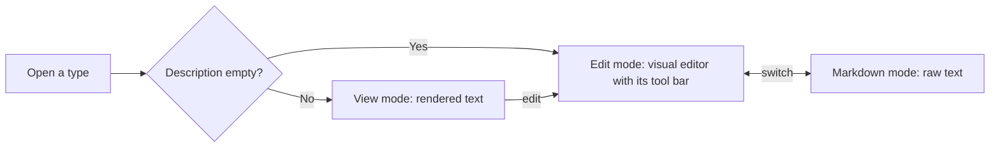
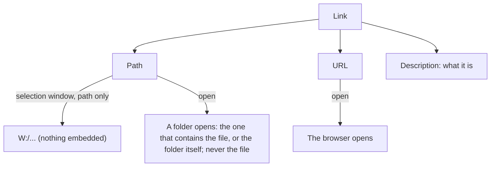

# Type documentation

> [Home](../README.md) › [Metadata](README.md) › Documentation · Previous: [Icons](02-icons.md) · Next: [Signals](04-signals.md)

Status: validated by the Product Owner on 2026-11-11. Open points are listed in [Open questions](12-open-questions.md).

A type has a documentation page, where people put what explains the type: a description and links to documents and sources.

## Rules

- Documentation is created and changed in Metadata only.
- The description and the links do not go to the model.

## What the page holds

| Part | Meaning |
| --- | --- |
| Description | A text in Markdown that says what the type is. Where else it is shown is open: it was shown in the tiles of the library screen, removed with the libraries of types (2026-11-16). |
| Links | Links to files, folders and URLs (standards, datasheets, project folders...), each with a short description. |

## The description

- It is stored in Markdown.
- Three modes (Product Owner, 2026-11-11):

| Mode | What the user sees | When |
| --- | --- | --- |
| View | The rendered text, to read. | By default when the type already has a description. |
| Edit | A visual editor (what you see is what you get), with a tool bar that helps with the formatting. | By default when the description is empty. |
| Markdown | The raw text, for those who write Markdown faster. | When the user switches to it from the edit mode. |

- The user goes from the view mode to the edit mode to change the text, and switches between the visual editor and the raw Markdown at any time.
- The description is written in the documentation page, not in General. It does not go to the model.

## The links

- A link is one of two kinds: a path to a file or a folder, or a URL.
- A path is chosen with a selection window: the user browses to the file or the folder, and the application keeps only its path (for example `W:/...`). The file is never loaded, copied or embedded.
- A URL is typed or pasted.
- Each link has a description: a short text in plain text (not Markdown) that says what is attached. It is a description, not a name.
- A link to a file or a folder can be opened directly, so the user does not lose time. Opening **always opens a folder, never a file** (Product Owner, 2026-11-11):
  - a link to a file opens the folder that contains the file;
  - a link to a folder opens that folder.
- The application never launches a file or a program: launching things blindly is not safe.
- A URL opens in the browser.
- Documents cannot be attached inside the application: that could be dangerous. Only links exist.
- The path is kept as it is chosen, with no translation. In a company, everyone is expected to have the same drive letters. Otherwise, the absolute path is used (for example the path of the server).
- The selection window and the opening of a folder are done by the server, since all access to files goes through the server (see [Storage](../storage/README.md)). In the free version, the application is a built program and the server runs on the user's computer, so it can open a folder window. In development, the front is opened in a browser, and the server still does it.
- The web hosting of the paid offer, where a folder cannot be opened on the user's computer, is out of these specs.

## Where it is used

| Thing | Created and changed in | Used in | In a symbol | In a synoptic |
| --- | --- | --- | --- | --- |
| Description, links | Metadata | Documentation page of the type | No | No |

## Open questions

- Is the description shown anywhere else than the documentation page (a tooltip in the type tree, in the type choice of a symbol)? It was shown in the tiles of the library screen, removed with the libraries of types (Product Owner, 2026-11-16).
