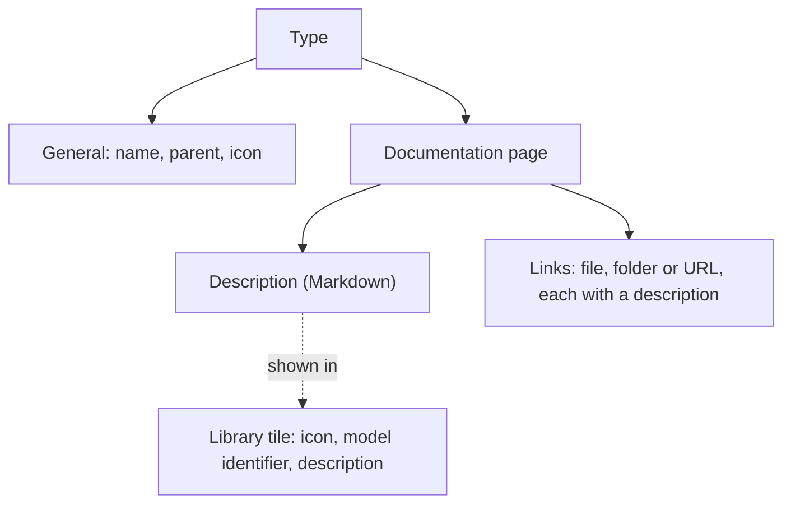
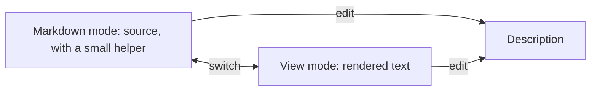
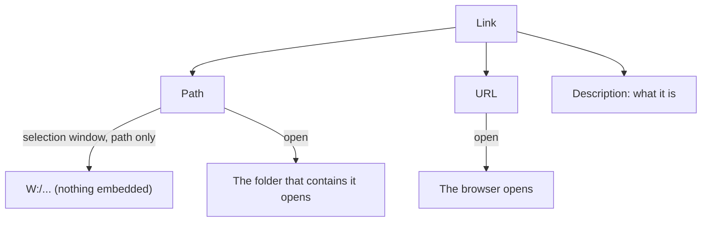

# Type documentation

> [Home](../README.md) › [Metadata](README.md) › Documentation · Previous: [Icons](02-icons.md) · Next: [Properties](04-properties.md)

Status: draft, rules stated by the Product Owner on 2026-11-10. Nothing here is validated.

A type has a documentation page, where people put what explains the type: a description and links to documents and sources.

## What the page holds

| Part | Meaning |
| --- | --- |
| Description | A text in Markdown that says what the type is. It is shown in the tiles of the library screen, next to the model identifier. |
| Links | Links to files, folders and URLs (standards, datasheets, project folders...), each with a short description. |

## The description

- It is written in Markdown.
- The editor works like Obsidian: Markdown is written directly, with a small helper to insert the syntax.
- Two modes: the Markdown source and a rendered view. The text can be edited in either mode, and the user switches from one to the other at any time.
- The description is written in the documentation page, not in General. It does not go to the model.

## The links

- A link is one of two kinds: a path to a file or a folder, or a URL.
- A path is chosen with a selection window: the user browses to the file or the folder, and the application keeps only its path (for example `W:/...`). The file is never loaded, copied or embedded.
- A URL is typed or pasted.
- Each link has a description: a short text in plain text (not Markdown) that says what is attached. It is a description, not a name.
- A link to a file or a folder can be opened directly: the application opens the folder that contains it, so the user does not lose time.
- A URL opens in the browser.
- Documents cannot be attached inside the application: that could be dangerous. Only links exist.
- The path is kept as it is chosen, with no translation. In a company, everyone is expected to have the same drive letters. Otherwise, the absolute path is used (for example the path of the server).
- The selection window and the opening of a folder are done by the server, since all access to files goes through the server (see [Storage](../storage/README.md)). In the free version, the application is a built program and the server runs on the user's computer, so it can open a folder window. In development, the front is opened in a browser, and the server still does it.
- The web hosting of the paid offer, where a folder cannot be opened on the user's computer, is out of these specs.

## Rules

- Documentation is created and changed in Metadata only.
- The description and the links do not go to the model.

## Where it is used

| Thing | Created and changed in | Used in | In a symbol | In a synoptic |
| --- | --- | --- | --- | --- |
| Description, links | Metadata | Documentation page of the type | No | No |
