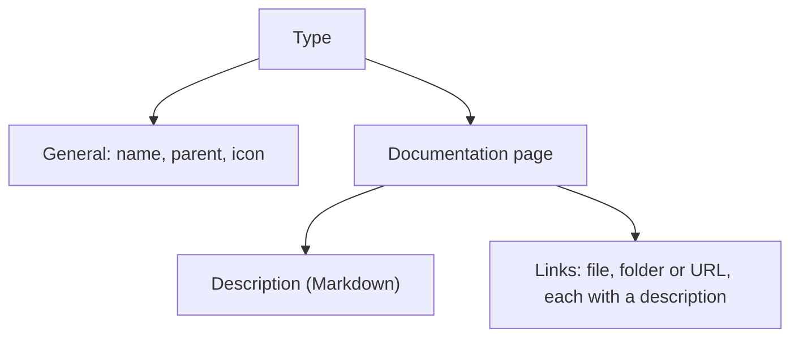
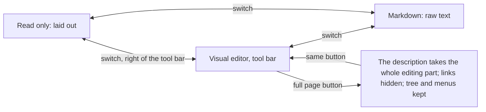
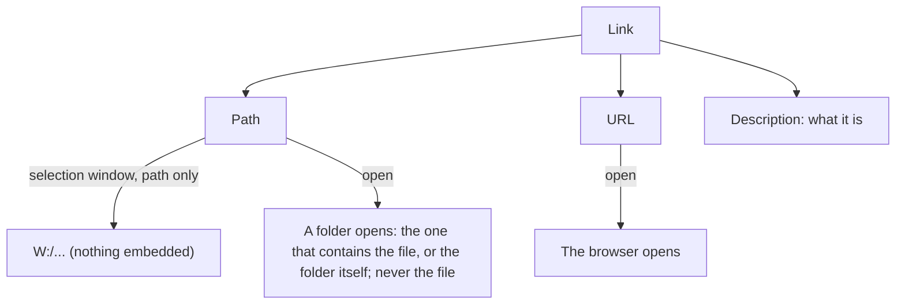

# Type documentation

> [Home](../README.md) › [Metadata](README.md) › Documentation · Previous: [Icons](02-icons.md) · Next: [Signals](04-signals.md)

Status: validated by the Product Owner on 2026-11-11; changed by him on 2026-11-16 (no Edit step, read-only mode kept, full page button with the type tree kept, add buttons above the links, the description shown on this page only); reviewing the wireframes later that day, he set the formatting tool bar in both modes, with the full page button in it, and a delete button with a warning on each link. Open points are listed in [Open questions](12-open-questions.md).

A type has a documentation page, where people put what explains the type: a description and links to documents and sources.

## Rules

- Documentation is created and changed in Metadata only.
- The description and the links do not go to the model.

## What the page holds

| Part | Meaning |
| --- | --- |
| Description | A text in Markdown that says what the type is. Shown on this page only (Product Owner, 2026-11-16). |
| Links | Links to files, folders and URLs (standards, datasheets, project folders...), each with a short description. |

## The description

- It is stored in Markdown.
- **No Edit or Save step** (Product Owner, 2026-11-16): what is typed is kept, as everywhere in Metadata, and checked on the [Versions](13-versions.md) page before a version is made.
- **The read-only mode stays** (Product Owner, 2026-11-16, correcting what he had said earlier that day: "en fait, si, faut le laisser"). Three modes, and the user switches between them at any time:

| Mode | What the user sees | When |
| --- | --- | --- |
| Read only | The description laid out, nothing can be typed. | Which mode opens first is open. |
| Visual | A visual editor (what you see is what you get), with a formatting tool bar. | When the user switches to it. |
| Markdown | The raw text, for those who write Markdown faster. | When the user switches to it. |

- Switching to Visual or Markdown is not an Edit button: there is nothing to save or to confirm when going back to read only.
- The application holds its own **Markdown editor** (Product Owner, 2026-11-16: "il faudra faire un éditeur Markdown"), with its two ways to type:
  - **Markdown**: the raw text shows its marks, for example the `#` of a heading;
  - **Visual**: the text is laid out, "comme un éditeur de texte Word".

### The formatting tool bar

Said by the Product Owner on 2026-11-16, while reviewing the wireframes.

- The **formatting tool bar** is there **in both modes**, Visual and Markdown ("disponible dans les deux, dans tous les cas"). In Markdown, a button writes the marks into the text; in Visual, it lays the text out.
- It works "un peu comme Word": the user picks what to apply, among **what Markdown can write**: the level of a heading, lists, tables, and the rest of Markdown ("tous les trucs Markdown").
- Proposed content, to confirm (the marks of CommonMark and of GitHub's Markdown): heading levels, bold, italic, strikethrough, bulleted list, numbered list, checklist, quote, inline code, code block, table, link, horizontal line.
- **No text colour**: Markdown has no mark for a colour (only raw HTML could), so the tool bar offers none. The Product Owner asked whether it could ("je sais pas si, en Markdown, on peut choisir la couleur de texte"); assistant's answer, to confirm.
- The **full page** button is part of the tool bar (Product Owner, 2026-11-16).
- The buttons Read only, Visual, Markdown sit on its right, on the same line (see above).
- The buttons that switch between the modes sit **on the right of the formatting tool bar**, on the same line (Product Owner, 2026-11-16).
- The tool bar also has a **full page** button (Product Owner, 2026-11-16):
  - the description takes the whole page of the documentation, and the links are no longer shown, so the user only types text, calmly;
  - it is not the full screen of the system: the window stays as it is, and the menus of the application stay;
  - **the type tree stays visible** (Product Owner, 2026-11-16): only the editing part takes the whole page, the rest of the screen does not move;
  - the same button brings the page back.
- The description is written in the documentation page, not in General. It does not go to the model.

## The links

- A link is one of two kinds: a path to a file or a folder, or a URL.
- A path is chosen with a selection window: the user browses to the file or the folder, and the application keeps only its path (for example `W:/...`). The file is never loaded, copied or embedded.
- A URL is typed or pasted.
- The buttons that add a path or a URL sit **above the list of links**, never under it (see the [layout rules](../screens/README.md#add-buttons-above-the-list)).
- Each link has a description: a short text in plain text (not Markdown) that says what is attached. It is a description, not a name.
- The list of links is **always editable**: its fields are changed in place, like everything in Metadata (validated by the Product Owner on 2026-11-16: "on ajoute un path ou une URL. Donc ça, c'est très bien").
- **Deleting a link:** a delete button (an icon) in the **last column of its line, on the far right**; a click opens a warning that asks to confirm (Product Owner, 2026-11-16: "Tu me rajoutes un bouton de suppression [...] il y a un message de warning quand on clique sur Supprimer"). No right click (see the [layout rules](../screens/README.md#delete-with-a-button-and-a-warning-in-metadata)).
- A link to a file or a folder can be opened directly, so the user does not lose time. Opening **always opens a folder, never a file** (Product Owner, 2026-11-11):
  - a link to a file opens the folder that contains the file;
  - a link to a folder opens that folder.
- The application never launches a file or a program: launching things blindly is not safe.
- A URL opens in the browser.
- Documents cannot be attached inside the application: that could be dangerous. Only links exist.
- The path is kept as it is chosen, with no translation. In a company, everyone is expected to have the same drive letters. Otherwise, the absolute path is used (for example the path of the server).
- The selection window and the opening of a folder are done by the server, since all access to files goes through the server (see [Storage](../storage/README.md)). In the free version, the application is a built program and the server runs on the user's computer, so it can open a folder window. In development, the front is opened in a browser, and the server still does it.
- The web hosting of the paid offer, where a folder cannot be opened on the user's computer, is out of these specs.

## Where it is used

| Thing | Created and changed in | Used in | In a symbol | In a synoptic |
| --- | --- | --- | --- | --- |
| Description, links | Metadata | Documentation page of the type | No | No |

## Open questions

- Which mode opens first: read only, or visual?
- The content of the formatting tool bar (proposed above) and no text colour: to confirm.
- How a link is edited in place, and whether links can be reordered.
