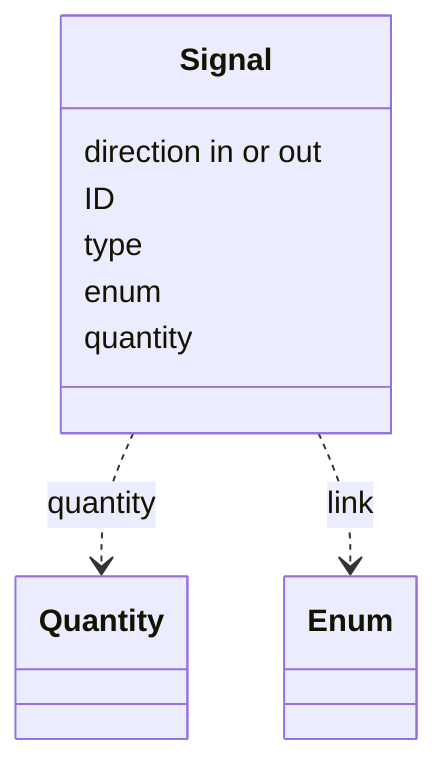
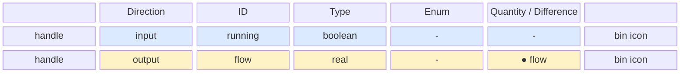
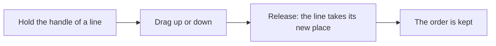

# Signals

> [Home](../README.md) › [Metadata](README.md) › Signals · Previous: [Documentation](03-documentation.md) · Next: [Units](05-units.md)

Status: validated by the Product Owner on 2026-11-11; changed by him on 2026-11-16 (signals shown in a table, always editable, direction first, line coloured by direction; no display name on the signal, it moved to the preset; a handle on each line to choose the order; the quantity says "quantity" or "difference"). Reviewing the wireframes later that day, he confirmed the ID and the removal of the display name, put the inherited signals first, read only, from the top of the tree down, marked a quantity and a difference by two icons, and replaced the delete by right click by a delete button with a warning. At the end of the day he removed the model unit from the signal (it is one per quantity, set outside Metadata), kept only the icons in the column Quantity, and left the columns of the handle and of the delete button without a header. On 2026-11-17 he removed the minimum and the maximum from the signal: a bound is a signal of its own. Later that day he made a bound a plain signal with no tie to the one it bounds (usually an input), named the column "Quantity / Difference", kept decimal places out of Metadata, and refused the bubble on an enum name. Open points are listed in [Open questions](12-open-questions.md).

A signal is what goes between the front and the model: an input or an output of the model. Only these are defined here. Values that stay inside the model are not defined in Metadata: the people who write the model name them as they wish, and they are invisible to the application.

## Rules

- Metadata is the contract with the model: what is negotiated with the model author is written here. Transforming data (for example mapping a value to a 0 to 1 range for an animation, proportionally or not) is not done here: it belongs to symbol editing.
- Only inputs and outputs exist: no separate constant parameters (the research notes that FMI has them; the project keeps none).
- No default value on a signal: default values live in presets only (see [Presets](09-presets.md)).
- Signals are inherited along the tree: "Pneumatic positive displacement pump" has the signals of Pump, of Positive displacement pump and of its own. A sub-type cannot declare again a signal name it already inherits (see [Types](01-types.md)).
- Signals are created and changed in Metadata only, never in a symbol or a synoptic.
- A signal's name is part of the model's interface definition: it is set once and is not meant to change. Renaming one is breaking for models, as for types (see [Types](01-types.md)).
- **The table of signals is always editable** (Product Owner, 2026-11-16): no Edit button, no Save button, no warning. It replaces the Edit and Save of 2026-11-11. A mistake is caught before it reaches anyone by the [Versions](13-versions.md) of Metadata: the changes are seen there as a list of differences before a version is made, and can be undone.
- A signal also has an internal identifier, set by the software, that never changes, like a type's (see [Types](01-types.md)). It exists on the application side only and never goes to the model. Symbols link to a signal through it, so renaming a signal does not break them (see [Libraries and symbols](../symbols/01-libraries-and-symbols.md)).
- A signal has an **ID**: its name for the model, the identifier above, set once (Product Owner, 2026-11-16).
- **A signal has no display name** (Product Owner, 2026-11-16, later the same day): since the faceplate is built by the preset, the name people see is written in the preset, one per signal, in its faceplate builder (see [Presets](09-presets.md#mode-faceplate-the-faceplate-builder)). It replaces the display name on the signal decided earlier that day. Confirmed while reviewing the wireframes: "Dans Signal, le display name ne sert à rien. Je te le dis très clairement."
- A signal has no description (Product Owner, 2026-11-16).
- **The line of a signal is coloured by its direction** (Product Owner, 2026-11-16): an input line and an output line have two different colours, so that the two are told apart at a glance. The colours are chosen with the design system.
- **A signal has no model unit** (Product Owner, 2026-11-16, end of the day: "« model unit », ça, on enlève. C'est pas ici qu'il faut mettre ça"). For one quantity, and for one difference, the model always uses **the same unit, everywhere**, so that there are no odd conversions. That unit is set once, outside Metadata (see [Units](05-units.md#model-unit-and-display-unit)). It replaces the model unit chosen per signal (decision 0024, accepted on 2026-11-16).
- **A signal has no minimum and no maximum** (Product Owner, 2026-11-17: "le min et le max, ça doit être un signal à part entière et pas une propriété de ce signal-là [...] comme ça, ça simplifie"). A bound is **a signal of its own**, declared in the table like any other, with its direction, ID, type and quantity. It replaces the bounds kept on the signal on 2026-11-16 (decision 0026, accepted on 2026-11-17).
- **A bound is a plain signal** (Product Owner, 2026-11-17: "c'est un signal ordinaire"): it has **no tie** to the signal it bounds. `speed_setpoint_max` is a signal like any other; its name is only a convention of the people who write it, and the application reads nothing in it.
- **Its direction is chosen like any signal's**, input or output. In practice a bound is **an input**: it is given to the model, to tell it the range its data will be bounded with (Product Owner, 2026-11-17: "on dit littéralement au modèle ce qu'il va avoir [...] dans la logique, c'est donné au modèle").
- Where a bound is used:
  - in a symbol, the bounded linear animation can take its minimum or its maximum from any signal of the type, input or output (see [Animation mode](../symbols/08-animation-mode/README.md#shapes-of-mapping));
  - the faceplate no longer checks a typed value against bounds, until the Product Owner reviews the faceplates (see [Presets](09-presets.md#typing-a-value)).
- **No decimal places on the signal** (Product Owner, 2026-11-17: "le modèle, il doit pouvoir tout bouffer"): the model gives and receives the whole value. If a number of decimals must be set, it is set once for the whole project, in a place for project settings, outside Metadata, so that every value of the project has the same decimals (Product Owner: "c'est pas dans les métadatas [...] avoir le même nombre de décimales partout"). That place is not described yet. What this means for the decimals of the presets and of the catalogue of units is asked (see [Open questions](12-open-questions.md)).

## Fields

| Field | Meaning | Rule |
| --- | --- | --- |
| Direction | Input or output of the model. | Belongs to the signal. Seen from the model: an input is what the model receives, an output is what it sends. First column of the table. |
| ID | The signal's name for the model. | Its variable identifier, set once. Shown as "ID" in the table. |
| Type | What kind of value. | Integer, real, boolean, text or enum. A real is a 64-bit double. |
| Enum | For an enum: the list of values. | An enum picked from the Enums page (see [Enums](06-enums.md)). A link to it, never a copy, and never defined in the signal. |
| Quantity | What the value measures (volume, flow, pressure...), and whether the value is the quantity itself or a difference of it. | Optional: a signal may have none. Only for integers and reals. Picked from the ready-made catalogue of the Units page, which the user never changes; the user picks the quantity or its difference, told apart by an icon (Product Owner, 2026-11-16), see [Units](05-units.md#value-or-difference-chosen-in-the-signal). |

There is no field Minimum or Maximum (Product Owner, 2026-11-17): a bound is a plain signal of its own. There is no field Decimals either (Product Owner, 2026-11-17).

## Example

The signals of `centrifugal_pump`, a child of `pump`, itself a child of `equipment`. The example shows every kind of line: both directions, every type, a quantity offered once, a quantity and a difference, inherited lines first (Product Owner, 2026-11-16: "complète le tableau [...] pour qu'on comprenne mieux avec un peu toutes les options").

In the column Quantity, ● stands for the icon of a quantity and Δ for the icon of a difference: both are placeholders, the icons are chosen with the design system.

| From | Direction | ID | Type | Enum | Quantity |
| --- | --- | --- | --- | --- | --- |
| `equipment`, read only | output | `fault_message` | text |  |  |
| `pump`, read only | input | `running` | boolean |  |  |
| `pump`, read only | output | `flow` | real |  | ● flow |
| own | input | `mode` | enum | `operating_mode` (0 Off, 1 Manual, 2 Automatic) |  |
| own | input | `speed_setpoint` | integer |  | ● rotational speed |
| own | input | `speed_setpoint_max` | integer |  | ● rotational speed |
| own | output | `inlet_pressure` | real |  | ● pressure |
| own | output | `pressure_rise` | real |  | Δ pressure |
| own | output | `bearing_temperature` | real |  | ● temperature |

`speed_setpoint_max` is a bound: a plain input signal, given to the model, with no tie to `speed_setpoint` (Product Owner, 2026-11-17). A minimum would be one more line, the same way.

Flow and rotational speed have no difference in the list: their value and their difference convert the same way.

## The table of signals

The signals of a type are shown in **one table**, one line per signal, one column per field (Product Owner, 2026-11-16). It replaces the list on the left with the panel of the selected signal on the right. The table takes as much room as it can, so that every column fits.

| Column | Values |
| --- | --- |
| Handle | A small grip at the very left of the line, with no value and **no header**: it is held and dragged to move the line (see [The order of the lines](#the-order-of-the-lines)). |
| Direction | Input or output. **First column** of values, before the ID, so that the line reads in order (Product Owner, 2026-11-16). |
| ID | The model identifier (Product Owner, 2026-11-16: "l'ID, qui est le modèle identifiant"). |
| Type | Integer, real, boolean, text, enum. |
| Enum | For an enum signal only: the enum it points to. |
| Quantity / Difference | Header **"Quantity / Difference"** (Product Owner, 2026-11-17: "quantity, c'est le rond, et différence, c'est le petit triangle. Du coup, c'est quantity/différence"). Optional, integers and reals only. One column holds the choice of the quantity or of its difference: its list offers the pressure and the pressure difference (Product Owner, 2026-11-16). Only the quantities whose conversion changes (temperature, gauge pressure...) have the two items; the others are offered once (see [Units](05-units.md#value-or-difference-chosen-in-the-signal)). **An icon before the name** says which it is: one icon for a quantity, another for a difference, so that the two are told apart at a glance (Product Owner, 2026-11-16: "on met un symbole, une icône. Comme ça, c'est beaucoup plus simple à reconnaître"). **The icon alone**: no "(quantity)" or "(difference)" after the name (Product Owner, 2026-11-16: "pas besoin de mettre (quantité) ou (différence) [...] quand on connaît les icônes"). The icons are chosen with the design system. |
| Delete | A delete button (an icon), in the last column, on the far right, with **no header**; a click opens a warning before anything is deleted (Product Owner, 2026-11-16). Not on the inherited lines. |

- **No column Model unit** (Product Owner, 2026-11-16, end of the day): the model unit is one per quantity, set outside Metadata (see [Units](05-units.md#model-unit-and-display-unit)).
- **No column Min or Max** (Product Owner, 2026-11-17): a bound is a plain signal of its own, on a line of its own.
- **No column Decimals** (Product Owner, 2026-11-17): decimals are not set in Metadata.
- The columns of the handle and of the delete button have no header and take the least room possible (see the [layout rules](../screens/README.md#columns-of-buttons-have-no-header)).

- Every line is always editable: a field is changed in place, with no Edit or Save step (Product Owner, 2026-11-16: "il faut que tout soit éditable tout le temps, rapidement"). The changes are checked on the [Versions](13-versions.md) page before a version is made.
- An input line and an output line have two different colours.
- The fields that do not apply to a line stay empty (no enum for a real, no quantity for a boolean).
- The line of an enum signal shows the name of the enum it points to (Product Owner, 2026-11-11). **No bubble** lists its items when the mouse rests on that name (Product Owner, 2026-11-17: "je vois pas où tu pourrais mettre l'info-bulle pour l'instant. Fais pas ça"). The enums themselves are made on their own page (see [Enums](06-enums.md)), never in the table of signals.
- The table shows the signals of the type and the signals it inherits from its parents. Inherited lines cannot be edited here: they are edited in the type that declares them.
- **The inherited lines come first, read only** (Product Owner, 2026-11-16), in this order:
  1. the signals of the first parent, at the top of the tree;
  2. then those of the next parent, down the branch;
  3. last, the signals of the type itself.
  Example for `pneumatic_positive_displacement_pump`: the signals of `pump`, then of `positive_displacement_pump`, then its own. The column "From" of the example above is only there to explain the order; whether the table shows which parent a line comes from is left to the design.
- The button that adds a signal is a small **+ icon on the right of the title "Signals"**, above the table (see the [layout rules](../screens/README.md#a-title-and-a-small--on-its-right)).
- **Deleting a signal** is done with the delete button in the last column of its line, then a warning that asks to confirm (Product Owner, 2026-11-16: "une icône de suppression et pas le clic droit"). There is no right click in Metadata (see the [layout rules](../screens/README.md#delete-with-a-button-and-a-warning-in-metadata)). The handle at the left of a line is not a button: it only moves the line.

The block below shows the order of the columns; the two lines have the colours of an input and of an output.

## The order of the lines

The user chooses the order of the signals, so that the table looks tidy (Product Owner, 2026-11-16: "un truc tout à gauche, genre une poignée, qui permet de déplacer l'ordre des signaux pour que ça fasse plus propre").

- Each line has a **handle** at its very left. The user holds it and drags the line up or down; the line drops where the mouse is released.
- The order is kept: the table opens again in the order the user left.
- Only the type's own lines have a handle: the inherited lines stay at the top, in the order chosen in the type that declares them (Product Owner, 2026-11-16, see [The table of signals](#the-table-of-signals)).
- A new signal goes at the end of the table. Assistant's choice, to confirm.
- The order is for the people who read the table: it does not go to the model and changes nothing in the contract with it. Assistant's reading, to confirm. On the [Versions](13-versions.md) page, a change of order is a patch.
- The look of the handle (for example six dots in two columns) is chosen with the design system.
- The table of values of every preset of the type shows the signals in this order, with no sort of its own (see [Presets](09-presets.md#mode-values-one-table-of-the-signals)). The faceplate follows the order of its builder.

## Where it is used

| Thing | Created and changed in | Used in | In a symbol | In a synoptic |
| --- | --- | --- | --- | --- |
| Signal (direction, ID, type, enum, quantity) | Metadata | Lines of a preset and its faceplate (read, or write to type a value), commands that set it | No | No |

## Open questions

- Does the faceplate check a typed value against bound signals? The Product Owner will settle it when he reviews the faceplates, where a big change may come (2026-11-17: "on verra après, quand on repassera sur les faceplates"). Until then, no check against bounds is written (see [Presets](09-presets.md#typing-a-value)).
