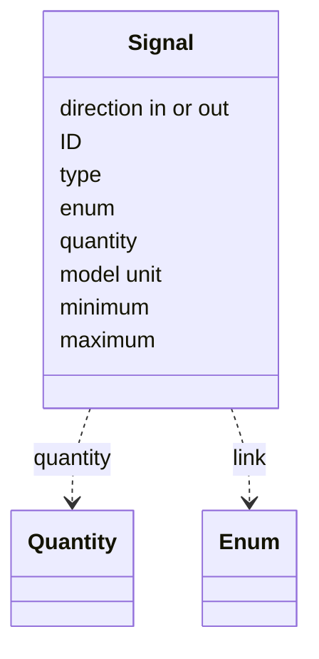
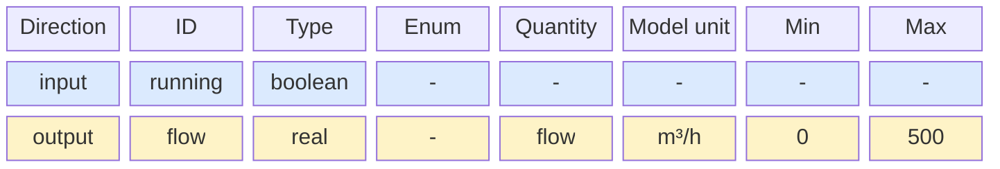
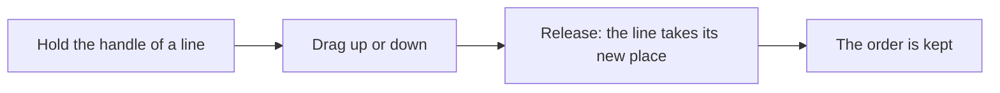

# Signals

> [Home](../README.md) › [Metadata](README.md) › Signals · Previous: [Documentation](03-documentation.md) · Next: [Units](05-units.md)

Status: validated by the Product Owner on 2026-11-11; changed by him on 2026-11-16 (signals shown in a table, always editable, direction first, line coloured by direction; no display name on the signal, it moved to the preset; a handle on each line to choose the order). Open points are listed in [Open questions](12-open-questions.md).

A signal is what goes between the front and the model: an input or an output of the model. Only these are defined here. Values that stay inside the model are not defined in Metadata: the people who write the model name them as they wish, and they are invisible to the application.

## Rules

- Metadata is the contract with the model: what is negotiated with the model author is written here. Transforming data (for example mapping a value to a 0 to 1 range for an animation, proportionally or not) is not done here: it belongs to symbol editing.
- Only inputs and outputs exist: no separate constant parameters (the research notes that FMI has them; the project keeps none).
- No default value on a signal: default values live in presets only (see [Presets](09-presets.md)).
- Signals are inherited along the tree: "Pneumatic positive displacement pump" has the signals of Pump, of Positive displacement pump and of its own. A sub-type cannot declare again a signal name it already inherits (see [Types](01-types.md)).
- Signals are created and changed in Metadata only, never in a symbol or a synoptic.
- A signal's name is part of the model's interface definition: it is set once and is not meant to change. Renaming one is breaking for models, as for types (see [Types](01-types.md)).
- **The table of signals is always editable** (Product Owner, 2026-11-16): no Edit button, no Save button, no warning. It replaces the Edit and Save of 2026-11-11. A mistake is caught before it reaches anyone by the [Versions](13-versions.md) of Metadata: the changes are seen there as a list of differences before a version is made, and can be undone.
- A signal also has an internal identifier, set by the software, that never changes, like a type's (see [Types](01-types.md)). It exists on the application side only and never goes to the model. Symbols link to a signal through it, so renaming a signal does not break them (see [Libraries and symbols](../symbols/01-libraries-and-symbols.md)).
- A signal has an **ID**: its name for the model, the identifier above, set once (Product Owner, 2026-11-16).
- **A signal has no display name** (Product Owner, 2026-11-16, later the same day): since the faceplate is built by the preset, the name people see is written in the preset, one per signal (see [Presets](09-presets.md#the-table-of-a-preset)). It replaces the display name on the signal decided earlier that day.
- A signal has no description (Product Owner, 2026-11-16).
- **The line of a signal is coloured by its direction** (Product Owner, 2026-11-16): an input line and an output line have two different colours, so that the two are told apart at a glance. The colours are chosen with the design system.

## Fields

| Field | Meaning | Rule |
| --- | --- | --- |
| Direction | Input or output of the model. | Belongs to the signal. Seen from the model: an input is what the model receives, an output is what it sends. First column of the table. |
| ID | The signal's name for the model. | Its variable identifier, set once. Shown as "ID" in the table. |
| Type | What kind of value. | Integer, real, boolean, text or enum. A real is a 64-bit double. |
| Enum | For an enum: the list of values. | An enum picked from the Enums page (see [Enums](06-enums.md)). A link to it, never a copy, and never defined in the signal. |
| Quantity | What the value measures (volume, flow, pressure, a temperature difference...). | Optional: a signal may have none. Only for integers and reals. Picked from the Units page, where a difference sits next to its quantity (see [Units](05-units.md)). |
| Model unit | The unit in which the model handles the value. | Only when a quantity is chosen. By default the model unit of the quantity; can be overridden here with another unit of the same quantity. |
| Minimum, maximum | Bounds of an integer or a real. | Metadata of the signal, indicative, written in the model unit. They are the zone the model is designed for, not a guarantee. The faceplate refuses a typed value outside them (see [Presets](09-presets.md#typing-a-value)). |

## Example

| Direction | ID | Type | Enum | Quantity | Min | Max |
| --- | --- | --- | --- | --- | --- | --- |
| input | `running` | boolean |  |  |  |  |
| output | `flow` | real |  | flow | 0 | 500 |
| input | `mode` | enum | `operating_mode` (0 Off, 1 Manual, 2 Automatic) | none |  |  |

## The table of signals

The signals of a type are shown in **one table**, one line per signal, one column per field (Product Owner, 2026-11-16). It replaces the list on the left with the panel of the selected signal on the right. The table takes as much room as it can, so that every column fits.

| Column | Values |
| --- | --- |
| Handle | A small grip at the very left of the line, with no value: it is held and dragged to move the line (see [The order of the lines](#the-order-of-the-lines)). |
| Direction | Input or output. **First column** of values, before the ID, so that the line reads in order (Product Owner, 2026-11-16). |
| ID | The model identifier (Product Owner, 2026-11-16: "l'ID, qui est le modèle identifiant"). |
| Type | Integer, real, boolean, text, enum. |
| Enum | For an enum signal only: the enum it points to. |
| Quantity | Optional, integers and reals only. |
| Model unit | Only with a quantity. |
| Minimum, maximum | Integers and reals only, in the model unit. |

- Every line is always editable: a field is changed in place, with no Edit or Save step (Product Owner, 2026-11-16: "il faut que tout soit éditable tout le temps, rapidement"). The changes are checked on the [Versions](13-versions.md) page before a version is made.
- An input line and an output line have two different colours.
- The fields that do not apply to a line stay empty (no enum for a real, no quantity for a boolean).
- The line of an enum signal shows the name of the enum it points to (Product Owner, 2026-11-11). Open: when the mouse rests on that name (for example `operating_mode`), does a small bubble list its items (0 Off, 1 Manual, 2 Automatic), so that the Enums page need not be opened? The enums themselves are made on their own page (see [Enums](06-enums.md)), never in the table of signals.
- The table shows the signals of the type and the signals it inherits from its parents. Inherited lines cannot be edited here: they are edited in the type that declares them.
- The button that adds a signal sits **above the table** (see the [layout rules](../screens/README.md#add-buttons-above-the-list)).
- No button on each line. Deleting a signal is done by a right click on its line, then Delete: a delete that is always shown invites a click (Product Owner, 2026-11-16, for all of Metadata: see the [layout rules](../screens/README.md#delete-by-right-click-in-metadata)). The handle at the left of a line is not a button: it only moves the line.

The block below shows the order of the columns; the two lines have the colours of an input and of an output.

## The order of the lines

The user chooses the order of the signals, so that the table looks tidy (Product Owner, 2026-11-16: "un truc tout à gauche, genre une poignée, qui permet de déplacer l'ordre des signaux pour que ça fasse plus propre").

- Each line has a **handle** at its very left. The user holds it and drags the line up or down; the line drops where the mouse is released.
- The order is kept: the table opens again in the order the user left.
- A new signal goes at the end of the table. Assistant's choice, to confirm.
- The order is for the people who read the table: it does not go to the model and changes nothing in the contract with it. Assistant's reading, to confirm. On the [Versions](13-versions.md) page, a change of order is a patch.
- The look of the handle (for example six dots in two columns) is chosen with the design system.
- Every preset of the type, and so its faceplate, shows the signals in this order: a preset has no sort of its own (Product Owner, 2026-11-16; see [Presets](09-presets.md#the-order-of-the-lines)).
- Open: how the inherited lines are placed among the type's own lines (see [Open questions](#open-questions)).

## Where it is used

| Thing | Created and changed in | Used in | In a symbol | In a synoptic |
| --- | --- | --- | --- | --- |
| Signal (direction, ID, type, enum, quantity, model unit, bounds) | Metadata | Lines of a preset and its faceplate (read, or write to type a value), commands that set it | No | No |

## Open questions

- Decimal places on the signal itself, so that the model fixes how many decimals an input or an output has? The Product Owner doubts it (2026-11-16, confirmed the same day): the model should give and receive the real value, and decimals are for display only. Not added; to think about.
- Mouse resting on the enum name of a line: a bubble with its items, or nothing?
- Order and inheritance: do the inherited signals stay together at the top, in their parent's order, with only the type's own signals moved by their handle? Or can every line be moved, inherited or not, each type keeping its own order?
