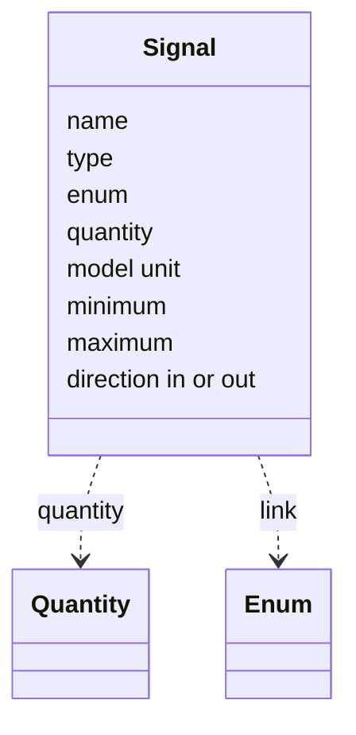

# Signals

> [Home](../README.md) › [Metadata](README.md) › Signals · Previous: [Documentation](03-documentation.md) · Next: [Units](05-units.md)

Status: validated by the Product Owner on 2026-11-11. Open points are listed in [Open questions](12-open-questions.md).

A signal is what goes between the front and the model: an input or an output of the model. Only these are defined here. Values that stay inside the model are not defined in Metadata: the people who write the model name them as they wish, and they are invisible to the application.

## Rules

- Metadata is the contract with the model: what is negotiated with the model author is written here. Transforming data (for example mapping a value to a 0 to 1 range for an animation, proportionally or not) is not done here: it belongs to symbol editing.
- Only inputs and outputs exist: no separate constant parameters (the research notes that FMI has them; the project keeps none).
- No default value on a signal: default values live in presets only (see [Presets](09-presets.md)).
- Signals are inherited along the tree: "Pneumatic positive displacement pump" has the signals of Pump, of Positive displacement pump and of its own. A sub-type cannot declare again a signal name it already inherits (see [Types](01-types.md)).
- Signals are created and changed in Metadata only, never in a symbol or a synoptic.
- A signal's name is part of the model's interface definition: it is set once and is not meant to change. Renaming one is breaking for models, as for types (see [Types](01-types.md)). It is done the same way: Edit button, change, Save button, with no warning.
- A signal has no display label of its own. The name and the description shown to the user are set in the preset (see [Presets](09-presets.md)); until then the faceplate shows the signal's name.

## Fields

| Field | Meaning | Rule |
| --- | --- | --- |
| Name | The signal's name. | It is also its variable identifier. No second label on the signal. |
| Type | What kind of value. | Integer, real, boolean, text or enum. A real is a 64-bit double. |
| Enum | For an enum: the list of values. | An enum picked from the Enums page (see [Enums](06-enums.md)). A link to it, never a copy, and never defined in the signal. |
| Quantity | What the value measures (volume, flow, pressure...). | Picked from the Units page (see [Units](05-units.md)). Only for integers and reals. |
| Model unit | The unit in which the model handles the value. | By default the model unit of the quantity. Can be overridden here with another unit of the same quantity. |
| Minimum, maximum | Bounds of an integer or a real. | Metadata of the signal, indicative, written in the model unit. They are the zone the model is designed for, not a guarantee. The faceplate refuses a typed value outside them (see [Faceplates](08-faceplates.md)). |
| Direction | Input or output of the model. | Belongs to the signal. Seen from the model: an input is what the model receives, an output is what it sends. |

## Example

| Name | Type | Enum | Quantity | Min | Max | Direction |
| --- | --- | --- | --- | --- | --- | --- |
| `running` | boolean |  |  |  |  | input |
| `flow` | real |  | flow | 0 | 500 | output |
| `mode` | enum | `operating_mode` (auto, manual, off) | none |  |  | input |

In the list of signals, an enum signal shows its type and, next to it, the enum it points to with its values, so the user sees at a glance which enum was chosen.

## Where it is used

| Thing | Created and changed in | Used in | In a symbol | In a synoptic |
| --- | --- | --- | --- | --- |
| Signal (name, type, enum, quantity, model unit, bounds, direction) | Metadata | Faceplate entries, commands that set it, preset default values, names and descriptions | No | No |
