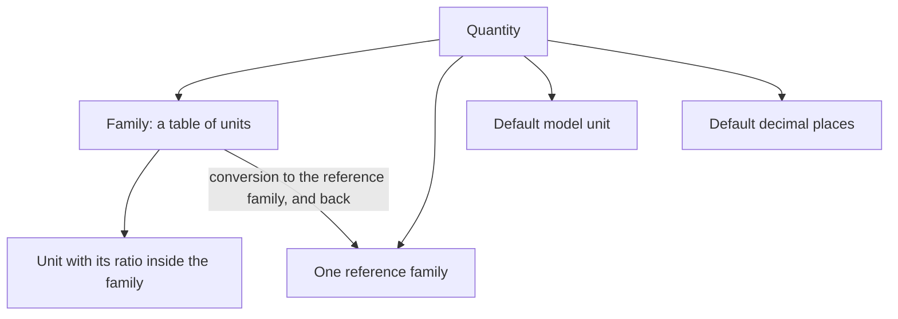
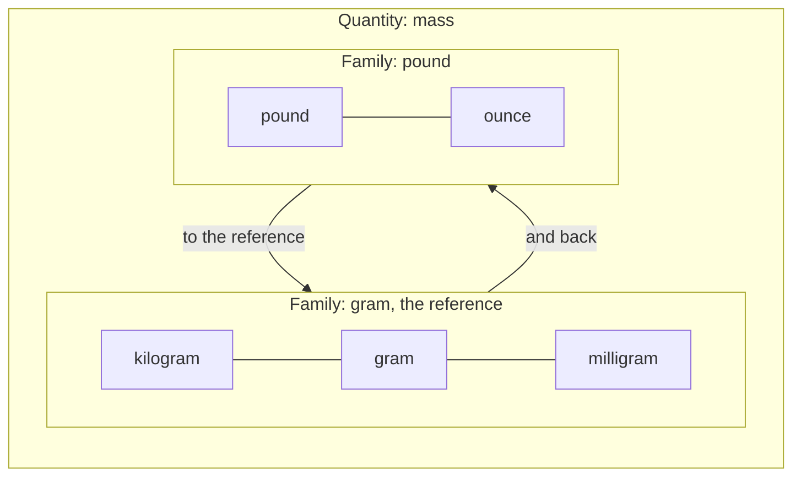
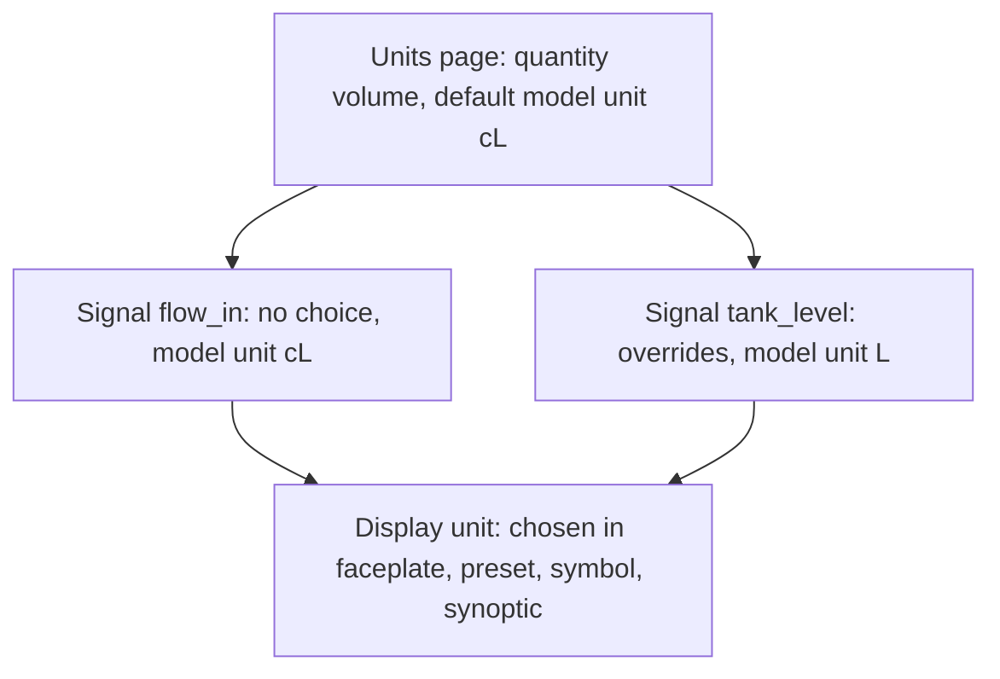
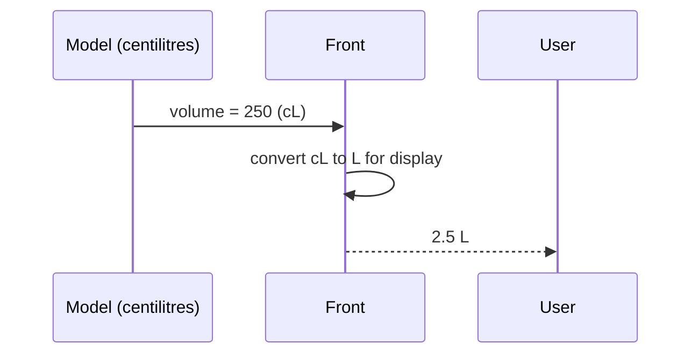
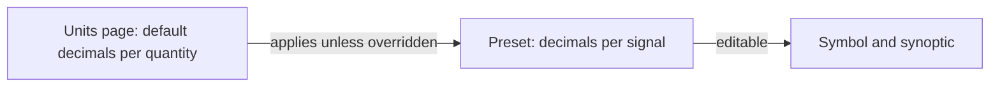

# Units

> [Home](../README.md) › [Metadata](README.md) › Units · Previous: [Signals](04-signals.md) · Next: [Enums](06-enums.md)

Status: validated by the Product Owner on 2026-11-11. Open points are listed in [Open questions](12-open-questions.md).

A Units page lists quantities (mass, volume, flow, pressure...), created by the user. A quantity is what a value measures; a unit is one way to count it: the kilogram is a unit of the quantity mass.

## Rules

- A quantity holds one or more unit families.
- A family is a table of units, like the school ladder: kilogram, hectogram, decagram, gram, decigram, centigram, milligram. Each unit has its ratio to the others in the family.
- A quantity can hold several families. Example: quantity "mass" has the family "gram" (the metric ladder) and the family "pound" (pound, ounce...).
- Each quantity has a reference family. Every other family is converted to it and from it, never pairwise. Formulas are not limited to a factor, so cases like temperature are covered.

## Model unit and display unit

- The Units page gives each quantity a default model unit. Example: quantity "volume", default model unit centilitre.
- A signal takes a quantity, not a unit: a signal is "volume", not "m³/h". By default it uses the model unit of its quantity.
- A signal can override it: in its definition, the user picks another unit of the same quantity as the model unit of that signal. The model then handles this signal in that unit.
- So the model unit is not one for all models: the quantity gives the default, the signal can change it.
- A display unit is any unit of the same quantity, in any family. It is chosen in a faceplate, then in a preset, and can be edited in a symbol or a synoptic.
- The value is converted for display only. The model value stays the same.

## Conversions only inside a quantity

A conversion only exists between two units of the same quantity: kilograms to pounds, never kilograms to volts.

The documentary research (2026-11-10) answers which function is needed: no single one. Four closed forms cover the useful cases, and a pair of free expressions covers the rest.

| Form | Going | Back | Example |
| --- | --- | --- | --- |
| Proportional | y = a·x | x = y / a | kilogram and pound |
| Affine | y = a·x + b | x = (y − b) / a | Celsius, Fahrenheit |
| Inverse | y = a / x | x = a / y | L/100 km and miles per gallon |
| Logarithmic | y = k·log(x / x₀) | x = x₀·base^(y / k) | decibel, pH |
| Other, one value | y = f(x) | x = f⁻¹(y) | slope in % = 100·tan(angle) |

All of it stays in pure JavaScript.

### Decided on 2026-11-11

- Each quantity has a reference family. Families convert to it and from it, not pairwise: 4 families need 6 formulas instead of 12, and two formulas cannot contradict each other.
- A conversion is one of the closed forms. A pair of free expressions, going and back, is the last resort. The application checks that the pair is a round trip.
- The user types a value in the display unit, so the back conversion (display unit to model unit) is also needed. The model value is still the only one stored.
- A temperature and a temperature difference are not converted the same way: 25 °C is 77 °F, but a difference of 25 °C is a difference of 45 °F (a heating rate in °C/min is a difference). A difference is its own quantity ("temperature difference"), with its own units and a proportional conversion. This needs no new mechanism, and it keeps the rule that a conversion only exists inside a quantity.
- Unit names carry their variant (US gallon, thermochemical calorie), because one name hides several values.
- Units are flat: "m³/h" is one unit with its own factor, nothing is deduced from its parts.
- When a conversion is not defined (logarithm of zero), the display says so instead of showing a wrong number.
- Floating point does not round-trip exactly (12 997 of 100 000 values do not come back unchanged from °C to °F to °C): display rounding hides it. A value typed in the display unit is converted back to the model unit, then rounded to 12 significant digits before it goes to the model, which removes the floating-point noise (100.03999999999999 becomes 100.04) and keeps the real precision of a 64-bit double (about 15 digits).

## Ready-made units

- The application ships with a catalogue of ready-made quantities and units, so that there is base data from the first launch and nobody has to type the usual units by hand. The user can still add and change quantities, families and units.
- Open: the source of this data and its licence. The licences of UCUM, QUDT, CLDR and NIST were not checked, and must be before the application is released (see [Open questions](12-open-questions.md)).

## Decimal places

- Decimal places are the number of decimals shown for a value. They are a display matter only.
- The Units page gives a default number of decimals per quantity. It is the global setting: one choice, applied everywhere, which suits a company that wants the same display for all.
- The preset can override it for each signal, next to its display unit (see [Presets](09-presets.md)). It keeps a minimum of flexibility.
- The symbol and the synoptic can edit it from the preset, like the display unit.

## Where it is used

| Thing | Created and changed in | Used in | In a symbol | In a synoptic |
| --- | --- | --- | --- | --- |
| Quantity, families, reference family, conversions, default model unit, default decimals | Units page | Signal (quantity, model unit), faceplate and preset (display unit, decimals) | No | No |
| Display unit, decimal places | Faceplate, then preset in Metadata | Faceplate entry | Edit | Edit |
