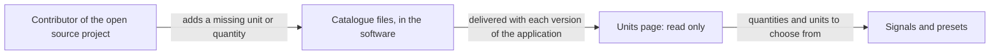
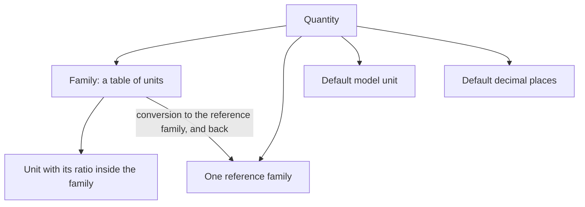
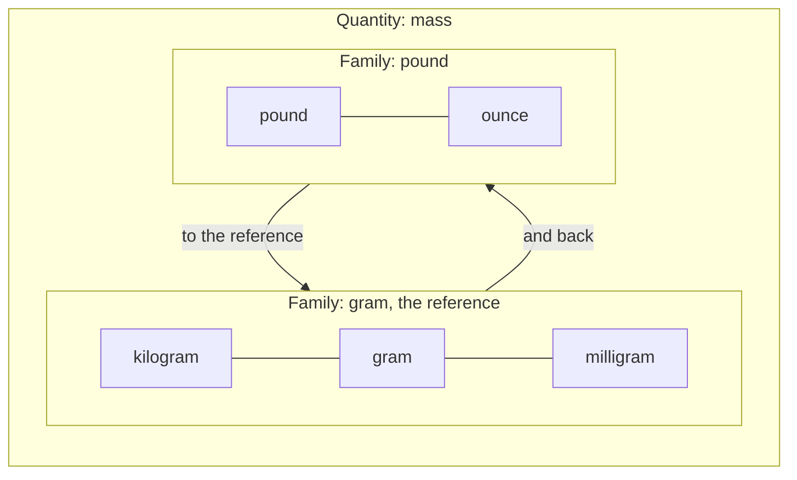
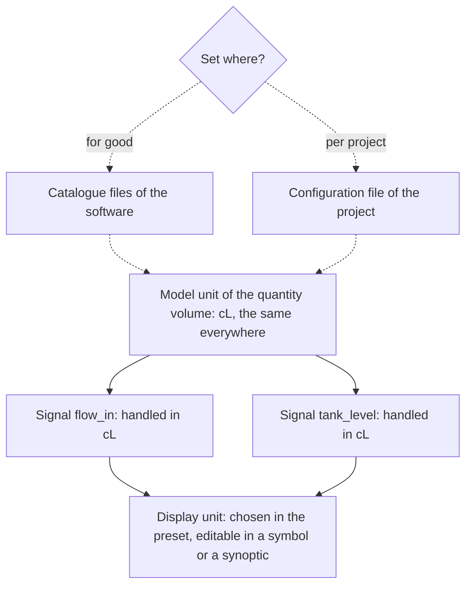
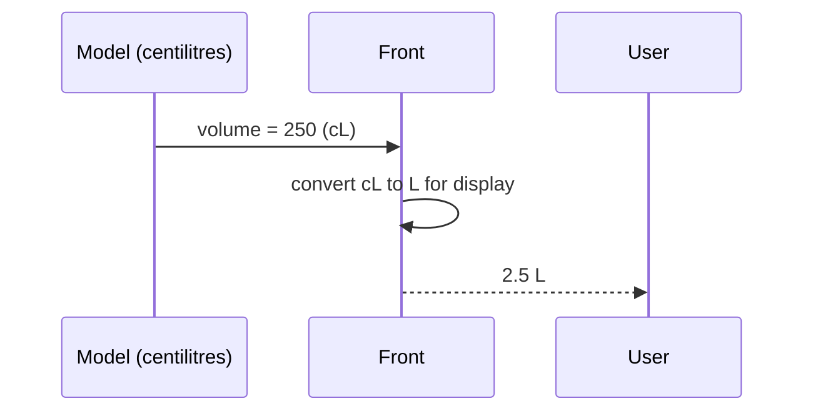
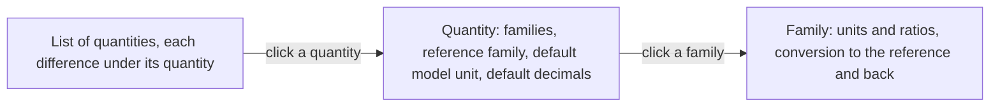
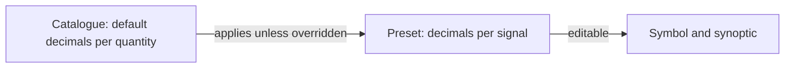

# Units

> [Home](../README.md) › [Metadata](README.md) › Units · Previous: [Signals](04-signals.md) · Next: [Enums](06-enums.md)

Status: validated by the Product Owner on 2026-11-11; changed by him on 2026-11-16 (the units are a ready-made catalogue, read only in the application, kept in files of the software that contributors complete; a signal says whether its value is a quantity or a difference; decision 0020, accepted on 2026-11-16; the same day: the choice shown in the one column "Quantity", a difference only where the conversion changes, default decimals fixed by the catalogue; at the end of the day, one model unit per quantity, the same everywhere, no longer chosen per signal). Open points are listed in [Open questions](12-open-questions.md).

A Units page lists quantities (mass, volume, flow, pressure...), with their families and units. A quantity is what a value measures; a unit is one way to count it: the kilogram is a unit of the quantity mass.

## Rules

### A ready-made catalogue, read only

Decided by the Product Owner on 2026-11-16: "il n'y a pas d'édition possible. Tout est préfait, avec tous les noms [...] Il n'y aurait jamais d'écriture ou de modification ici, et puis basta."

- The units are known and documented worldwide: there is nothing for the user to decide. So the application ships every quantity, family, unit and conversion ready made, with their names.
- The aim is the whole catalogue at once: every unit that can be imagined is in it from the first launch (Product Owner: "toutes les unités possibles, imaginables, on peut viser juste pour toutes les mettre à l'intérieur instantanément").
- **The Units page is read only.** The user browses the quantities, families and units and reads their conversions; there is no + button, no field to change, nothing to delete. It replaces the rule of 2026-11-11 by which the user could add and change quantities, families and units.
- The catalogue is kept in **files of the software itself**, delivered with the application. Synoptic Studio is open source: when a unit or a quantity is missing, a contributor adds it to these files, and it comes to everyone with the next version of the software (Product Owner: "s'il manque des unités, des quantités, il faudrait pouvoir venir les rajouter").
- The format of these files and the repository that holds them are chosen with the architecture, not in these specs (left open by decision 0020).
- Since the user never changes the units, a change of the units is never a difference on the [Versions](13-versions.md) page of Metadata.

### Quantities, families and conversions

- A quantity holds one or more unit families.
- A family is a table of units, like the school ladder: kilogram, hectogram, decagram, gram, decigram, centigram, milligram. Each unit has its ratio to the others in the family.
- A quantity can hold several families. Example: quantity "mass" has the family "gram" (the metric ladder) and the family "pound" (pound, ounce...).
- Each quantity has a reference family. Every other family is converted to it and from it, never pairwise. Formulas are not limited to a factor, so cases like temperature are covered.

## Model unit and display unit

Changed by the Product Owner on 2026-11-16, at the end of the day: "il faut, pour un même type de quantité, qu'il faille tout le temps la même unité, pour les différences pareil, partout. Comme ça, au moins, t'as pas de trucs chelous de conversion."

- **One model unit per quantity, the same everywhere** (decision 0024, accepted on 2026-11-16): every signal of a quantity is handled by the model in that unit. A difference has its own model unit, the same everywhere too.
- A signal takes a quantity, not a unit: a signal is "volume", not "m³/h". **The signal never chooses its model unit**: the override per signal of 2026-11-11 is removed, and the column Model unit with it (see [Signals](04-signals.md)).
- **The model unit is not set in Metadata** ("ça va pas dans la définition de la metadata. Ça va plutôt après"). Two places are possible, not chosen yet:
  - once and for good, in the catalogue files of the software: then it is the model unit the catalogue already gives each quantity, shown read only on the Units page;
  - once per project, in a configuration file of the project.
- À trancher : where the model unit is set. The Product Owner leans towards the catalogue of the software (2026-11-16), but has not settled it: "On verra ça plus tard car potentiellement dans une page annexe mais il faut que j'y réfléchisse". A third place is now possible: an annex page, not described yet. Until then, the Units page keeps showing the catalogue's model unit of each quantity.
- A display unit is any unit of the same quantity, in any family. It is chosen in a preset, and can be edited in a symbol or a synoptic.
- The value is converted for display only. The model value stays the same.

## Conversions only inside a quantity

A conversion only exists between two units of the same quantity: kilograms to pounds, never kilograms to volts.

The documentary research (2026-11-10) answers which function is needed: no single one. Four closed forms cover the useful cases, and a pair of free expressions covers the rest.

| Form | Going | Back | Example |
| --- | --- | --- | --- |
| Proportional | y = a·x | x = y / a | kilogram and pound |
| Affine | y = a·x + b | x = (y − b) / a | Celsius, Fahrenheit |
| Inverse | y = a / x | x = a / y | L/100 km and miles per gallon |
| Logarithmic | y = k·log(x / x₀) | x = x₀·base^(y / k) | decibel, pH |
| Other, one value | y = f(x) | x = f⁻¹(y) | slope in % = 100·tan(angle) |

All of it stays in pure JavaScript.

### Decided on 2026-11-11

- Each quantity has a reference family. Families convert to it and from it, not pairwise: 4 families need 6 formulas instead of 12, and two formulas cannot contradict each other.
- A conversion is one of the closed forms. A pair of free expressions, going and back, is the last resort. The application checks that the pair is a round trip.
- The user types a value in the display unit, so the back conversion (display unit to model unit) is also needed. The model value is still the only one stored.
- A temperature and a temperature difference are not converted the same way: 25 °C is 77 °F, but a difference of 25 °C is a difference of 45 °F (a heating rate in °C/min is a difference). A difference is its own quantity ("temperature difference"), with its own units and a proportional conversion. This needs no new mechanism, and it keeps the rule that a conversion only exists inside a quantity.
- On the Units page, a difference is shown **in the same place as its quantity**, attached to it (Product Owner, 2026-11-11): the user finds "temperature difference" right under "temperature", not elsewhere in the list. It stays a quantity of its own for the conversions.

### Value or difference, chosen in the signal

Decided by the Product Owner on 2026-11-16: "quand on choisit une quantité, il faudrait pouvoir choisir si c'est une quantité ou si c'est un écart."

- When the user gives a signal a quantity, they also say whether its value is **the quantity itself** or **a difference** of it. Example: the pressure, or the pressure difference.
- The conversion follows this choice: a difference of 25 °C is a difference of 45 °F, a value of 25 °C is 77 °F (see above).
- **One column "Quantity"** in the table of signals holds the choice (Product Owner, 2026-11-16): its list offers the pressure and the pressure difference side by side, each with its **icon** (one for a quantity, one for a difference), and no "(quantity)" or "(difference)" written after the name. No column of its own: one column less in a table that is already wide.
- **Only the quantities whose conversion changes offer a difference** (Product Owner, 2026-11-16): those where a value and a difference are not converted the same way, because of an offset (temperature, gauge pressure...). The other quantities are offered once: their value and their difference convert the same way.
- Which quantities have a difference is written in the catalogue files, with the difference itself (Product Owner: "ce sera configuré"); the user never decides it.

## The Units page

- The page is read only (see [A ready-made catalogue, read only](#a-ready-made-catalogue-read-only)).
- The page lists the quantities. Each difference is shown under its quantity.
- A click on a quantity opens it: its families, its reference family, its default model unit and its default decimal places.
- A click on a family opens its table of units and its conversion to the reference family and back.

- Unit names carry their variant (US gallon, thermochemical calorie), because one name hides several values.
- Units are flat: "m³/h" is one unit with its own factor, nothing is deduced from its parts.
- When a conversion is not defined (logarithm of zero), the display says so instead of showing a wrong number.
- Floating point does not round-trip exactly (12 997 of 100 000 values do not come back unchanged from °C to °F to °C): display rounding hides it. A value typed in the display unit is converted back to the model unit, then rounded to 12 significant digits before it goes to the model, which removes the floating-point noise (100.03999999999999 becomes 100.04) and keeps the real precision of a 64-bit double (about 15 digits).

## Source of the catalogue

- Open: the source of the catalogue data and its licence. The licences of UCUM, QUDT, CLDR and NIST were not checked, and must be before the application is released (see [Open questions](#open-questions)). It matters more now that the whole catalogue ships with the software.

## Decimal places

- Decimal places are the number of decimals shown for a value. They are a display matter only.
- The catalogue gives a default number of decimals per quantity, written in its files and shown read only on the Units page. It applies everywhere unless a preset overrides it. Confirmed by the Product Owner on 2026-11-16: fixed by the catalogue, and changed in a preset when needed.
- The preset can override it for each signal, next to its display unit (see [Presets](09-presets.md)). It keeps a minimum of flexibility.
- The symbol and the synoptic can edit it from the preset, like the display unit.

## Where it is used

| Thing | Created and changed in | Used in | In a symbol | In a synoptic |
| --- | --- | --- | --- | --- |
| Quantity, families, reference family, conversions, default model unit, default decimals | Catalogue files of the software, completed by contributors; read only on the Units page | Signal (quantity, value or difference), preset (display unit, decimals) | No | No |
| Model unit of a quantity, the same everywhere | Outside Metadata: the catalogue for good (leaning), a configuration file of the project, or an annex page (open) | Every signal of the quantity, its bounds, the conversions for display | No | No |
| Display unit, decimal places | Preset, in Metadata | Faceplate, texts of a symbol that show a value | Edit | Edit |

## Open questions

- Source and licence of the catalogue data (UCUM, QUDT, CLDR, NIST not checked).
- Where the model unit of each quantity is set: once and for good in the catalogue, once per project in a configuration file, or on an annex page (Product Owner, 2026-11-16: "Je sais pas où on va le mettre encore"; later the same day, leaning towards the catalogue, "il faut que j'y réfléchisse").
